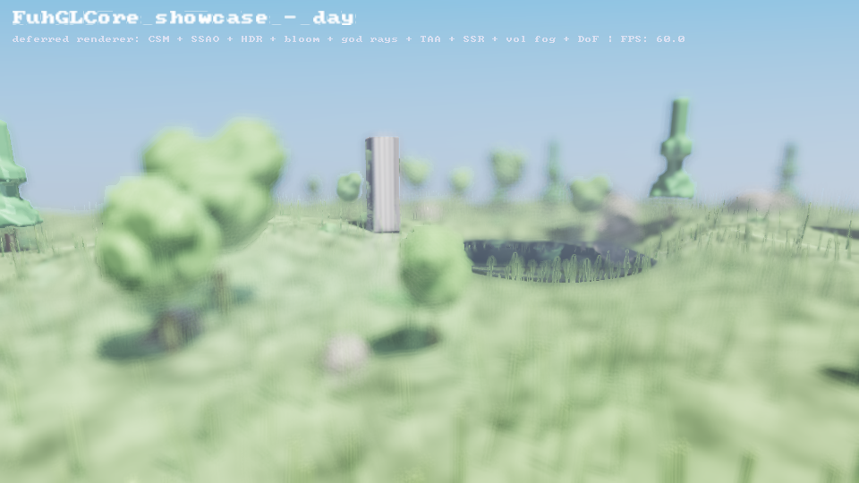
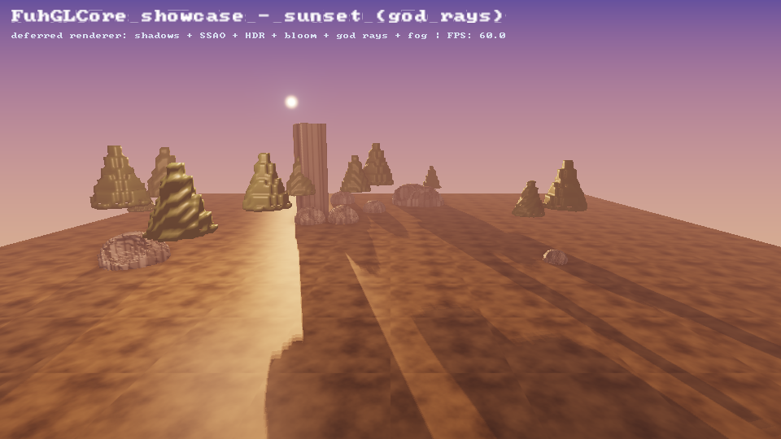
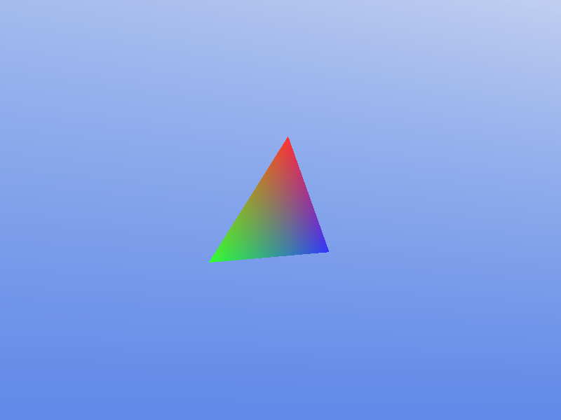
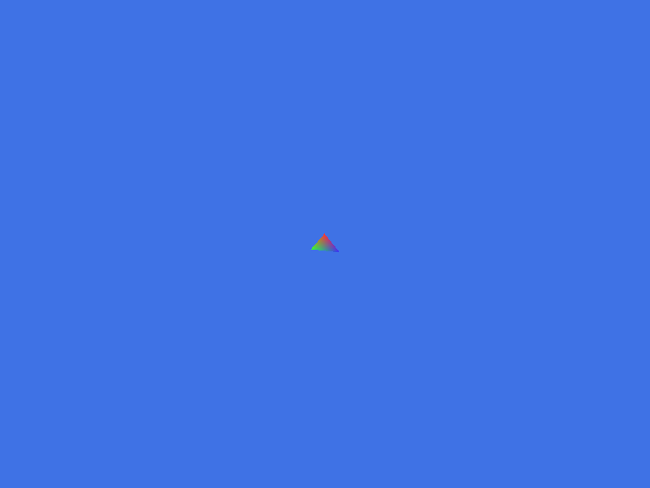

# FuhGLCore

**Ein C++17-OpenGL-Toolkit ohne Fremdbibliotheken — von der GL-Kernschicht bis zu
einer sofort einsatzbereiten Render-Schicht.** Verwendet werden nur die
C++-Standardbibliothek und Plattform-System-APIs: kein GLAD/GLEW, kein GLFW/SDL,
keine Khronos-Header, kein vcpkg.

Untere Schicht: ein zur Laufzeit ladender OpenGL-Loader (GL 1.0–4.6, per Name zur
Laufzeit aufgelöst), schlanke RAII-Wrapper, native Fenster + GL-Kontexte
(Win32/WGL, X11/GLX, macOS/Cocoa, dazu unter Linux ein experimentelles
EGL-Backend mit Wayland und surfaceless/headless), ein header-only Math-Modul und
Kamera-Controller. Darüber sitzt die eingebaute Render-Schicht
(`fuhgl/render.hpp`) — Forward- & Deferred-Pipelines mit Lichtquellen, PCF-Schatten,
SSAO, HDR-Postprocessing (Bloom, God Rays, ACES-Tonemapping), prozedurale Texturen
& Materialien, CSG-Körper, Text/FPS-Overlay, Drahtgitter-Overlay und Instancing.

🇬🇧 [English version of this README](README.md)

Der Name „Core“ bezeichnet den dependency-freien GL-/Fenster-/Math-Kern; die
eingebaute Render-Schicht darüber (`fuhgl/render.hpp` — Pipelines, Default-Renderer,
Post-FX, Körper/CSG, Text, Drahtgitter, Instancing) ist ein kleines Modul in derselben
Bibliothek, kein separates Engine-Projekt.




Landschaft, gerendert mit dem `DeferredRenderer` (Schatten, SSAO, HDR + Bloom, God
Rays, Nebel) — siehe `examples/showcase` und
[Tutorial 29](docs/de/tutorials/29-showcase-scene.md).




*(Screenshots wurden headless in der CI gerendert — siehe [Tutorial 12](docs/de/tutorials/12-headless-rendering-and-screenshots.md))*

## Was du bekommst

- **Runtime-GL-Loader** — `fuhgl::gl::init()` lädt Kernfunktionen (GL 1.0–4.6) per Name
  zur Laufzeit (so viel, wie die Plattform bietet — macOS ist bei GL 4.1 gedeckelt,
  Windows/Linux kommen bis 4.6); `gl::procAddress(name)` für Erweiterungen/DSA;
  optionale GL-4.5-DSA-Tabelle (`gl::dsa()`).
- **RAII-Wrapper** (PIMPL, verschiebbar, nicht kopierbar) — `Shader`, `Program`, `Buffer`,
  `VertexArray`, `Texture` (2D/3D/Array/Cube/Multisample), `Sampler`, `Framebuffer`,
  `Renderbuffer`, `UniformBuffer`, `Query`, `Fence`.
- **Natives Fenster + GL-Kontext** — `fuhgl::Window`: Win32/WGL, X11/GLX, macOS/Cocoa,
  und unter Linux ein EGL-Backend (Wayland oder surfaceless/headless). Kein
  Windowing-Framework nötig.
- **Mathematik** — `fuhgl::math`: `Vec2/3/4`, `Mat3/Mat4` (spalten-major, direkt für
  `glUniformMatrix*fv` geeignet), `perspective/ortho/lookAt/...`, `Frustum`, Picking-Strahlen,
  `Quat` (Rotationen + `slerp`; `toMat4(q)` entspricht `rotate(Winkel, Achse)`) und geseedetes
  `Noise` (Perlin 2D/3D + fBm) — siehe [Tutorial 30](docs/de/tutorials/30-math-quaternions-noise.md).
- **Kameras** — `FirstPersonCamera`, `FreeCamera` (6-DOF), `IsometricCamera`, über
  `attach(window)` an Fenster-Events gekoppelt.
- **Skybox** — Cubemap-Skybox mit dem Far-Ebenen-Depth-Trick, aus 6 Bildern oder prozedural.
- **Extras** — Compute-Shader, Timer-Queries/Fences, indirekte Draws, MSAA-Resolve,
  dependency-freies GLSL-`#include "..."`.
- **Render-Pipelines** — `fuhgl::render`: `ForwardPipeline` und `DeferredPipeline`
  (G-Buffer + Lighting-Pass, optionales MSAA), gesteuert über eine schlichte
  `SceneView` (siehe [Tutorial 13](docs/de/tutorials/13-render-pipelines.md)).
- **Geräte-Infos & Fähigkeiten** — `gl::queryDeviceInfo()`: GPU-Hersteller/Renderer,
  GL-/GLSL-Version, Erweiterungsliste, Implementierungs-Limits und Feature-Flags
  (DSA, Compute, …), plus ein ausdruckbarer Bericht (siehe
  [Tutorial 14](docs/de/tutorials/14-device-info-and-capabilities.md)).
- **Buffer-/Textur-Power-ups** — `Buffer::mapRange()`-Streaming, `gl::copyBufferSubData()`,
  komprimierter Textur-Upload (`Texture::compressedImage2D()`), Textur-Readback
  (`gl::getTexImage`), GL-4.3-Vertex-Binding, Compute-Image-I/O (`gl::bindImageTexture`,
  `gl::dispatchComputeIndirect`) — siehe [Tutorials 15](docs/de/tutorials/15-buffer-streaming-and-copies.md)
  und [16](docs/de/tutorials/16-textures-images-and-compute-io.md).
- **Prozedurale Texturen, voreingestellte Materialien, Körper & CSG** —
  `render::procedural` erzeugt Texturen im Code (Schachbrett/Rauschen/Voronoi/…),
  `render::materials` liefert matte/texturierte/emissive Presets, und `render::Solid` +
  CSG-Operatoren (`makeCube(...) - makeSphere(...)`) vermaschen analytische Körper per
  Marching Tetrahedra — mit wählbaren UV-Mapping-Modi (`render::SolidUv`: planar
  XZ/XY/YZ, sphärisch, zylindrisch), damit texturierte Materialien auf jedem Körper
  funktionieren — siehe [Tutorials 17](docs/de/tutorials/17-procedural-textures-and-materials.md)
  und [18](docs/de/tutorials/18-solids-and-csg.md).
- **Vollständiger GL-State & Batching** — Blending/Stencil, Polygon-Modus,
  Viewport-/Scissor-Arrays, Multi-Draw-/Instanced-Base-Draws, Debug-Labels & -Gruppen
  (`gl/debug.hpp`), Query-/Sync-Helfer, Internal-Format-Abfragen,
  `glCopyImageSubData`/`glClearTexImage` — siehe
  [Tutorial 19](docs/de/tutorials/19-state-batching-and-debug.md).
- **Lichtquellen** — `render::Light` mit den Typen direktional/Punkt/Spot, analytischer
  Attenuation, Reichweiten-Cutoff und Spot-Kegeln, als `LightBlock`-UBO in die Pipelines
  hochgeladen — siehe [Tutorial 20](docs/de/tutorials/20-lights.md).
- **Shadow Mapping** — `render::ShadowMap` (reiner Depth-Pass aus Sicht der Lichtquelle)
  + `lightViewProj()`-Helfer + PCF-Sampling in den Pipelines über `SceneView::shadowMap` —
  siehe [Tutorial 21](docs/de/tutorials/21-shadows.md).
- **Cascaded Shadow Maps (CSM)** — `render::CascadeShadowMap` (Depth-Textur-Array, eine Ebene
  pro Kaskade, passend pro Kamera-Frustum-Slice) über `ForwardRenderer::enableCsmShadows()` /
  `SceneView::cascades` — siehe [Tutorial 33](docs/de/tutorials/33-cascaded-shadow-maps.md).
- **Render Graph + TAA + SSR** — die Post-Kette des Deferred-Renderers läuft über
  `render::RenderGraph` (deklarative Pässe, auto-sortiert, FBO pro Pass); optionales
  Temporal AA (Halton-Jitter + History-Akkumulation, `taaEnabled`) und Screen-Space
  Reflections (`ssrEnabled`) — siehe [Tutorials 34–36](docs/de/tutorials/34-render-graph.md).
- **GPU-Culling + Indirect Draw** — `render::GpuCuller` cullt Instanzen auf der GPU
  (Compute-Shader + Bounding Spheres) und zeichnet die sichtbaren mit einem indirekten
  instanzierten Draw; **Bindless Textures** (`GL_ARB_bindless_texture`) über
  `gl::ext::BindlessTexture` — siehe [Tutorials 37–38](docs/de/tutorials/37-gpu-culling-indirect.md).
- **PBR-Materialien** — Metallic-Roughness-Shading (Cook-Torrance GGX) in beiden Pipelines:
  `materials::pbr(albedo, metallic, roughness, ao)`, im Deferred-Pfad pro Pixel in einem
  5. G-Buffer-Attachment gespeichert — siehe [Tutorial 31](docs/de/tutorials/31-pbr-materials.md).
- **IBL (Image-Based Lighting)** — `render::Environment` backt aus einer beliebigen Cubemap
  eine Irradiance-Cubemap, eine GGX-vorgefilterte Env-Cubemap und eine BRDF-LUT
  (deterministischer CPU-Bake); `SceneView::env` setzen (oder `ForwardRenderer::setEnvironment()`)
  — siehe [Tutorial 32](docs/de/tutorials/32-ibl-environment.md).
- **Default-Forward-Renderer** — `render::ForwardRenderer`: ein `render()`-Aufruf erledigt
  den Schatten-Depth-Pass + den beleuchteten Forward-Pass mit Lichtquellen, PCF-Schatten
  und Distanznebel — siehe [Tutorial 22](docs/de/tutorials/22-forward-renderer.md).
- **Default-Deferred-Renderer + Post-FX** — `render::DeferredRenderer`: G-Buffer mit
  Parallax-/Bump-Mapping, SSAO, HDR-Beleuchtung mit Schatten, Bloom, Crepuscular God
  Rays und ACES-Tonemapping — siehe
  [Tutorial 23](docs/de/tutorials/23-deferred-renderer-postfx.md).
- **Text & FPS-Overlay** — `render::TextRenderer` mit eingebetteter Public-Domain-8x8-Bitmap-Schrift
  (ein gebatchter Draw-Call pro Frame) plus `render::FpsCounter` — siehe
  [Tutorial 24](docs/de/tutorials/24-text-and-fps-overlay.md).
- **Drahtgitter-Overlay** — `render::Wireframe`: Körper (Dreieckskanten) und Bounding Boxes
  (AABB-Kanten) als ein gebatchter `GL_LINES`-Draw — siehe
  [Tutorial 25](docs/de/tutorials/25-wireframe-solids-and-bounding-boxes.md).
- **Instancing** — `Mesh::setInstanceData()` legt Modellmatrizen pro Instanz auf der GPU ab
  (Divisor-1-`mat4`-Attribut); ein Draw-Call rendert hunderte Kopien, animiert über
  `updateInstanceData()` — siehe [Tutorial 28](docs/de/tutorials/28-instancing.md).

Basis: **OpenGL 3.3 Core** (höhere Versionen bis 4.6 werden opportunistisch geladen, wo
die Plattform sie bietet; macOS ist bei 4.1 gedeckelt). Die API wirft keine Ausnahmen
bei Domain-Fehlern — Fehler werden als `bool`/Info-Log-Strings gemeldet (die
C++-Standardbibliothek selbst kann weiterhin werfen, z. B. `std::bad_alloc`);
Debug-Builds asserten und leiten GL-Debug-Ausgaben an einen Callback weiter.

## Schnellstart

```cpp
#include <fuhgl/fuhgl.hpp>

int main() {
    fuhgl::Window window;
    if (!window.create("Hello", 800, 600)) return 1;  // natives Fenster + 3.3-Core-Kontext + gl::init()

    fuhgl::Shader vs(fuhgl::Shader::Type::Vertex), fs(fuhgl::Shader::Type::Fragment);
    vs.compile(vertexSrc); fs.compile(fragmentSrc);
    fuhgl::Program prog; prog.create(); prog.attach(vs); prog.attach(fs); prog.link();

    fuhgl::FirstPersonCamera cam; cam.attach(window);
    while (!window.shouldClose()) {
        window.pollEvents();
        cam.update(1.f / 60.f);
        fuhgl::gl::clearColor(0.1f, 0.1f, 0.12f, 1.f);
        fuhgl::gl::clear(fuhgl::gl::ClearBit::Color | fuhgl::gl::ClearBit::Depth);
        prog.use();
        prog.setUniform("uViewProj", cam.viewProj(800.f / 600.f));
        fuhgl::gl::drawArrays(fuhgl::gl::Primitive::Triangles, 0, 3);
        window.swapBuffers();
    }
}
```

Komplette Einführung: [Tutorial 01 — Fenster und erstes Dreieck](docs/de/tutorials/01-window-and-first-triangle.md).

## Build

```sh
cmake -S . -B build -DCMAKE_BUILD_TYPE=Release
cmake --build build
cmake --install build --prefix <prefix>   # stellt find_package(FuhGLCore) bereit
ctest --test-dir build --output-on-failure
```

Optionen: `-DFUHGL_BUILD_EXAMPLES=ON` (Standard), `-DFUHGL_BUILD_TESTS=ON` (Standard),
`-DFUHGL_LINUX_BACKEND=X11|EGL` (Standard X11; EGL ergänzt Wayland + surfaceless headless),
`-DFUHGL_ENABLE_HARDENING=ON` (Standard; Härtungs-Flags, siehe [DEVELOPMENT.md](docs/DEVELOPMENT.md)).

Es werden nur ein C++17-Compiler und CMake ≥ 3.20 benötigt — GL-Funktionen werden zur
Laufzeit geladen, daher sind zur Build-Zeit keine OpenGL-Entwicklungspakete nötig.

## Dokumentation

- [Dokumentationsübersicht / language picker](docs/README.md)
- [Tutorials (Deutsch)](docs/de/tutorials/README.md) — ein kleines Tutorial pro Feature, mit Screenshots;
  [Tutorials (English)](docs/en/tutorials/README.md) — englische Fassung
- [Benutzerhandbuch](docs/USER_GUIDE.md) — Konzepte und Features (der beschreibende Teil; auf Englisch)
- [Entwicklung](docs/DEVELOPMENT.md) — Architektur, Konventionen, Build, Tests, CI (der technische Teil; auf Englisch)
- [Anforderungen](docs/REQUIREMENTS.md) — die vereinbarten funktionalen/nicht-funktionalen Anforderungen (auf Englisch)
- API-Referenz — Doxygen-HTML wird in der CI gebaut und als `doxygen-html`-Artefakt hochgeladen
  (lokal: `cd docs && doxygen Doxyfile`)

## Sicherheit

Eine Sicherheitslücke gefunden? Bitte **privat** melden (keine öffentlichen Issues) —
siehe [SECURITY.md](SECURITY.md).

## Lizenz

MIT — siehe [LICENSE](LICENSE).
