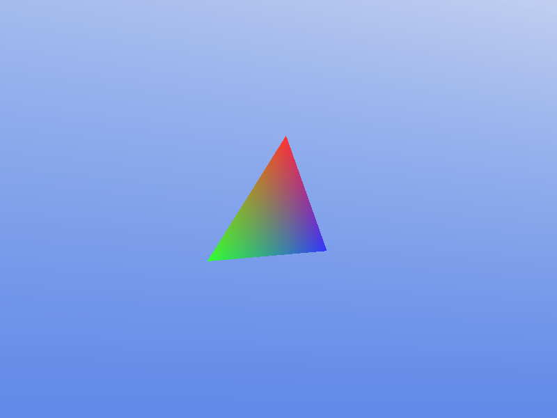
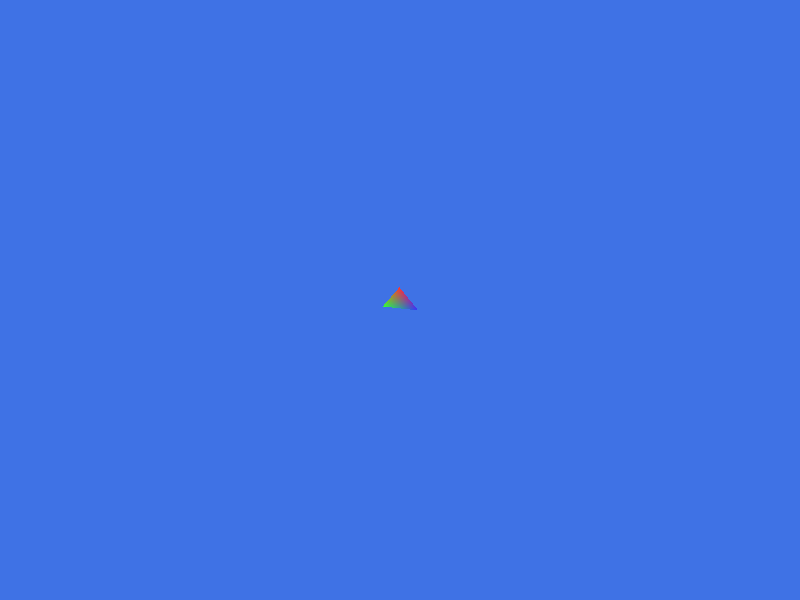

# FuhGLCore

A lightweight OpenGL wrapper for C++17 with **zero third-party dependencies** —
only the C++ standard library and platform system APIs. No GLAD/GLEW, no GLFW/SDL,
no Khronos headers, no vcpkg.




*(Screenshots rendered headless in CI — see [tutorial 12](docs/tutorials/12-headless-rendering-and-screenshots.md))*

## What you get

- **Runtime GL loader** — `fuhgl::gl::init()` loads core functions (GL 1.0–4.6) by name at
  runtime; `gl::procAddress(name)` for extensions/DSA; optional GL 4.5 DSA table (`gl::dsa()`).
- **RAII wrappers** (PIMPL, movable, non-copyable) — `Shader`, `Program`, `Buffer`,
  `VertexArray`, `Texture` (2D/3D/array/cube/multisample), `Sampler`, `Framebuffer`,
  `Renderbuffer`, `UniformBuffer`, `Query`, `Fence`.
- **Native window + GL context** — `fuhgl::Window`: Win32/WGL, X11/GLX, macOS/Cocoa,
  and on Linux an EGL backend (Wayland or surfaceless/headless). No windowing library needed.
- **Math** — `fuhgl::math`: `Vec2/3/4`, `Mat3/Mat4` (column-major, ready for
  `glUniformMatrix*fv`), `perspective/ortho/lookAt/...`, `Frustum`, picking rays.
- **Cameras** — `FirstPersonCamera`, `FreeCamera` (6-DOF), `IsometricCamera`, wired to
  window events via `attach(window)`.
- **Skybox** — cubemap skybox with the far-plane depth trick, from 6 images or procedural.
- **Extras** — compute shaders, timer queries/fences, indirect draws, MSAA resolve,
  dependency-free GLSL `#include "..."`.
- **Render pipelines** — `fuhgl::render`: `ForwardPipeline` and `DeferredPipeline`
  (G-buffer + lighting pass, optional MSAA) driven by a plain `SceneView`
  (see [tutorial 13](docs/tutorials/13-render-pipelines.md)).

Baseline: **OpenGL 3.3 core** (up to 4.6 loaded opportunistically). No exceptions in the
API — failures return `bool`/info-log strings; debug builds assert and forward GL debug
output to a callback.

## Quick start

```cpp
#include <fuhgl/fuhgl.hpp>

int main() {
    fuhgl::Window window;
    if (!window.create("Hello", 800, 600)) return 1;  // native window + 3.3 core context + gl::init()

    fuhgl::Shader vs(fuhgl::Shader::Type::Vertex), fs(fuhgl::Shader::Type::Fragment);
    vs.compile(vertexSrc); fs.compile(fragmentSrc);
    fuhgl::Program prog; prog.create(); prog.attach(vs); prog.attach(fs); prog.link();

    fuhgl::FirstPersonCamera cam; cam.attach(window);
    while (!window.shouldClose()) {
        window.pollEvents();
        cam.update(1.f / 60.f);
        fuhgl::gl::clearColor(0.1f, 0.1f, 0.12f, 1.f);
        fuhgl::gl::clear(fuhgl::gl::ClearBit::Color | fuhgl::gl::ClearBit::Depth);
        prog.use();
        prog.setUniform("uViewProj", cam.viewProj(800.f / 600.f));
        fuhgl::gl::drawArrays(fuhgl::gl::Primitive::Triangles, 0, 3);
        window.swapBuffers();
    }
}
```

Full walkthrough: [tutorial 01 — window and first triangle](docs/tutorials/01-window-and-first-triangle.md).

## Build

```sh
cmake -S . -B build -DCMAKE_BUILD_TYPE=Release
cmake --build build
cmake --install build --prefix <prefix>   # provides find_package(FuhGLCore)
ctest --test-dir build --output-on-failure
```

Options: `-DFUHGL_BUILD_EXAMPLES=ON` (default), `-DFUHGL_BUILD_TESTS=ON` (default),
`-DFUHGL_LINUX_BACKEND=X11|EGL` (default X11; EGL adds Wayland + surfaceless headless).

Only a C++17 compiler and CMake ≥ 3.20 are required — GL functions are loaded at runtime,
so no OpenGL dev packages are needed at build time.

## Documentation

- [User guide](docs/USER_GUIDE.md) — concepts and features (the descriptive part)
- [Tutorials](docs/tutorials/README.md) — one small tutorial per feature, with screenshots
- [Development](docs/DEVELOPMENT.md) — architecture, conventions, build, tests, CI (the technical part)
- [Requirements](docs/REQUIREMENTS.md) — the agreed functional/non-functional requirements
- API reference — Doxygen HTML is built in CI and uploaded as the `doxygen-html` artifact
  (locally: `cd docs && doxygen Doxyfile`)

## License

MIT — see [LICENSE](LICENSE).
