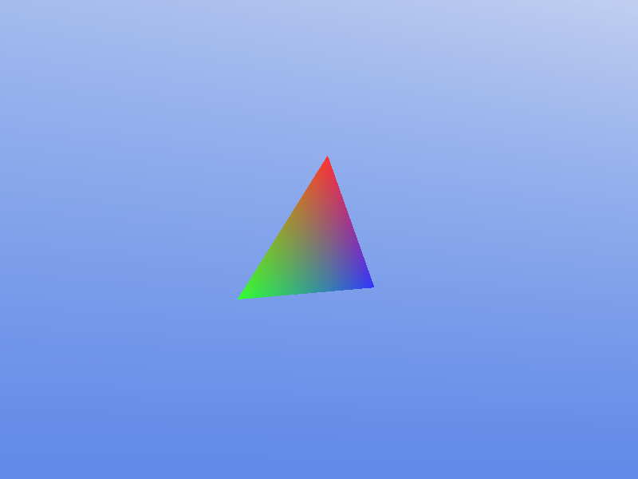
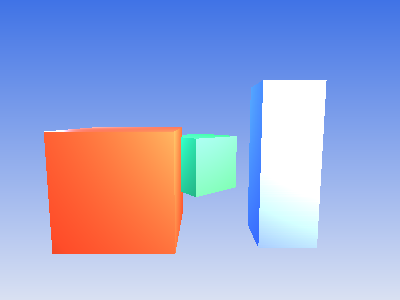

# FuhGLCore — User Guide (descriptive)

This is the *descriptive* part of the documentation: what FuhGLCore does and how to use
it. For architecture, build internals and CI see [DEVELOPMENT.md](DEVELOPMENT.md).
Step-by-step examples live in [tutorials/](en/tutorials/README.md)
(🇩🇪 German translation: [docs/de/tutorials/](de/tutorials/README.md)).

## Mental model

FuhGLCore is a thin layer over OpenGL, not a framework. You own the render loop; the
library gives you safe, modern-C++ handles for GL objects:

1. **Create a window/context** — `fuhgl::Window::create()` opens a native window and a
   GL context (3.3 core by default) and calls `gl::init()` for you.
   ([tutorial 01](en/tutorials/01-window-and-first-triangle.md))
2. **Create GL objects** — RAII classes (`Shader`, `Program`, `Buffer`, …) create,
   use and destroy GL objects; move-only, no leaks.
3. **Render** — thin `fuhgl::gl::*` functions for state and draw calls; math types for
   matrices; cameras for view/projection.

## Features at a glance

| Feature | Entry point | Tutorial |
|---|---|---|
| Native window + GL context | `fuhgl::Window` | [01](en/tutorials/01-window-and-first-triangle.md) |
| Shaders / programs (+ GLSL `#include`) | `Shader`, `Program` | [02](en/tutorials/02-shaders-programs-includes.md) |
| Vertex buffers / VAOs | `Buffer`, `VertexArray` | [03](en/tutorials/03-buffers-and-vao.md) |
| Textures 2D/3D/array/cube + samplers | `Texture`, `Sampler` | [04](en/tutorials/04-textures-and-samplers.md) |
| Framebuffers, MSAA resolve | `Framebuffer`, `Renderbuffer` | [05](en/tutorials/05-framebuffers-and-msaa.md) |
| Skybox | `fuhgl::Skybox` | [06](en/tutorials/06-skybox.md) |
| Cameras, frustum culling, picking | `FirstPersonCamera` …, `math::Frustum` | [07](en/tutorials/07-cameras-frustum-picking.md) |
| Quaternions & seeded gradient noise (Perlin / fBm) | `math::Quat`, `math::Noise` | [30](en/tutorials/30-math-quaternions-noise.md) |
| Uniform buffer objects | `UniformBuffer` | [08](en/tutorials/08-uniform-buffers.md) |
| Compute shaders | `gl::dispatchCompute` | [09](en/tutorials/09-compute-shaders.md) |
| GPU timing / fences | `Query`, `Fence` | [10](en/tutorials/10-queries-and-sync.md) |
| GL 4.5 DSA fast path (72 entries) | `gl::dsa()`, `gl::hasDsa()`, `gl::dsaFunctionNames()` | [11](en/tutorials/11-dsa.md) |
| Headless rendering + screenshots | EGL backend, `examples/screenshot` | [12](en/tutorials/12-headless-rendering-and-screenshots.md) |
| Render pipelines: forward & deferred | `fuhgl::render::ForwardPipeline`, `DeferredPipeline` | [13](en/tutorials/13-render-pipelines.md) |
| Device info & capabilities | `gl::queryDeviceInfo()` | [14](en/tutorials/14-device-info-and-capabilities.md) |
| Buffer streaming / copies / readback | `Buffer::mapRange()`, `gl::copyBufferSubData()` | [15](en/tutorials/15-buffer-streaming-and-copies.md) |
| Texture upload/readback/compressed, compute images | `Texture::compressedImage2D()`, `gl::bindImageTexture()` | [16](en/tutorials/16-textures-images-and-compute-io.md) |
| Procedural textures & predefined materials | `render::procedural::voronoi()`, `render::materials::matte/textured/emissive` | [17](en/tutorials/17-procedural-textures-and-materials.md) |
| Solids & CSG (bodies + boolean ops), textured via UV modes | `render::Solid`, `makeCube(...) - makeSphere(...)`, `buildMesh(res, color, render::SolidUv::Spherical)` | [18](en/tutorials/18-solids-and-csg.md) |
| GL state, batching, debug labels, image ops | `gl::stencilOp()`, `gl::multiDrawElements()`, `gl::objectLabel()`, … | [19](en/tutorials/19-state-batching-and-debug.md) |
| Lights: directional / point / spot | `render::Light::directional/point/spot()`, `SceneView::lights` | [20](en/tutorials/20-lights.md) |
| Shadow mapping (depth pass + PCF) | `render::ShadowMap`, `render::lightViewProj()`, `SceneView::shadowMap` | [21](en/tutorials/21-shadows.md) |
| Cascaded shadow maps (CSM, depth texture array) | `render::CascadeShadowMap`, `enableCsmShadows()`, `SceneView::cascades` | [33](en/tutorials/33-cascaded-shadow-maps.md) |
| Render graph (declarative passes, auto-ordered) | `render::RenderGraph`, `DeferredRenderer::postGraph()` | [34](en/tutorials/34-render-graph.md) |
| Temporal anti-aliasing (Halton jitter + history) | `DeferredRenderer::taaEnabled`, `SceneView::jitter` | [35](en/tutorials/35-taa.md) |
| Screen-space reflections | `DeferredRenderer::ssrEnabled` | [36](en/tutorials/36-ssr.md) |
| PBR materials (metallic-roughness, GGX) | `materials::pbr(...)`, `Material::metallic/roughness/ao` | [31](en/tutorials/31-pbr-materials.md) |
| IBL environment (irradiance / prefilter / BRDF LUT) | `render::Environment`, `SceneView::env` | [32](en/tutorials/32-ibl-environment.md) |
| Default forward renderer | `render::ForwardRenderer` (lights + auto shadows + fog) | [22](en/tutorials/22-forward-renderer.md) |
| Default deferred renderer + post FX | `render::DeferredRenderer` (SSAO, HDR, bloom, god rays, parallax/bump, ACES) | [23](en/tutorials/23-deferred-renderer-postfx.md) |
| Text & FPS overlay (bitmap font HUD) | `render::TextRenderer`, `render::FpsCounter` | [24](en/tutorials/24-text-and-fps-overlay.md) |
| Wireframe (solids + bounding boxes) | `render::Wireframe` (`addSolid`/`addBoundingBox`/`addMesh`) | [25](en/tutorials/25-wireframe-solids-and-bounding-boxes.md) |
| Program pipelines / transform feedback (P3) | `gl::ProgramPipeline`, `gl::TransformFeedback`, `Program::setTransformFeedbackVaryings` | [26](en/tutorials/26-program-pipelines-transform-feedback-binaries.md) |
| Program reflection (uniforms/attributes/UBOs) | `Program::activeUniforms()`, `activeAttributes()`, `uniformBlocks()` | [27](en/tutorials/27-program-reflection.md) |
| Instancing (one draw call per mesh, many copies) | `Mesh::setInstanceData(models, n)`, `updateInstanceData()`, `instanceCount()` | [28](en/tutorials/28-instancing.md) |
| Showcase scene (README hero images) | `examples/showcase` — DeferredRenderer landscape, day/sunset | [29](en/tutorials/29-showcase-scene.md) |

## Error handling

No exceptions: fallible operations return `bool` and expose an info log
(`Shader::compile` → `infoLog()`). `gl::lastError()` wraps `glGetError`, and
`gl::setDebugCallback(...)` forwards GL 4.3/`KHR_debug` messages to your callback.
In debug builds `FUHGL_ASSERT(cond)` aborts on programmer errors.

## Platforms

Windows (WGL), Linux (X11/GLX by default; EGL backend with Wayland or surfaceless via
`-DFUHGL_LINUX_BACKEND=EGL`), macOS (Cocoa). Baseline GL 3.3 core; up to 4.6 loaded
opportunistically.
