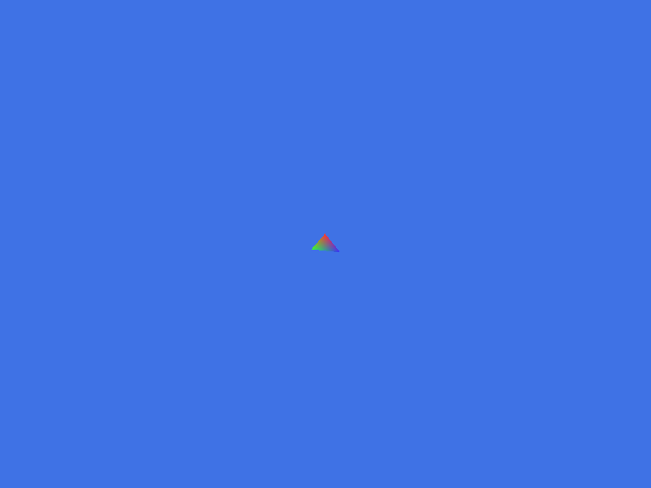

# FuhGLCore — User Guide (descriptive)

This is the *descriptive* part of the documentation: what FuhGLCore does and how to use
it. For architecture, build internals and CI see [DEVELOPMENT.md](DEVELOPMENT.md).
Step-by-step examples live in [tutorials/](tutorials/README.md).

## Mental model

FuhGLCore is a thin layer over OpenGL, not a framework. You own the render loop; the
library gives you safe, modern-C++ handles for GL objects:

1. **Create a window/context** — `fuhgl::Window::create()` opens a native window and a
   GL context (3.3 core by default) and calls `gl::init()` for you.
   ([tutorial 01](tutorials/01-window-and-first-triangle.md))
2. **Create GL objects** — RAII classes (`Shader`, `Program`, `Buffer`, …) create,
   use and destroy GL objects; move-only, no leaks.
3. **Render** — thin `fuhgl::gl::*` functions for state and draw calls; math types for
   matrices; cameras for view/projection.

## Features at a glance

| Feature | Entry point | Tutorial |
|---|---|---|
| Native window + GL context | `fuhgl::Window` | [01](tutorials/01-window-and-first-triangle.md) |
| Shaders / programs (+ GLSL `#include`) | `Shader`, `Program` | [02](tutorials/02-shaders-programs-includes.md) |
| Vertex buffers / VAOs | `Buffer`, `VertexArray` | [03](tutorials/03-buffers-and-vao.md) |
| Textures 2D/3D/array/cube + samplers | `Texture`, `Sampler` | [04](tutorials/04-textures-and-samplers.md) |
| Framebuffers, MSAA resolve | `Framebuffer`, `Renderbuffer` | [05](tutorials/05-framebuffers-and-msaa.md) |
| Skybox | `fuhgl::Skybox` | [06](tutorials/06-skybox.md) |
| Cameras, frustum culling, picking | `FirstPersonCamera` …, `math::Frustum` | [07](tutorials/07-cameras-frustum-picking.md) |
| Uniform buffer objects | `UniformBuffer` | [08](tutorials/08-uniform-buffers.md) |
| Compute shaders | `gl::dispatchCompute` | [09](tutorials/09-compute-shaders.md) |
| GPU timing / fences | `Query`, `Fence` | [10](tutorials/10-queries-and-sync.md) |
| GL 4.5 DSA fast path | `gl::dsa()`, `gl::hasDsa()` | [11](tutorials/11-dsa.md) |
| Headless rendering + screenshots | EGL backend, `examples/screenshot` | [12](tutorials/12-headless-rendering-and-screenshots.md) |
| Render pipelines: forward & deferred | `fuhgl::render::ForwardPipeline`, `DeferredPipeline` | [13](tutorials/13-render-pipelines.md) |
| Device info & capabilities | `gl::queryDeviceInfo()` | [14](tutorials/14-device-info-and-capabilities.md) |

## Error handling

No exceptions: fallible operations return `bool` and expose an info log
(`Shader::compile` → `infoLog()`). `gl::lastError()` wraps `glGetError`, and
`gl::setDebugCallback(...)` forwards GL 4.3/`KHR_debug` messages to your callback.
In debug builds `FUHGL_ASSERT(cond)` aborts on programmer errors.

## Platforms

Windows (WGL), Linux (X11/GLX by default; EGL backend with Wayland or surfaceless via
`-DFUHGL_LINUX_BACKEND=EGL`), macOS (Cocoa). Baseline GL 3.3 core; up to 4.6 loaded
opportunistically.
