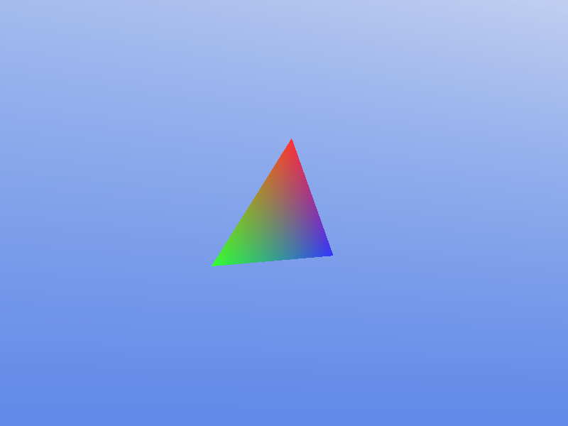

# 01 — Fenster, GL-Kontext und das erste Dreieck

> 🇬🇧 **English version:** [docs/en/tutorials/01-window-and-first-triangle.md](../../en/tutorials/01-window-and-first-triangle.md)

**Ziel:** ein natives Fenster mit einem GL-3.3-Core-Kontext öffnen und ein farbiges Dreieck
zeichnen. Es ist keine Windowing-Bibliothek beteiligt — `fuhgl::Window` erledigt das nativ
(Win32/WGL, X11/GLX, Cocoa; EGL/Wayland/surfaceless unter Linux mit `-DFUHGL_LINUX_BACKEND=EGL`).



```cpp
#include <fuhgl/fuhgl.hpp>

int main() {
    fuhgl::Window window;
    if (!window.create("Triangle", 800, 600)) return 1; // Kontext aktuell + gl::init() erledigt

    // --- Shader ---
    fuhgl::Shader vs(fuhgl::Shader::Type::Vertex), fs(fuhgl::Shader::Type::Fragment);
    vs.compile(kVertexSrc); fs.compile(kFragmentSrc);      // kompletter Quelltext in examples/triangle
    fuhgl::Program prog; prog.create(); prog.attach(vs); prog.attach(fs); prog.link();

    // --- Geometrie ---
    const float vertices[] = { /* pos + color, 3 Vertices */ };
    fuhgl::Buffer vbo(fuhgl::Buffer::Target::Array);
    vbo.bind(); vbo.setData(sizeof(vertices), vertices, fuhgl::Buffer::Usage::StaticDraw);
    fuhgl::VertexArray vao; vao.create(); vao.bind();
    vao.setAttrib(0, 3, fuhgl::gl::GL_FLOAT, false, 6*sizeof(float), 0);          // aPos
    vao.setAttrib(1, 3, fuhgl::gl::GL_FLOAT, false, 6*sizeof(float), 3*sizeof(float)); // aColor

    fuhgl::FirstPersonCamera cam; cam.position = {0, 0, 3}; cam.attach(window);

    while (!window.shouldClose()) {
        window.pollEvents();                              // verteilt key/mouse/resize/close
        cam.update(1.f/60.f);
        fuhgl::gl::viewport(0, 0, window.framebufferWidth(), window.framebufferHeight());
        fuhgl::gl::clearColor(0.1f, 0.1f, 0.12f, 1.f);
        fuhgl::gl::clear(fuhgl::gl::ClearBit::Color | fuhgl::gl::ClearBit::Depth);
        prog.use();
        prog.setUniform("uViewProj", cam.viewProj(800.f/600.f));
        vao.bind();
        fuhgl::gl::drawArrays(fuhgl::gl::Primitive::Triangles, 0, 3);
        window.swapBuffers();
    }
}
```

Kernpunkte:

- `Window::create(title, w, h, hints)` — die Hints steuern GL-Version (`glMajor/glMinor`,
  Default 3.3 Core), MSAA-Samples, VSync, Resizable.
- Events sind Callbacks: `setKeyCallback`, `setCursorPosCallback`, `setScrollCallback`,
  `setResizeCallback`, `setCloseCallback`, `setMouseButtonCallback`. Tasten sind
  plattformunabhängig (`fuhgl::Key::W`, `Key::Escape`, …).
- `window.framebufferWidth/Height()` unterscheiden sich auf HiDPI (macOS) von
  `width()/height()`.
- **Escape** in `examples/triangle` beendet das Programm (über Close/Key-Callback verdrahtet).

Komplettes Programm: `examples/triangle/main.cpp`.
