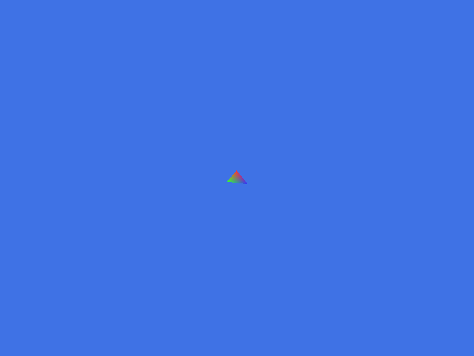

# 06 — Skybox

> 🇬🇧 **English version:** [docs/en/tutorials/06-skybox.md](../../en/tutorials/06-skybox.md)

**Ziel:** eine Skybox, die immer an der Far-Ebene bleibt, aus 6 Bildern oder einem
prozeduralen Verlauf — für die prozedurale Variante werden keine Bilddateien benötigt.



```cpp
fuhgl::Skybox sky; sky.create();

// Variante A: 6 Cube-Seiten (PosX, NegX, PosY, NegY, PosZ, NegZ), jeweils size x size
sky.loadFaces(faces, 512);   // standardmäßig GL_RGB8/GL_RGB/GL_UNSIGNED_BYTE

// Variante B: prozeduraler vertikaler Verlauf
sky.makeGradient({0.25f, 0.45f, 0.9f},   // obere Farbe
                 {0.85f, 0.88f, 0.95f}); // Horizontfarbe

// pro Frame, vor der Szenen-Geometrie:
sky.draw(camera, aspect);    // übernimmt den xyww-Depth-Trick + State-Save/Restore
```

So funktioniert es: die Skybox ist ein Einheitswürfel; der Vertex-Shader gibt
`gl_Position = (uViewProj * pos).xyww` aus, dadurch ist ihre Tiefe exakt 1.0 (Far-Ebene).
`draw()` setzt `depthFunc(LEQUAL)` + `depthMask(false)`, entfernt die Translation aus der
View-Matrix (die Skybox ist unendlich weit weg), zeichnet und stellt den State wieder her.

Komplettes Beispiel: `examples/triangle/main.cpp`.
