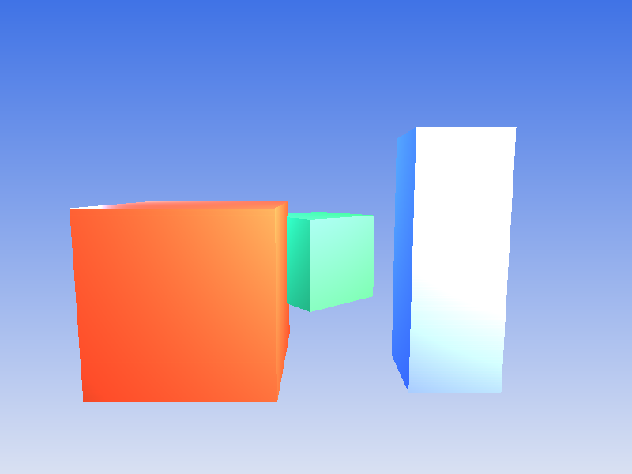
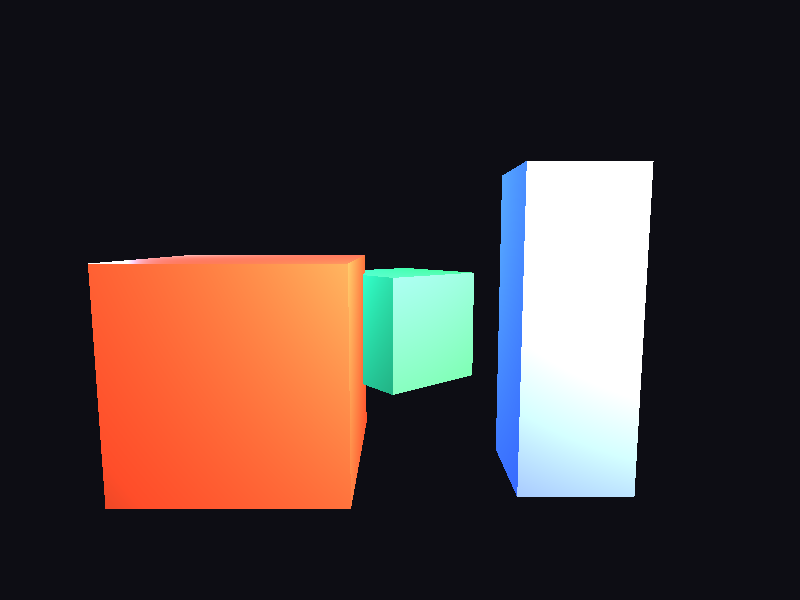

# 13 — Render-Pipelines (Forward & Deferred)

> 🇬🇧 **English version:** [docs/en/tutorials/13-render-pipelines.md](../../en/tutorials/13-render-pipelines.md)

**Ziel:** eine kleine Szene über ein Pipeline-Objekt rendern, statt die Pässe von Hand zu
schreiben. `fuhgl::render` bietet `ForwardPipeline` (ein Pass) und `DeferredPipeline`
(G-Buffer + Fullscreen-Lighting), beide gesteuert über eine schlichte `SceneView`.




*(Beide Screenshots headless in der CI über das surfaceless-EGL-Backend gerendert — siehe
[Tutorial 12](12-headless-rendering-and-screenshots.md).)*

## Die Bausteine

```cpp
fuhgl::render::Mesh boxMesh;
fuhgl::render::shapes::box(boxMesh, {1,1,1}, {0.9f, 0.3f, 0.2f}); // pos+normal+color

fuhgl::render::SceneView scene;
scene.camera = &cam;
scene.width = 800; scene.height = 600; scene.aspect = 800.f/600.f;
scene.items.push_back({&boxMesh, nullptr, fuhgl::math::translate({0,0,0})}); // nullptr = Default-Material
scene.lights.push_back({{3,3,4}, {1.f,0.9f,0.7f}, 25.f});                        // Punktlicht
```

`DrawItem { mesh, material, model }`, `Light { position, color, intensity }` — das ist die
ganze „Szene“; es gibt keinen Szenengraphen. Lichtquellen gelangen über ein std140-UBO
(Binding 0, max. 64) in die Shader.

> **State:** `render()` setzt den GL-State, den es braucht — Depth-Test (`LESS`) und
> Back-Face-Culling mit CCW-Frontfaces — daher müssen Meshes CCW-Winding verwenden
> (`shapes::box/quad` tun das).

## Deferred

```cpp
fuhgl::render::DeferredPipeline pipe;
pipe.create(800, 600, /*msaaSamples=*/0);   // >0 aktiviert MSAA-G-Buffer + Resolve

// pro Frame:
pipe.render(scene);
fuhgl::Framebuffer::blitToDefault(pipe.output(), window.framebufferWidth(), window.framebufferHeight());
```

Internes: G-Buffer = Albedo (RGBA8) + Normal (RGBA8) + Position (RGBA16F, Alpha markiert
Geometrie) als MRT-Attachments + Depth; Pass 2 ist ein Fullscreen-Dreieck, das aus dem
G-Buffer shadet, mit prozeduralem Sky-Verlauf dort, wo keine Geometrie geschrieben wurde.
MSAA löst sich über `Framebuffer::blitTo` auf.

## Forward

```cpp
fuhgl::render::ForwardPipeline fwd;
fwd.create();
fwd.setTarget(nullptr);        // direkt ins Fenster-Framebuffer rendern
// oder: fwd.setTarget(&myFbo);  // offscreen rendern, dann fwd.blitToScreen()

fwd.render(scene);             // dieselbe SceneView, dasselbe Beleuchtungsmodell
```

## Eigene Materialien

Ein `Material` ist nur ein `Program` + Textur-Bindings. Eigene Shader müssen die
Standard-Uniform-Namen verwenden, die die Pipelines setzen: `uModel`, `uViewProj`
(Geometrie), `uCamPos`, `uAmbient`, `uLightCount` + Light-UBO (Lighting). Für
Deferred-Geometrie-Materialien zusätzlich `layout(location=0..2) out` Albedo/Normal/Position
schreiben. GLSL-`#include` funktioniert hier ebenfalls (siehe [02](02-shaders-programs-includes.md)).

```cpp
fuhgl::render::Material custom;
custom.create();
custom.program().attach(myVs); custom.program().attach(myFs); custom.program().link();
custom.setTexture(0, myTexture);
scene.items.push_back({&boxMesh, &custom, model});
```

Komplettes Demo: `examples/deferred/main.cpp` (windowed oder headless
`--screenshot out.png [--forward]`). Headless-Pipeline-Test: `tests/gl_smoke_deferred.cpp`
(läuft in der CI, prüft einen beleuchteten Box-Pixel und den Sky-Hintergrund).
