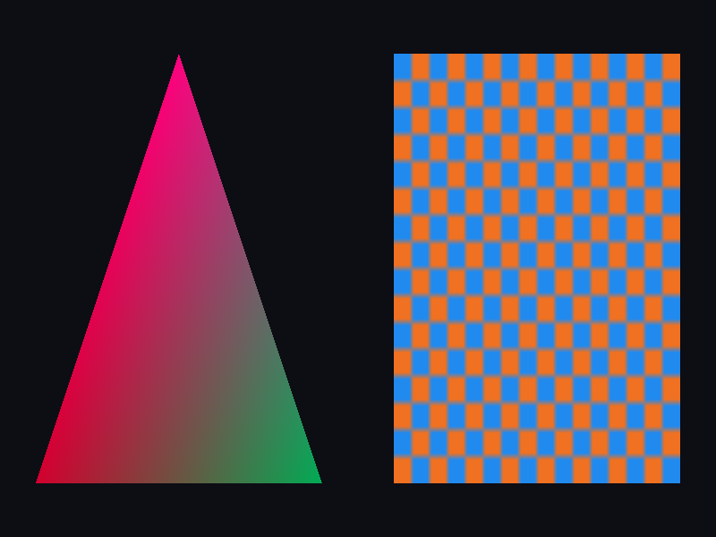

# 15 — Puffer-Streaming, GPU-seitige Kopien & das GL-4.3-Vertex-Binding-Modell

> 🇬🇧 **English version:** [docs/en/tutorials/15-buffer-streaming-and-copies.md](../../en/tutorials/15-buffer-streaming-and-copies.md)

**Ziel:** einen VBO jeden Frame ohne Stalls aktualisieren (`mapRange` + Invalidate),
Puffer auf der GPU kopieren (`glCopyBufferSubData`), Daten zurücklesen
(`glGetBufferSubData`) und das moderne GL-4.3-Vertex-Binding-Modell statt klassischer
Attribut-Zeiger verwenden.



*(Linke Hälfte: Dreieck mit pro Frame gestreamten Farben. Screenshot headless in der CI
von `examples/stream --screenshot` gerendert — siehe [12](12-headless-rendering-and-screenshots.md).)*

## Streaming mit mapRange (der richtige Weg für pro-Frame-Daten)

```cpp
fuhgl::Buffer vbo(fuhgl::Buffer::Target::Array);
vbo.bind();
vbo.setData(3 * sizeof(Vert), nullptr, fuhgl::Buffer::Usage::StreamDraw); // einmal allokieren

// pro Frame:
vbo.bind();
void* p = vbo.mapRange(0, 3 * sizeof(Vert),
                       fuhgl::gl::GL_MAP_WRITE_BIT | fuhgl::gl::GL_MAP_INVALIDATE_BUFFER_BIT);
if (p) {
    std::memcpy(p, verts, 3 * sizeof(Vert));   // Orphaning: Treiber darf einen frischen Puffer liefern
    vbo.flushMappedRange(0, 3 * sizeof(Vert)); // nur nötig mit GL_MAP_FLUSH_EXPLICIT_BIT
    vbo.unmap();
} else {
    vbo.setSubData(0, 3 * sizeof(Vert), verts); // Fallback für uralte Treiber
}
```

`GL_MAP_INVALIDATE_BUFFER_BIT` / `GL_MAP_INVALIDATE_RANGE_BIT` sagen dem Treiber, dass der
alte Inhalt tot ist — genau das vermeidet den CPU/GPU-Sync-Stall bei dynamischen Puffern.
Die Flags `GL_MAP_PERSISTENT_BIT`/`GL_MAP_COHERENT_BIT` (GL 4.4) erlauben noch feinere
Kontrolle.

## GPU-seitige Kopie, Invalidate, Readback, Parameter

```cpp
fuhgl::Buffer src(fuhgl::Buffer::Target::CopyRead), dst(fuhgl::Buffer::Target::CopyWrite);
src.bind(); src.setData(size, data, fuhgl::Buffer::Usage::StaticDraw);
dst.bind(); dst.setData(size, nullptr, fuhgl::Buffer::Usage::StaticDraw);

fuhgl::gl::copyBufferSubData(fuhgl::gl::GL_COPY_READ_BUFFER, fuhgl::gl::GL_COPY_WRITE_BUFFER,
                             0, 0, size);                       // GPU-seitiges memcpy
dst.invalidateSubData(0, 64);                                  // Bereich als tot markieren
unsigned char back[64];
dst.getSubData(0, sizeof back, back);                          // Readback zum Host
gl::GLint bytes = dst.parameteri(fuhgl::gl::GL_BUFFER_SIZE);   // GL_BUFFER_SIZE abfragen
```

`Buffer::Target` hat `CopyRead`, `CopyWrite`, `PixelPack`, `PixelUnpack` und
`DispatchIndirect` dazugewonnen (letzteres speist `gl::dispatchComputeIndirect`, siehe
Tutorial 16).

## GL-4.3-Vertex-Binding-Modell (keine klassischen Attribut-Zeiger)

```cpp
fuhgl::VertexArray vao;
vao.create();
vao.bind();
vao.bindVertexBuffer(0, vbo, 0, sizeof(Vert));        // Binding-Index 0 <- vbo
vao.setAttribFormat(0, 3, fuhgl::gl::GL_FLOAT, false, offsetof(Vert, pos));
vao.setAttribFormat(1, 3, fuhgl::gl::GL_FLOAT, false, offsetof(Vert, color));
vao.setAttribBinding(0, 0);                           // Attribut 0 liest Binding 0
vao.setAttribBinding(1, 0);
vao.enableAttrib(0);
vao.enableAttrib(1);
vao.setBindingDivisor(0, 1);                          // 1 = pro Instanz
// ... ganz normal zeichnen
```

Integer-/64-Bit-Attribute nutzen die `I`-/`L`-Varianten (ohne Normalisierung):
`vao.setAttribI(2, 1, fuhgl::gl::GL_INT, ...)` / `setAttribL(...)` sowie die passenden
`setAttribIFormat` / `setAttribLFormat`. Alle 4.3-Aufrufe sind auf älteren Kontexten
No-Ops.

## Beispiel

`examples/stream` — windowed Animation (Esc beendet) oder headless PNG:

```
./build/examples/stream
./build/examples/stream --screenshot stream.png
```

Test: `tests/gl_smoke_buffers.cpp` verifiziert in der CI gegen einen echten Kontext
mapRange/getSubData-Roundtrips, Puffer-Kopien, VAO-4.3-Rendering und mehr.
