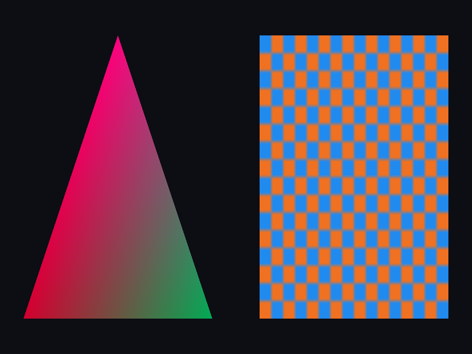

# 16 — Textur-Upload/Readback, komprimierte Texturen, Puffer-Texturen & Compute-Image-I/O

> 🇬🇧 **English version:** [docs/en/tutorials/16-textures-images-and-compute-io.md](../../en/tutorials/16-textures-images-and-compute-io.md)

**Ziel:** 3D-Textur-Volumes aktualisieren (`setSubImage3D`), Framebuffer-Bereiche in
Texturen kopieren, **komprimierte** (DXT/BC) Texturen ohne CPU-Dekompression hochladen,
Pixel zurücklesen (`getTexImage`), einen Puffer als Textur ansehen (`texBuffer`), Zero-Copy-
Textur-Views erzeugen (`glTextureView`) und Texturen als **Compute-Images** binden
(`glBindImageTexture`) mit direktem/indirektem Dispatch.



*(Rechte Hälfte: Quad mit einer per `Texture::compressedImage2D` hochgeladenen
DXT1-komprimierten Schachbrett-Textur — `examples/stream --screenshot`, headless in der CI
gerendert.)*

## Sub-Images, Kopien, Readback

```cpp
tex.setSubImage2D(0, x, y, w, h, fuhgl::gl::GL_RGBA, fuhgl::gl::GL_UNSIGNED_BYTE, pixels);
tex.setSubImage3D(0, x, y, z, w, h, d, fuhgl::gl::GL_RGBA, fuhgl::gl::GL_UNSIGNED_BYTE, voxels);

tex.copyTexImage2D(0, fuhgl::gl::GL_RGBA8, 0, 0, 512, 512);        // Framebuffer -> Textur
tex.copyTexSubImage2D(0, dx, dy, sx, sy, w, h);                    // ... Sub-Rechteck
tex.copyTexSubImage3D(0, dx, dy, dz, sx, sy, w, h);                // 3D-Variante

std::vector<unsigned char> px(w * h * 4);
fuhgl::gl::getTexImage(fuhgl::gl::GL_TEXTURE_2D, 0, fuhgl::gl::GL_RGBA, fuhgl::gl::GL_UNSIGNED_BYTE, px.data());
// für große Readbacks zuerst einen PixelPack-Puffer binden (Buffer::Target::PixelPack)

gl::GLint w = tex.getLevelParameteri(fuhgl::gl::GL_TEXTURE_WIDTH, 0);
gl::GLint compressed = tex.getLevelParameteri(fuhgl::gl::GL_TEXTURE_COMPRESSED, 0);
gl::GLint minFilter = tex.getParameteri(fuhgl::gl::GL_TEXTURE_MIN_FILTER);
```

## Komprimierte Texturen (DXT/BC — keine CPU-Dekompression nötig)

```cpp
tex.bind();
tex.compressedImage2D(0, fuhgl::gl::GL_COMPRESSED_RGBA_S3TC_DXT5_EXT, w, h, imageSize, dxtBytes);
tex.compressedSubImage2D(0, x, y, w, h, fuhgl::gl::GL_COMPRESSED_RGBA_S3TC_DXT5_EXT, imageSize, block);
// 3D/Array/Cube-Varianten: compressedImage3D / compressedSubImage3D
// Readback: fuhgl::gl::getCompressedTexImage(target, level, buffer);
```

Übliche Formate sind in `types.hpp` vordefiniert: `GL_COMPRESSED_RGB(A)_S3TC_DXT1/3/5_EXT`,
die SRGB-Varianten und `GL_COMPRESSED_RGBA_BPTC_UNORM` (BC7). Ein 4x4-DXT1-Block ist 8 Byte,
DXT5 ist 16 Byte. Unterstützung zur Laufzeit über `gl::queryDeviceInfo()` / `hasExtension`
prüfen (Tutorial 14) und einen unkomprimierten Fallback vorhalten (so macht es
`examples/stream`).

## Puffer-Texturen und Textur-Views

```cpp
fuhgl::Buffer data(fuhgl::Buffer::Target::Array);
data.bind(); data.setData(bytes, ptr, fuhgl::Buffer::Usage::StaticDraw);

fuhgl::Texture bufTex(fuhgl::Texture::Target::TexBuffer);
bufTex.bind();
bufTex.texBufferImage(fuhgl::gl::GL_RGBA8, data);                  // ganzer Puffer als 1D-Textur
// oder ein Ausschnitt: bufTex.texBufferRangeImage(fuhgl::gl::GL_RGBA8, data, offset, size);

fuhgl::Texture view(fuhgl::Texture::Target::Tex2D);
view.create(fuhgl::Texture::Target::Tex2D);
view.view(fuhgl::Texture::Target::Tex2D, srcTex, fuhgl::gl::GL_RGBA8, 2, 1, 0, 1); // Mip 2 als View (GL 4.3)
```

## Compute-Image-I/O (GL 4.2+) + indirekter Dispatch

```cpp
// Shader: layout(rgba8, binding = 0) uniform writeonly image2D uImg;
fuhgl::gl::bindImageTexture(0, img.id(), 0, false, 0, fuhgl::gl::GL_WRITE_ONLY, fuhgl::gl::GL_RGBA8);
prog.use();
fuhgl::gl::dispatchCompute(groupsX, groupsY, groupsZ);
fuhgl::gl::memoryBarrier(fuhgl::gl::GL_SHADER_IMAGE_ACCESS_BARRIER_BIT);

// indirekt: die Gruppenanzahlen kommen aus einem Puffer an GL_DISPATCH_INDIRECT_BUFFER
indirectBuf.bind(); // Buffer::Target::DispatchIndirect
fuhgl::gl::dispatchComputeIndirect(0);

// SSBO-Blöcke: per Name binden wie UBOs
prog.bindShaderStorageBlock("DataBlock", 0);   // glGetShaderStorageBlockIndex + glShaderStorageBlockBinding
ssbo.bindBase(0);                              // Buffer::Target::ShaderStorage
```

Neu an `Program` außerdem: Unsigned-Uniform-Setter (`setUniform("uCount", 3u)`,
`setUniform(loc, count, uint*)`) und Readback-Getter (`getUniformi/f/u(name)` — sie fragen
das Programm-Objekt direkt ab, kein `use()` nötig).

## Beispiel & Test

```
./build/examples/stream                       # windowed: gestreamtes Dreieck + DXT-Quad
./build/examples/stream --screenshot out.png  # headless PNG (CI-Docs-Job)
```

`tests/gl_smoke_buffers.cpp` (CI, echter Kontext): mapRange/Kopie/getSubData-Roundtrips,
2D+3D-Sub-Image/Readback, DXT5-komprimierter Roundtrip, Image-Binding-Compute (direkt und
indirekt), SSBO-Compute-Schreibzugriff, VAO-4.3-Rendering, Uniform-Readback.
