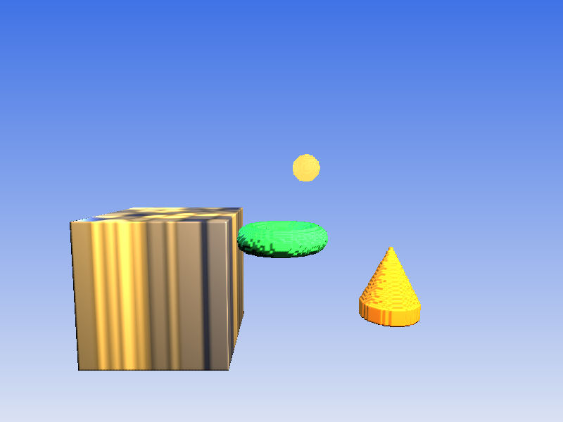

# 17 — Prozedurale Texturen & vordefinierte Materialien

> 🇬🇧 **English version:** [docs/en/tutorials/17-procedural-textures-and-materials.md](../../en/tutorials/17-procedural-textures-and-materials.md)

**Ziel:** Texturen im Code erzeugen (keine Bilddateien) und fertige Materialien statt
handgeschriebener Shader verwenden.



*(Der CSG-Teil links nutzt eine prozedurale Voronoi-Textur mit dem `textured`-Material —
Screenshot headless in der CI von `examples/solids --screenshot` gerendert, siehe
[12](12-headless-rendering-and-screenshots.md) und [18](18-solids-and-csg.md).)*

## Prozedurale Texturen (`fuhgl::render::procedural`)

Alle Generatoren liefern ein CPU-seitiges RGBA8-`Image` (deterministisch — gekeimtes
Rauschen ergibt für denselben Seed dasselbe Bild), und `makeTexture()` lädt es in eine
`fuhgl::Texture` (RGBA8, Mipmaps + lineares Filtern als Default):

```cpp
auto img = fuhgl::render::procedural::voronoi(128, 128, 6, 1337u,
                                              {0.12f,0.14f,0.22f}, {0.95f,0.75f,0.35f});
fuhgl::Texture tex = fuhgl::render::procedural::makeTexture(img);
// außerdem: checker(w,h,cells,c1,c2), gradient, stripes, bricks, rings, noise(w,h,seed,octaves,...)
```

## Vordefinierte Materialien (`fuhgl::render::materials`)

Preset-Materialien brauchen **kein GLSL**: sie setzen `builtinShader = true` und tragen
Daten; die Pipelines (Forward + Deferred) steuern ihre eingebauten Shader mit den Uniforms
`uAlbedo`, `uEmissive`, `uUseTex`, `uMatTex` (Albedo-Textur auf Einheit 3):

```cpp
fuhgl::render::Material m1 = fuhgl::render::materials::matte({0.85f, 0.6f, 0.25f});
fuhgl::render::Material m2 = fuhgl::render::materials::textured(tex, {1,1,1}); // Textur * Tint
fuhgl::render::Material m3 = fuhgl::render::materials::emissive({1.f, 0.35f, 0.15f}, 2.5f);
fuhgl::render::Material m4 = fuhgl::render::materials::texturedEmissive(tex, tint, glow);

scene.items.push_back({&mesh, &m2, model}); // DrawItem.material = Preset
```

In der **Deferred**-Pipeline wird der emissive Term in einem 4. G-Buffer-Attachment
gespeichert und im Lighting-Pass addiert; in der **Forward**-Pipeline direkt im
Fragment-Shader.

Vollständig eigene Materialien (eigener `Program`) funktionieren weiterhin wie gehabt
(Tutorial 13): `builtinShader = false` (Default) setzen und die Standard-Uniform-Namen
verwenden.

## Beispiel

```
./build/examples/solids                       # windowed (WASD + Maus, Esc beendet)
./build/examples/solids --screenshot out.png  # headless PNG (CI-Docs-Job)
```

Tests: `tests/test_solids.cpp` (Generator-Determinismus/Muster) und
`tests/gl_smoke_solids.cpp` (echtes GL-Rendering eines texturierten CSG-Körpers in der CI).
