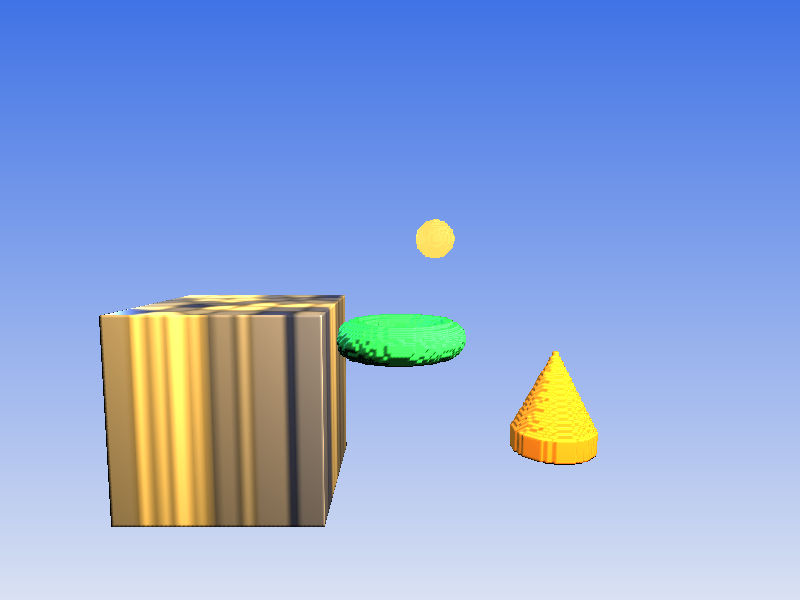
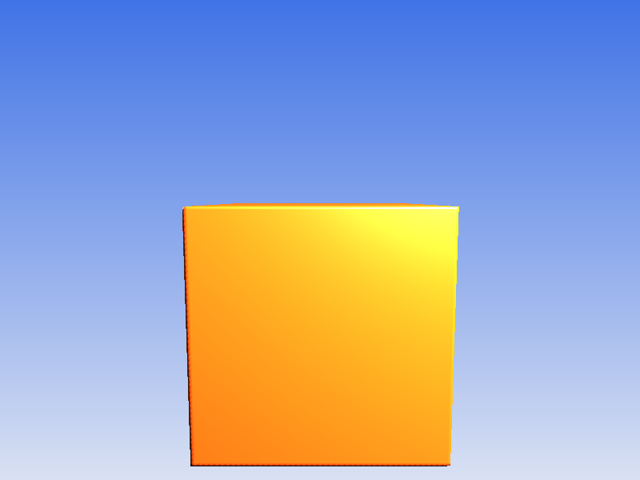
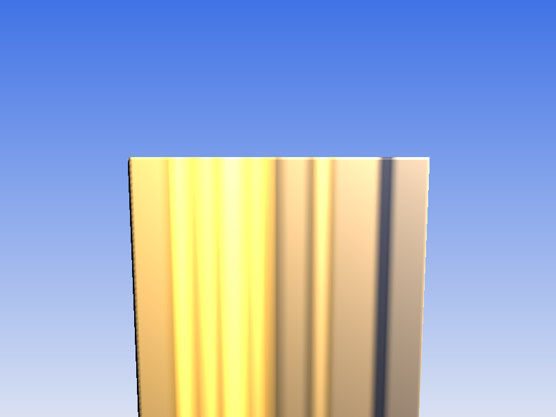
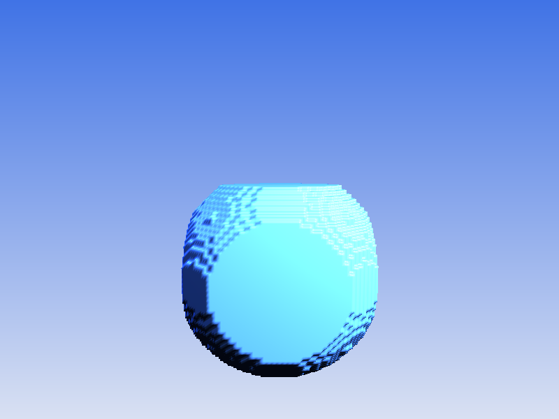
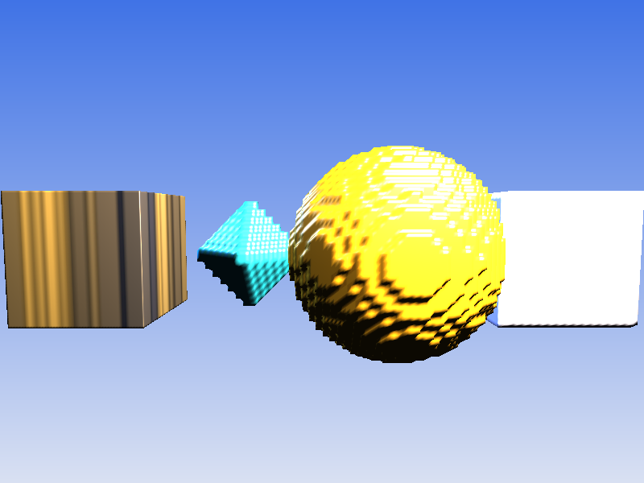
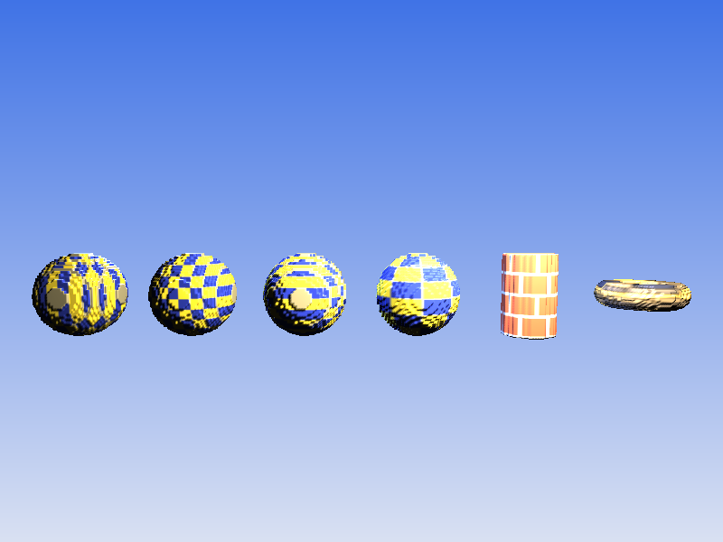

# 18 — Körper & CSG (Constructive Solid Geometry)

> 🇬🇧 **English version:** [docs/en/tutorials/18-solids-and-csg.md](../../en/tutorials/18-solids-and-csg.md)

**Ziel:** Körper analytisch beschreiben, mit booleschen Operatoren kombinieren
(Vereinigung / Schnitt / Differenz) und bei Bedarf ein renderbares Mesh extrahieren.



*(Links: `cube - sphere` mit Voronoi-Textur, Mitte: `torus - cylinder`,
rechts: `cylinder | translated(cone)`, plus eine emissive Markierungskugel.
Screenshot headless in der CI gerendert — siehe [12](12-headless-rendering-and-screenshots.md).)*

## Die `Solid`-Abstraktion

Ein `fuhgl::render::Solid` ist ein analytischer Körper: ein `inside(point)`-Test plus eine
AABB. Er hält keine GL-Objekte (polymorpher Werttyp, geteilt über `SolidPtr`):

```cpp
class Solid {
public:
    virtual bool inside(const math::Vec3& p) const = 0; // lokaler Raum, zentriert im Ursprung
    virtual math::Vec3 aabbMin() const = 0;
    virtual math::Vec3 aabbMax() const = 0;
    render::MeshData buildMeshData(int resolution = 32, const math::Vec3& color = ...) const;
    render::Mesh      buildMesh(int resolution = 32, const math::Vec3& color = ...) const; // GL-Upload
};
```

Primitive: `makeCube(halfExtents)`, `makeSphere(r)`, `makeCylinder(r, height)` (Y-Achse),
`makeCone(r, height)`, `makeTorus(R, r)`, dazu `translated(solid, offset)`.

## CSG-Operatoren

```cpp
using namespace fuhgl::render;
auto part = makeCube({1,1,1}) - makeSphere(0.75f);            // Differenz
auto both = makeTorus(0.55f, 0.2f) & makeCube({0.8f,0.8f,0.8f}); // Schnitt
auto uni  = makeCylinder(0.45f, 0.25f) | translated(makeCone(0.45f, 0.9f), {0,0.55f,0}); // Vereinigung

Mesh mesh = part->buildMesh(48, {1,1,1});   // Marching Tetrahedra, pos/normal/color/uv
scene.items.push_back({&mesh, &material, model});
```

Operatoren auf `SolidPtr`: `a | b` (Vereinigung), `a & b` (Schnitt), `a - b` (Differenz).
Die AABB eines CSG-Knotens wird automatisch abgeleitet (Differenz ist durch `a` begrenzt).

## CSG in Bildern

Alle headless in der CI von `examples/solids --screenshot ... --csg <modus>` gerendert:

**Vereinigung** — `makeCube({0.85,0.85,0.85}) | makeSphere(0.8)`:



**Differenz** — `makeCube({1,1,1}) - makeSphere(0.75)` (voronoi-texturiert):



**Schnitt** — `makeSphere(0.95) & makeCube({0.8,0.8,0.8})`:



**Bounding Volumes** des Differenz-Körpers — solid, Low-Poly-Oktaeder, Umkugel, AABB-Box:



## Wie das Meshing funktioniert

`buildMeshData(resolution)` tastet das `inside()`-Feld auf einem Voxel-Gitter ab
(`resolution` Zellen entlang der längsten AABB-Kante) und extrahiert die Iso-Fläche per
**Marching Tetrahedra** (jeder Voxel in 6 Tets zerlegt; 1/3-inside-Fälle → 1 Dreieck,
2-inside → Quad = 2 Dreiecke; Winding gegen den Feldgradienten fixiert, Vertex-Normalen sind
akkumulierte Face-Normalen). Vertices werden über eine Kanten-Map zwischen Zellen geteilt.
UVs sind default-planar (XZ) — siehe nächster Abschnitt zu den Mapping-Modi.
Vollständig CPU-seitig und ohne GL-Kontext unit-testbar.

Höheres `resolution` = glattere Oberfläche, mehr Dreiecke (48³ für Hero-Teile ist ein
guter Default; das Beispiel gibt Vertex-/Index-Anzahlen aus).

## Bounding Volumes

Jeder Körper (auch CSG-Ergebnisse — ihre AABB wird automatisch abgeleitet) lässt sich in
ein Bounding Volume hüllen, z. B. für Frustum-Culling oder Kollisions-Vortests:

```cpp
auto box  = fuhgl::render::makeBoundingBox(*part);        // exakte AABB als Solid (Würfel)
auto sph  = fuhgl::render::makeBoundingSphere(*part);     // Umkugel: AABB-Mitte, halbe Diagonale als Radius
auto oct  = fuhgl::render::makeBoundingOctahedron(*part); // Low-Poly-Variante (L1-Ball, 6 Spitzen / 8 Flächen)
auto any  = fuhgl::render::makeBoundingVolume(*part, fuhgl::render::BoundingVolume::Octahedron);

// Culling mit dem Math-Modul:
fuhgl::math::Frustum fr = fuhgl::math::Frustum::fromViewProj(cam.viewProj(aspect));
if (fuhgl::render::intersects(fr, *part))   // AABB vs. Frustum (Positive-Vertex-Test)
    scene.items.push_back({&partMesh, &partMat, model});
```

Alle drei sind selbst wieder Solids, lassen sich also meshen (`buildMesh`), transformieren
(`translated`) und per CSG kombinieren.

## Texturierte Körper: UV-Mapping-Modi (F23)

Gemeshte Vertices tragen immer UVs (MeshData-Layout: pos/normal/color/**uv**), und
`buildMeshData`/`buildMesh` nehmen einen optionalen `render::SolidUv`-Modus, damit eine
prozedurale Textur (`render::procedural::checker/voronoi/bricks/...` +
`render::materials::textured`) so auf der Oberfläche landet, wie du es willst:

```cpp
// ein Körper pro UV-Modus — alle mit derselben Schachbrett-Textur gerendert:
render::Mesh a = render::makeSphere(0.8f)->buildMesh(32, {1,1,1}, render::SolidUv::PlanarXZ);     // von oben
render::Mesh b = render::makeSphere(0.8f)->buildMesh(32, {1,1,1}, render::SolidUv::PlanarXY);     // von vorn
render::Mesh c = render::makeSphere(0.8f)->buildMesh(32, {1,1,1}, render::SolidUv::PlanarYZ);     // von der Seite
render::Mesh d = render::makeSphere(0.8f)->buildMesh(32, {1,1,1}, render::SolidUv::Spherical);    // equirektangular
render::Mesh e = render::makeCylinder(0.5f, 1.6f)->buildMesh(32, {1,1,1}, render::SolidUv::Cylindrical); // um Y
render::Mesh f = render::makeTorus(0.55f, 0.25f)->buildMesh(40, {1,1,1}, render::SolidUv::Cylindrical);

fuhgl::Texture tex = render::procedural::makeTexture(render::procedural::checker(64, 64, 8, c1, c2));
render::Material mat = render::materials::textured(tex);   // bindet die Albedo-Textur auf Einheit 3
scene.items.push_back({&d, &mat, fuhgl::math::Mat4{}});
```

- `PlanarXZ` (Default, bisheriges Verhalten), `PlanarXY`, `PlanarYZ` — die AABB auf eine
  Ebene projiziert, normalisiert auf [0,1] (degenerierte Achsen bilden auf 0 ab).
- `Spherical` — equirektangular um die AABB-Mitte (gut für Kugeln / organische CSG).
- `Cylindrical` — Winkel um die Y-Achse + Höhe (gut für Zylinder, Kegel, Tori).

Der reine Helfer `render::solidUvPoint(mode, p, aabbMin, aabbMax)` berechnet die UV eines
einzelnen Punkts und ist direkt unit-getestet (`tests/test_solids.cpp` prüft Eck-/Mitte-Werte,
Pol/Seam-Verhalten und dass jede gemeshte UV für alle fünf Modi in [0,1] bleibt).

Von links nach rechts: PlanarXZ, PlanarXY, PlanarYZ, Spherical (Kugeln) + Cylindrical
(Zylinder mit Bricks, Torus mit Voronoi) — je eine Checker-/Brick-/Voronoi-Textur:



## Beispiel

```
./build/examples/solids                       # windowed Demo-Szene (Esc beendet)
./build/examples/solids --screenshot out.png  # headless PNG (CI-Docs-Job)
```

Tests: `tests/test_solids.cpp` (inside()/AABB jeder Primitive, CSG-Logik an Sample-Punkten,
Mesh-Sanity: Index-Bereich, Shell-Bounds, Einheitsnormalen; prozedurale Generatoren)
und `tests/gl_smoke_solids.cpp` (rendert einen texturierten CSG-Körper durch die
DeferredPipeline in der CI und prüft die Pixel).
