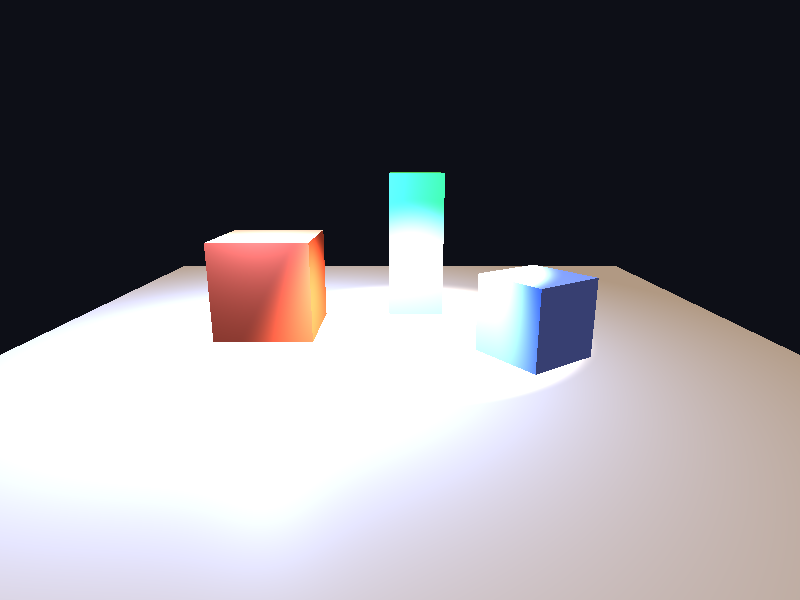

# 20 — Lichtquellen: direktional, Punkt & Spot (F14)

> 🇬🇧 **English version:** [docs/en/tutorials/20-lights.md](../../en/tutorials/20-lights.md)

**Ziel:** echte Lichtquellen-Klassen für das eingebaute Beleuchtungsmodell. `render::Light`
(siehe `include/fuhgl/render/light.hpp`) ersetzt die alte punkt-only-Struktur und
unterstützt **direktionale** (Sonne), **Punkt**- und **Spot**-Lichtquellen mit analytischer
Attenuation, Reichweiten-Cutoff und Spot-Kegeln. Die Pipelines laden bis zu `kMaxLights` (64)
davon über das std140-`LightBlock`-UBO an Binding 0 hoch — keine Shader-Änderung nötig, um
Lichtquellen hinzuzufügen.



## Die Light-Klasse

`Light` ist ein Werttyp (keine GL-Handles, kein PIMPL). Die ersten drei Member behalten die
historische Reihenfolge, daher ergibt Aggregate-Initialisierung weiterhin ein Punktlicht:

```cpp
fuhgl::render::SceneView scene;
scene.lights.push_back({{3.f, 3.f, 4.f}, {1.f, 0.9f, 0.7f}, 25.f}); // Punktlicht (Aggregate-Init)

// Factories (bevorzugt):
using fuhgl::render::Light;
scene.lights.push_back(Light::directional({-0.4f, -1.f, -0.25f}, {1.f, 0.85f, 0.65f}, 1.6f)); // Sonne
scene.lights.push_back(Light::point({-2.2f, 2.6f, 0.6f}, {0.45f, 0.65f, 1.f}, 14.f, 9.f));      // range = 9
scene.lights.push_back(Light::spot({0.3f, 4.5f, 1.6f}, {0.f, -1.f, -0.35f}, {1.f, 0.95f, 0.7f}, 60.f,
                                    fuhgl::math::radians(18.f), fuhgl::math::radians(32.f)));
```

Felder (alle public, im Header dokumentiert):

| Feld | Bedeutung |
|---|---|
| `type` | `LightType::Point` / `Directional` / `Spot` |
| `position` | Ursprung bei Punkt/Spot |
| `direction` | Laufrichtung (direktional) / Zielrichtung (Spot), von den Factories normalisiert |
| `color`, `intensity` | lineares RGB × Skalar; direktional: konstante Einstrahlungs-Skalierung |
| `attenuationConstant/Linear/Quadratic` | `atten = intensity / (c + l·d + q·d²)` (Punkt/Spot) |
| `range` | 0 = unendlich; sonst weiches quartisches Fenster auf null bei `d = range` |
| `coneInner`, `coneOuter` | Spot-Kegel-Halbwinkel in Radiant (volle Helligkeit → null) |

Die CPU-seitige Mathematik spiegelt den Shader exakt und ist unit-getestet
(`tests/test_light.cpp`):

```cpp
float a = light.attenuation(distance);        // Abstands-Falloff + Range-Fenster
float c = light.coneFactor(toLightDir);       // 1 innerhalb des inneren Kegels, 0 außerhalb des äußeren
```

## Wie die Pipelines Lichtquellen konsumieren

`SceneView::lights` ist ein `std::vector<Light>`. Sowohl `ForwardPipeline` als auch
`DeferredPipeline` packen ihn per `render::packLightBlock(lights, block)` in die
`LightBlock`-Struktur (C++-Spiegel des std140-UBO) und laden sie einmal pro Frame hoch:

```glsl
layout(std140) uniform LightBlock {
    vec4 lightPosIntensity[64]; // xyz = Position, w = Intensität
    vec4 lightColor[64];        // rgb = Farbe
    vec4 lightDirType[64];      // xyz = Richtung, w = Typ (0 Punkt, 1 direktional, 2 Spot)
    vec4 lightParams0[64];      // Attenuation c/l/q, range
    vec4 lightParams1[64];      // cos(coneInner), cos(coneOuter)
};
```

Das geteilte GLSL (`src/render/lighting_glsl.hpp`) berechnet pro Lichtquelle die Richtung `L`
und die Attenuation (`lightVector()`) und akkumuliert diffuses + Blinn-Phong-Specular in
`shade()`. Direktionale Lichtquellen ignorieren die Distanz; Spots multiplizieren zusätzlich
mit dem weichen Kegel-Faktor.

## Eine beleuchtete Szene rendern

```cpp
fuhgl::render::ForwardPipeline pipeline;
pipeline.create();

fuhgl::render::SceneView scene;
scene.camera = &cam;          // irgendeine fuhgl::Camera
scene.width = 800; scene.height = 600; scene.aspect = 800.f / 600.f;
scene.clearColor = {0.05f, 0.06f, 0.09f};
scene.ambient    = {0.05f, 0.05f, 0.06f};
scene.items.push_back({&boxMesh, nullptr, fuhgl::math::translate({0.f, 0.8f, 0.f})});
scene.lights.push_back(fuhgl::render::Light::directional({-0.4f, -1.f, -0.25f}, {1.f, 0.85f, 0.65f}, 1.6f));

pipeline.render(scene);       // Lichtquellen + Ambient sind Teil der SceneView
```

Komplettes Demo siehe `examples/lights/main.cpp` (Sonne + Punkt + Spot, windowed oder
`--screenshot out.png` headless). Der Headless-Test `tests/gl_smoke_lights.cpp` verifiziert
pro Lichtquellentyp, dass der gerenderte Mittel-Pixel hell/dunkel wie erwartet ist.

## Eigene Shader

Wer eigene Material-Shader schreibt, bindet denselben Block selbst:

```glsl
layout(std140) uniform LightBlock { /* dasselbe Layout wie oben */ };
// in C++ nach dem Linken:
program.bindUniformBlock("LightBlock", 0);
ubo.bindBase(0); // einen render::LightBlock mit packLightBlock() hochladen
```
