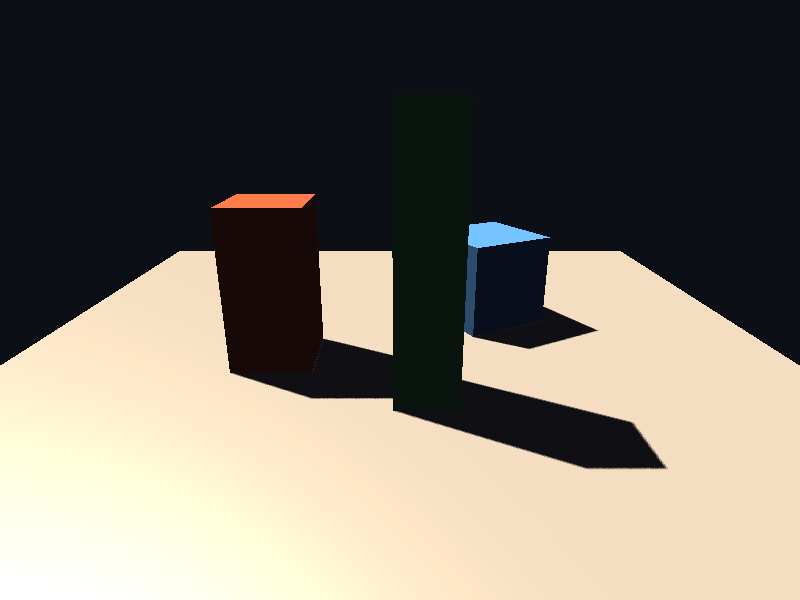

# 21 — Shadow Mapping (F15)

> 🇬🇧 **English version:** [docs/en/tutorials/21-shadows.md](../../en/tutorials/21-shadows.md)

**Ziel:** die Voraussetzungen für Echtzeit-Schatten: eine `render::ShadowMap`, die die
Szenen-Tiefe aus Sicht der Lichtquelle rendert (reiner Depth-Pass), Helfer für die
Licht-View-Projektion-Matrix und PCF-Schatten-Sampling in den eingebauten
Beleuchtungs-Shadern der Pipelines.



## Die Bausteine

### 1. Licht-View-Projektion (`render/shadow.hpp`)

```cpp
fuhgl::render::Light sun = fuhgl::render::Light::directional({0.55f, -1.f, 0.3f}, {1.f, 0.9f, 0.72f}, 1.7f);

// direktionales Licht: Ortho-Box mit `radius` um `center`, blickt entlang -direction
// Spot:                  Perspektive mit fov = 2 * coneOuter an der Lichtposition
fuhgl::math::Mat4 lightVP = fuhgl::render::lightViewProj(sun, /*sceneCenter*/ {0.f, 0.5f, 0.f}, /*radius*/ 8.f);
// oder die einzelnen Matrizen:
fuhgl::math::Mat4 lv = fuhgl::render::lightView(sun, center, radius);
fuhgl::math::Mat4 lp = fuhgl::render::lightProjection(sun, /*aspect*/ 1.f);
```

Gerade-nach-unten-Lichtquellen werden behandelt (der Up-Vektor kippt auf +X, um ein
degeneriertes `lookAt` zu vermeiden). Punktlicht-Schatten bräuchten eine Cube-Shadow-Map —
hier nicht behandelt.

### 2. Die Shadow-Map (`render::ShadowMap`, PIMPL — besitzt eine Depth-Textur + FBO)

```cpp
fuhgl::render::ShadowMap shadowMap;
shadowMap.create(1024);                    // Depth-Textur 1024x1024, LINEAR gefiltert

// pro Frame, vor dem Hauptrender: Depth-Pass aus Sicht der Lichtquelle
shadowMap.render(scene, lightVP);          // Backfaces werden gezeichnet (weniger Acne)
```

`ShadowMap::render()` bindet sein reines Depth-FBO (`glDrawBuffer(GL_NONE)`), leert die
Tiefe und zeichnet jeden `scene.items`-Eintrag mit einem minimalen Depth-Programm
(`uModel`, `uLightVP`).

### 3. Sampling im Lighting-Pass

Die Map in der `SceneView` setzen; sowohl `ForwardPipeline` als auch `DeferredPipeline`
nehmen sie automatisch auf:

```cpp
scene.shadowMap = &shadowMap;
scene.lightVP = lightVP;
scene.shadowLightIndex = 0;   // Index in scene.lights[], zu dem die Map gehört
scene.shadowStrength = 1.f;   // 0 = aus, 1 = voll
pipeline.render(scene);
```

Das geteilte GLSL (`src/render/lighting_glsl.hpp`, `kShadowFunc`) projiziert das Fragment
in den Lichtraum, wendet ein slope-skaliertes Depth-Bias an und macht ein 3x3-PCF auf der
LINEAR-gefilterten Depth-Textur:

```glsl
float shadowFactor(vec3 worldPos, vec3 N, vec3 L) {
    vec4 lp = uLightVP * vec4(worldPos, 1.0);
    vec3 p = lp.xyz / lp.w * 0.5 + 0.5;
    if (p.z > 1.0 || p.xy outside [0,1]) return 1.0;   // außerhalb der Map = beleuchtet
    float bias = max(0.0015 * (1.0 - dot(N, L)), 0.0004);
    // 3x3-Taps, texture(uShadowMap, p.xy + offset).r >= p.z - bias
}
```

Nur `uShadowLightIndex` wird beschattet — die übrigen Lichtquellen bleiben unbeschattet
(eine Shadow-Map pro Frame hält es günstig).

## Komplettes Beispiel

Siehe `examples/shadows/main.cpp`: Boden + drei Boxen + eine Sonne, Depth-Pass dann
Forward-Pass. Der Headless-Test `tests/gl_smoke_shadows.cpp` rendert die Szene mit und ohne
Shadow-Map und assertet, dass ein sichtbarer Pixel-Blob dunkler wird und nichts heller.
`tests/test_shadow.cpp` unit-testet die Licht-VP-Mathematik (Szenen-Kugel bleibt in der
Ortho-Box, Spot-Kegel-Rand bildet auf |ndc| ≈ 1 ab, kein NaN bei gerade-nach-unten-Licht).

## Stellschrauben

| Knopf | Wo | Wirkung |
|---|---|---|
| Map-Größe | `shadowMap.create(size)` | Auflösung / Qualität der Schattenkanten |
| `sceneRadius` in `lightViewProj` | pro Frame | Ausdehnung der Ortho-Box — muss den beschatteten Bereich abdecken |
| Bias | `kShadowFunc` in `lighting_glsl.hpp` | Acne vs. Peter-Panning |
| Backface-Depth-Pass | `ShadowMap::render` | `cullFace(Front)` reduziert Acne |
| `shadowStrength` | `SceneView` | 0..1 Weichheit des Schattens |
