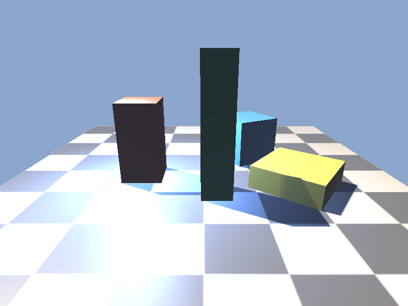

# 22 — Default-Forward-Renderer (F16)

> 🇬🇧 **English version:** [docs/en/tutorials/22-forward-renderer.md](../../en/tutorials/22-forward-renderer.md)

**Ziel:** ein sofort einsatzbereiter Renderer statt händisch verdrahteter Pipeline + Licht +
Shadow-Map: `render::ForwardRenderer` besitzt eine `ForwardPipeline`, die szenenweiten
Einstellungen (Lichtquellen, Ambient, Clear-Farbe, Nebel) und eine optionale Shadow-Map,
die bei jedem `render()`-Aufruf automatisch aus der ersten direktionalen/Spot-Lichtquelle
neu gerendert wird.


*Mit Schatten und Nebel (links wäre `--no-shadows`: siehe `tutorial-forward-renderer-noshadow.png`).*

## Verwendung

```cpp
fuhgl::render::ForwardRenderer renderer;
renderer.create(800, 600);          // eigenes RGBA8+Depth-Target; create() rendert ins Fenster

renderer.addLight(fuhgl::render::Light::directional({0.55f, -1.f, 0.3f}, {1.f, 0.9f, 0.72f}, 1.7f)); // Sonne
renderer.addLight(fuhgl::render::Light::point({-2.5f, 3.f, 1.f}, {0.45f, 0.65f, 1.f}, 12.f, 10.f));
renderer.setAmbient({0.10f, 0.10f, 0.12f});
renderer.setClearColor({0.55f, 0.65f, 0.8f});
renderer.setFog({0.55f, 0.65f, 0.8f}, 0.028f);  // exponentieller Distanznebel

renderer.enableShadows(1024);                    // Größe der Depth-Map
renderer.setShadowSceneBounds({0.f, 0.5f, 0.f}, 8.f); // Mitte + Radius, die die Map abdeckt
renderer.setShadowStrength(1.f);

std::vector<fuhgl::render::DrawItem> items = { {&boxMesh, &floorMaterial, fuhgl::math::translate({0,1.4f,0.4f})}, ... };

// pro Frame:
renderer.render(cam, items, width, height);      // Schatten-Pass + Forward-Pass, ein Aufruf
// windowed: manuell blitten oder create() ohne Größe aufrufen, um direkt ins Fenster zu rendern
renderer.blitToScreen();                        // bei create() mit Größe
```

`render()` baut die `SceneView` intern: es kopiert `lights()`, Ambient/Clear/Fog, berechnet
`lightViewProj()` für die erste direktionale oder Spot-Lichtquelle, rendert den
`ShadowMap`-Depth-Pass und dann den Forward-Pass — die Shadow-Map wird im Lighting-Shader
per PCF gesampelt (Tutorial 21).

## Enthaltene Features

| Feature | Wie |
|---|---|
| Lichtarten | `lights()` — direktional/Punkt/Spot (Tutorial 20) |
| Schatten | `enableShadows(size)` + `setShadowSceneBounds()` — automatischer Depth-Pass, PCF |
| Nebel | `setFog(color, density)` — `visibility = exp(-density·distance)` im Shader |
| Ambient / Clear | `setAmbient()`, `setClearColor()` |
| Eigenes Render-Target | `create(w, h)` → `target()`, `blitToScreen()`; `create()` → Fenster-FB |
| MSAA | über `pipeline().setTarget(...)` mit eigenem Multisample-FBO |

## Tests & Beispiel

`tests/gl_smoke_forward.cpp` rendert einen Boden + Werfer durch den `ForwardRenderer` und
verifiziert (a) dass der automatische Schatten-Pass einen sichtbaren Blob verdunkelt und
(b) dass starker roter Nebel entfernte Pixel zur Nebelfarbe schiebt. `examples/forward/main.cpp`
ist das komplette Demo (`--screenshot`, `--no-shadows`, `--no-fog`).
