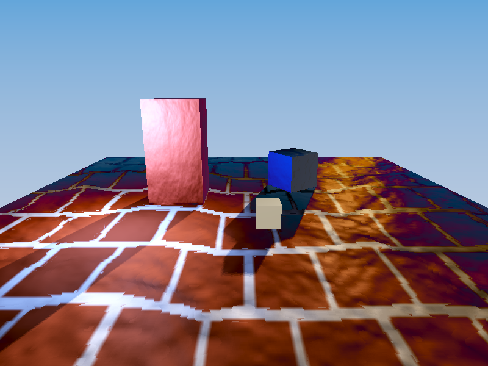

# 23 — Default-Deferred-Renderer + Postprocessing (F17)

> 🇬🇧 **English version:** [docs/en/tutorials/23-deferred-renderer-postfx.md](../../en/tutorials/23-deferred-renderer-postfx.md)

**Ziel:** `render::DeferredRenderer` — ein sofort einsatzbereiter Deferred-Renderer mit der
kompletten Post-Kette: **SSAO**, **HDR**-Beleuchtung, **Bloom**, **Crepuscular (God) Rays**,
ACES-Tonemapping, dazu **Parallax Occlusion** und **Bump/Normal Mapping** im G-Buffer-Pass
und **PCF-Schatten** aus Tutorial 21.


*Komplette Kette (SSAO + Schatten + Bloom + God Rays + Parallax-Boden). Vergleich `--no-fx`:
`tutorial-deferred-fx-nofx.png`.*

## Verwendung

```cpp
fuhgl::render::DeferredRenderer renderer;
renderer.create(800, 600);            // G-Buffer + Post-Kette; optionales MSAA: create(w, h, 4)
renderer.enableShadows(1024);
renderer.setShadowSceneBounds({0.f, 0.5f, 0.f}, 8.f);

// Knöpfe (alle optional, vernünftige Defaults):
renderer.ssaoEnabled = true;  renderer.ssaoRadius = 0.6f;  renderer.ssaoStrength = 1.2f;
renderer.bloomStrength = 0.8f; renderer.bloomThreshold = 1.0f; renderer.bloomBlurPasses = 2;
renderer.godRaysEnabled = true; renderer.rayDensity = 0.92f; renderer.rayDecay = 0.95f; renderer.rayWeight = 0.4f;
renderer.exposure = 1.1f;

fuhgl::render::SceneView scene;
scene.camera = &cam; scene.width = 800; scene.height = 600; scene.aspect = 800.f/600.f;
scene.lights.push_back(fuhgl::render::Light::directional({0.35f, -0.85f, 0.5f}, {1.f, 0.88f, 0.7f}, 1.8f));
scene.items.push_back({&floorMesh, &parallaxFloorMat, fuhgl::math::translate({0, -0.25f, 0})});
...

renderer.render(scene);               // alles in einem Aufruf
// Ergebnis ist LDR RGBA8 in renderer.output() (mit Framebuffer::blitToDefault ins Fenster blitten)
```

## Das Frame, Pass für Pass

1. **Schatten-Depth-Pass** (falls aktiviert): `ShadowMap::render` aus der ersten
   direktionalen/Spot-Lichtquelle (`lightViewProj`).
2. **G-Buffer**: `DeferredPipeline::renderGBuffer()` — Albedo / Normal / Weltposition
   (RGBA16F) / Emissive MRT (+ MSAA-Resolve). Unterstützt **Parallax Occlusion Mapping**
   (Height-Map, Einheit 5) und **Bump Mapping** (Normal-Map, Einheit 4): der Fragment-Shader
   baut einen Tangenten-Rahmen aus screen-space-Ableitungen, ray-marched die Height-Layer
   entlang des Sichtstrahls und perturbert die Normale — kein Tangenten-Vertex-Attribut nötig.
3. **SSAO**: Halbkugel-Kernel (deterministischer LCG, in den Shader injiziert) um die
   Weltraum-Normale, mit der Kamera-VP projiziert, per Depth-Vergleich gegen den
   Positions-Puffer geprüft; danach ein separabler 9-Tap-Blur. Wird im Lighting-Pass gesampelt
   (Einheit 5).
4. **HDR-Lighting**: `renderLighting()` in ein RGBA16F-Target — Lichtquellen (Tutorial 20),
   PCF-Schatten (Tutorial 21), Nebel, SSAO-Multiplikation, Sky-Verlauf + **HDR-Sonnenscheibe**
   (`SceneView::sunDirection/sunColor/sunCos`, abgeleitet aus der ersten direktionalen Lichtquelle).
5. **Bloom**: Bright-Pass (Luminanz-Schwelle) + separabler Gauß-Blur im Ping-Pong.
6. **Crepuscular Rays**: radiales Blur des HDR-Puffers zur Screen-Position der Sonne
   (`render::sunScreenUV(camera, sunDir, w, h)`), decay-gewichtet mit 48 Samples.
7. **Composite**: `scene·exposure + bloom·strength + rays` → **ACES**-filmisches Tonemapping →
   Gamma 2.2 → LDR RGBA8 `output()`.

## Parallax-/Bump-Materialien

```cpp
auto heightImg = fuhgl::render::procedural::noise(256, 256, 42u, 5);       // Height (nutzt .r)
fuhgl::Texture heightTex = fuhgl::render::procedural::makeTexture(heightImg);
fuhgl::Texture normalTex = fuhgl::render::procedural::makeNormalMap(heightImg, 3.f); // abgeleitete Tangentenraum-Normalmap
fuhgl::Texture bricksTex = fuhgl::render::procedural::makeTexture(fuhgl::render::procedural::bricks(256, 256, 8, 12, brick, mortar));

fuhgl::render::Material floor = fuhgl::render::materials::parallax(bricksTex, heightTex, /*scale*/ 0.05f, /*layers*/ 20);
floor.normalMap = &normalTex;                        // Bump obendrauf
// oder: fuhgl::render::materials::normalMapped(bricksTex, normalTex);
```

## Tests & Beispiel

`tests/gl_smoke_deferred_fx.cpp` schaltet jeden Effekt (SSAO / Bloom / God Rays / Parallax)
um und assertet die erwartete Pixeländerung; `tests/test_shadow.cpp` unit-testet
`sunScreenUV`. `examples/postfx/main.cpp` ist das Demo (`--screenshot`, `--no-fx`,
`--no-shadows`).
