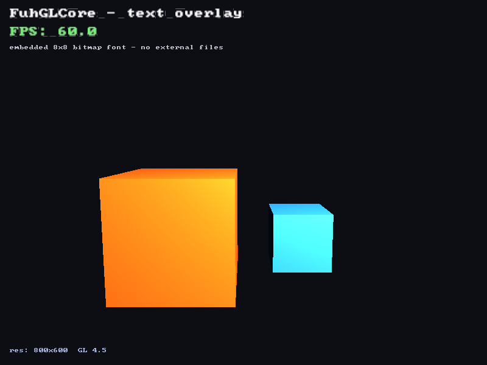

# 24 — Text & FPS-Overlay (Bitmap-Font-HUD)

> 🇬🇧 **English version:** [docs/en/tutorials/24-text-and-fps-overlay.md](../../en/tutorials/24-text-and-fps-overlay.md)

**Ziel:** Text über ein gerendertes Frame zeichnen — HUD-Labels, FPS-Anzeige, Debug-Infos —
ohne externe Font-Datei und ohne Abhängigkeit.



`render::TextRenderer` bettet eine Public-Domain-8x8-Bitmap-Schrift (font8x8, IBM-VGA-basiert)
als 128x64-`GL_R8`-Atlas ein und batcht alle Glyphen eines Frames in **einen Draw-Call**.

```cpp
fuhgl::render::TextRenderer text;
text.create();                    // einmal, sobald der GL-Kontext existiert

// pro Frame, nach dem Rendern der 3D-Szene ins aktuelle Framebuffer:
text.begin(width, height);        // Ortho-Projektion (Pixel, y nach unten), Blending an
text.draw("FuhGLCore", 16.f, 14.f, 2.f, {1.f, 1.f, 1.f, 1.f});   // Scale 2 = 16-Pixel-Glyphen
char line[64];
std::snprintf(line, sizeof(line), "FPS: %.1f", fps.fps());
text.draw(line, 16.f, 44.f, 2.f, {0.45f, 0.95f, 0.45f, 1.f});     // grün
text.end();                       // ein Draw-Call, stellt den State wieder her
```

- Koordinaten sind Pixel, `(0,0)` = oben links, y wächst nach unten.
- `TextRenderer::measure(text, scale)` liefert die Pixel-Größe; `lineHeight(scale)` = 8·scale.
- `render::FpsCounter` ist ein kleiner Werttyp: `frame(window.time())` einmal pro Frame
  aufrufen, `fps()` auslesen (EMA-geglättet).

Die Font-Daten selbst sind reine Daten und ohne GL unit-testbar:
`render::font8x8Glyph('A')` liefert die 8 Zeilen-Bitmasken einer Glyphe
(`render::kFontGlyphCount` = 128, `render::kFontGlyphSize` = 8).

## Beispiel

`examples/text` rendert zwei beleuchtete Boxen und ein HUD (Titel, Live-FPS, Auflösung + GL-Version).
Headless-Screenshot (CI-Docs-Job):

```
FUHGL_BACKEND=surfaceless ./build-egl/examples/text --screenshot docs/images/tutorial-text.png
```

`examples/gpuinfo` nutzt denselben Renderer, um die Capability-Balken zu beschriften —
dadurch wird der [Tutorial 14](14-device-info-and-capabilities.md)-Screenshot lesbar.

Tests: `tests/test_text.cpp` (Font-Sanity, `measure`, `FpsCounter`) und
`tests/gl_smoke_text.cpp` (rendert Text headless in ein FBO und verifiziert per Readback,
dass Glyph-Pixel geschrieben wurden; überspringt ohne GL ≥ 3.3).
