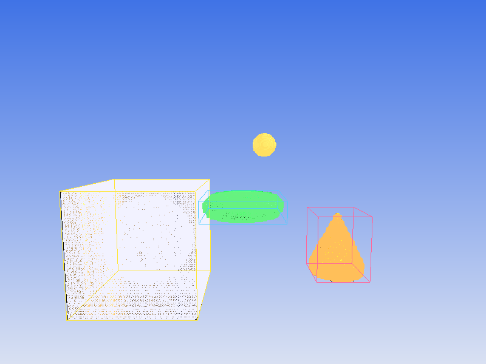

# 25 — Wireframe: Körper & Bounding Boxes als Liniengitter

> 🇬🇧 **English version:** [docs/en/tutorials/25-wireframe-solids-and-bounding-boxes.md](../../en/tutorials/25-wireframe-solids-and-bounding-boxes.md)

**Ziel:** Solids und ihre Bounding Volumes als Wireframe visualisieren — für Debugging,
Bounding-Volume-Vorschau und CSG-Inspektion.



`render::Wireframe` reiht Liniensegmente auf der CPU ein (keine GL-Aufrufe während des
Queueing) und zeichnet alles in **einem `glDrawArrays(GL_LINES)`** pro Frame:

```cpp
fuhgl::render::Wireframe wire;
wire.create();                       // einmal, sobald der GL-Kontext existiert

// pro Frame:
wire.clear();
wire.addSolid(*part, 24, model, {0.95f, 0.95f, 1.f});   // Marching-Tetrahedra-Mesh-Kanten
wire.addBoundingBox(*part, model, {1.f, 0.9f, 0.2f});   // AABB-Kanten (12 Linien)
wire.addBox({-1,-1,-1}, {1,1,1}, {1.f, 1.f, 1.f});      // explizite AABB
wire.addMesh(meshData, model, {0.f, 1.f, 0.f});        // Dreieckskanten beliebiger MeshData
wire.addLine({0,0,0}, {1,1,0}, {1.f, 0.f, 0.f});        // einzelnes Segment
wire.render(camera, width, height); // depth-getestet, ins aktuelle Framebuffer
```

- Dreieckskanten werden pro Mesh dedupliziert (`wireframeEdges(meshData)` ist ein reiner,
  unit-testbarer Helfer; Box-Ecken/-Kanten über `boxCorners()` / `kBoxEdgeIndices`).
- `addBoundingBox(solid, model, color)` nutzt die exakten `aabbMin()/aabbMax()` des Körpers
  (funktioniert auch für CSG-Körper — siehe Tutorial 18).

## Beispiel

`examples/solids --wireframe` rendert die Demo-Szene gefüllt (Deferred-Pipeline) plus ein
Wireframe-Overlay: jeder Körper in heller Farbe, seine AABB in einer Akzentfarbe.

```
FUHGL_BACKEND=surfaceless ./build-egl/examples/solids --screenshot docs/images/tutorial-wireframe.png --wireframe
```

Tests: `tests/test_wireframe.cpp` (Ecken-/Kanten-Tabellen, Edge-Dedupe-Anzahlen, CPU-Queueing
ohne GL) und `tests/gl_smoke_wireframe.cpp` (headless FBO-Render einer weißen AABB + grünen
Mesh-Wireframe, per Readback verifiziert; überspringt ohne GL ≥ 3.3).
