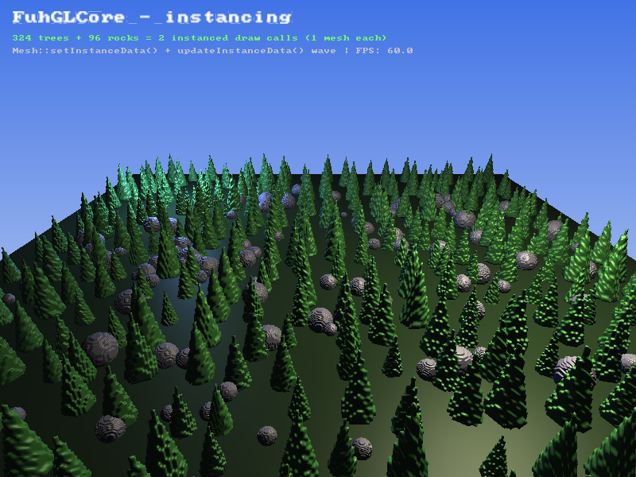

# 28 — Instancing: hunderte Körper, ein Draw-Call pro Mesh

> 🇬🇧 **English version:** [docs/en/tutorials/28-instancing.md](../../en/tutorials/28-instancing.md)

**Ziel:** viele Kopien derselben Geometrie mit einem einzigen Draw-Call rendern —
Bäume, Felsen, Partikel, eine Menschenmenge — indem man pro Instanz eine Modellmatrix
einmal hochlädt und die GPU sie pro Instanz holt.



## Wie es funktioniert

`render::Mesh` hat einen optionalen **Instanz-Puffer**: ein Divisor-1-`mat4`-Vertex-Attribut
an den Locations 4..7 (eine `vec4`-Spalte pro Attribut, 64 Byte Stride, spalten-major
`math::Mat4`):

```cpp
fuhgl::render::Mesh treeMesh = tree->buildMesh(24, {1,1,1});   // einmal bauen

std::vector<fuhgl::math::Mat4> models = {
    fuhgl::math::translate({-2.f, 0.f, 0.f}) * fuhgl::math::scale({1,1,1}),
    fuhgl::math::translate({ 2.f, 0.f, 1.f}) * fuhgl::math::scale({1.3f,1.3f,1.3f}),
    // ...
};
treeMesh.setInstanceData(models.data(), (int)models.size());   // einmal hochladen
// pro Frame, wenn sich die Instanzen bewegen:
treeMesh.updateInstanceData(models.data(), (int)models.size()); // glBufferSubData
// und zurück zum einzelnen Draw:
treeMesh.clearInstanceData();
```

`Mesh::draw()` stößt automatisch `glDrawElementsInstanced` / `glDrawArraysInstanced` aus,
wenn `instanceCount() > 0` — **die Render-Loops ändern sich überhaupt nicht**:

```cpp
scene.items.push_back({&treeMesh, &treeMat, fuhgl::math::Mat4{}});  // 324 Instanzen, 1 Draw
pipeline.render(scene);
```

Die eingebauten Pipeline-Shader (Forward, Deferred-G-Buffer, Shadow-Depth-Pass) deklarieren
`layout(location = 4) in mat4 aInstanceModel;` und kombinieren, wenn das neue
`uInstanced`-Uniform 1 ist (wird automatisch aus `item.mesh->instanceCount()` gesetzt):

```glsl
mat4 model = (uInstanced == 1) ? (uModel * aInstanceModel) : uModel;
```

Die `model`-Matrix des Items wirkt also als Gruppen-Transform und jede Instanzmatrix platziert
eine Kopie — instanzierte Meshes werfen auch korrekt Schatten (der Depth-Pass ist ebenfalls
instanziert). Hat ein Mesh keinen Instanz-Puffer, ist Attribut 4 deaktiviert und der Shader liest
den generischen Default — aber `uInstanced == 0` wählt `uModel`, daher bleiben normale Draws
unbeeinträchtigt (keine zusätzlichen Programm-Varianten nötig).

## Beispiel

`examples/instancing` rendert ein 18x18-Raster aus Kegeln (324 Bäume) plus 96 verstreute
Kugeln (Felsen) — **2 Draw-Calls für 420 Körper** — durch den Deferred-Renderer, mit einer
Wellen-Animation, die jeden Frame per `updateInstanceData()` neu hochgeladen wird, und einem
TextRenderer-HUD:

```
FUHGL_BACKEND=surfaceless ./build-egl/examples/instancing --screenshot docs/images/tutorial-instancing.png
```

Tests: `tests/gl_smoke_instancing.cpp` (headless: ein Box-Mesh mit 3 Instanzmatrizen beleuchtet
drei Probe-Pixel; `updateInstanceData()` bewegt sie — der Mittel-Probe geht ins Sky;
`clearInstanceData()` stellt den einzelnen Draw wieder her; GL-Fehler geprüft;
überspringt ohne GL ≥ 3.3).
