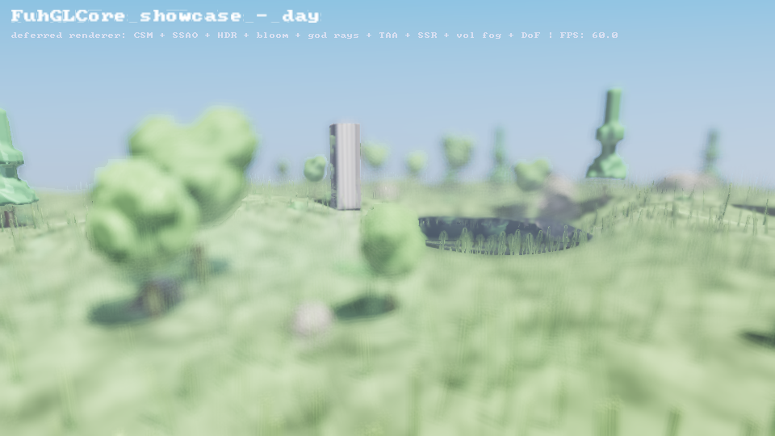
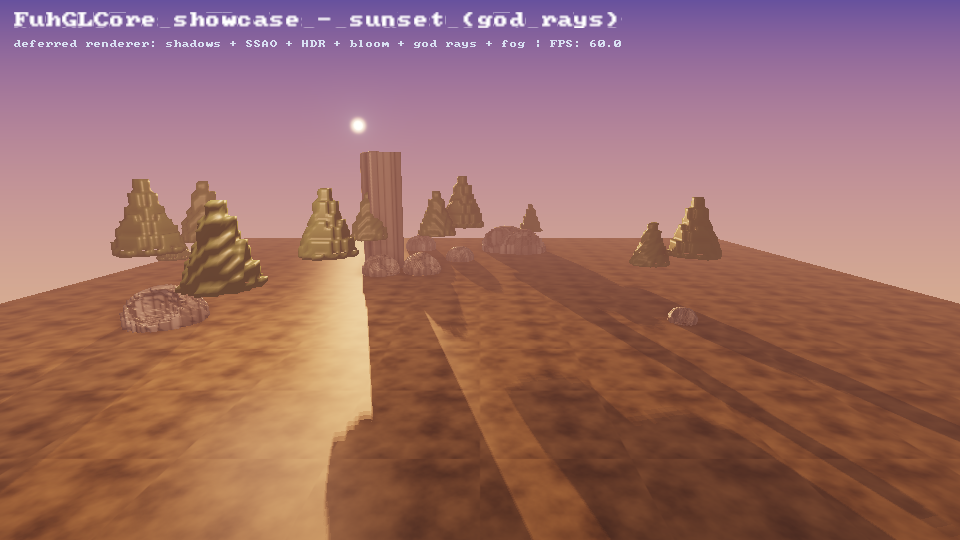

# 29 — Showcase-Szene (die README-Bilder)

> 🇬🇧 **English version:** [docs/en/tutorials/29-showcase-scene.md](../../en/tutorials/29-showcase-scene.md)

**Ziel:** eine kleine, gut aussehende Landschaft, gerendert mit dem Default-`DeferredRenderer`
und seinem kompletten Effekt-Stack — wird für die beiden Hero-Bilder oben in der README
verwendet.




Die Szene (`examples/showcase`) kombiniert mehrere Features aus früheren Tutorials:

- **CSG-Körper** (Tutorial 18): Felsen (`makeSphere - makeSphere`), Bäume
  (`makeCylinder | makeCone`), ein Monolith (`makeCube - makeSphere`), alle einmal gemesht
  und per Modellmatrizen platziert — Fels/Stein/Boden bekommen **prozedurale Texturen**
  (Voronoi / Noise über `materials::textured`, Tutorials 17 + 18).
- **DeferredRenderer** (Tutorial 23) mit `enableShadows(2048)` (Tutorial 21),
  SSAO, HDR-Beleuchtung mit sichtbarer Sonnenscheibe, Bloom, crepuscular **God Rays**
  (`rayWeight`), Distanznebel und einem Verlaufs-Sky (`pipeline().skyTop/skyBottom`).
- **Text-Overlay** (Tutorial 24) für die HUD-Zeile.

Zwei Looks werden in der CI gerendert:

```
FUHGL_BACKEND=surfaceless ./build-egl/examples/showcase --screenshot docs/images/readme-showcase-day.png    --mode day    --width 960 --height 540
FUHGL_BACKEND=surfaceless ./build-egl/examples/showcase --screenshot docs/images/readme-showcase-sunset.png --mode sunset --width 960 --height 540
```

`--mode sunset` senkt die direktionale Sonne in den Kamera-Frustum (Richtung
`{0.25, -0.10, 1.0}` → die Sonnenscheibe steht tief vorn) mit warmen Farben — das erzeugt die
langen Schatten und den starken God-Ray-Burst im zweiten Bild. Der `DeferredRenderer` leitet
`scene.sunDirection`/`sunColor` automatisch aus der ersten direktionalen Lichtquelle ab.

Windowed: `./build/examples/showcase` (WASD + Maus, Esc beendet).
