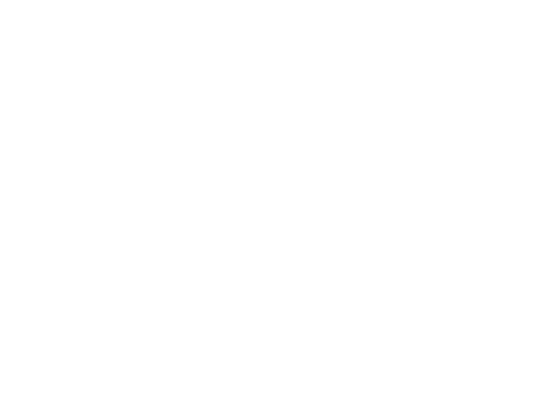

# 30 — Quaternionen und geseedetes Noise in `fuhgl::math`

> 🇬🇧 **English version:** [docs/en/tutorials/30-math-quaternions-noise.md](../../en/tutorials/30-math-quaternions-noise.md)

**Ziel:** Dinge ohne Euler-Winkel-Gimbal-Lock rotieren und deterministische prozedurale
Werte erzeugen (Terrain-Höhen, Platzierungs-Jitter, Textur-Seeds) — alles header-only
Value-Types, kein GL-Kontext nötig.



## Quaternionen (`math::Quat`)

```cpp
#include <fuhgl/math.hpp>
using namespace fuhgl::math;

Quat q = fromAxisAngle(radians(90.f), {0.f, 1.f, 0.f}); // 90° um Y
Vec3 v = q * Vec3{1.f, 0.f, 0.f};                      // Vektor rotieren -> (0, 0, -1)

Mat4 m = toMat4(q);                    // gleiche Rotation wie rotate(radians(90.f), {0,1,0})
Quat e = fromEuler(yaw, pitch, roll);  // Yaw um Y, dann Pitch um X, dann Roll um Z
Quat l = lookRotation({0.f, 0.f, -1.f}, {0.f, 1.f, 0.f}); // Identität (Default-Forward)

Quat halb = slerp(qA, qB, 0.5f);       // sphärische Interpolation (nlerp = günstige Näherung)
Quat back = inverse(q);                // Umkehrung: back * (q * v) == v
```

`q * v` ist die Rotation `q * v * q^-1` (Hamilton-Konvention, rechtshändig) und
**identisch** zu `rotate(Winkel, Achse) * v` — die Unit-Tests prüfen
`toMat4(fromAxisAngle(a, achse)) == rotate(a, achse)` elementweise. `q` und `-q` sind
dieselbe Rotation (Doppelüberdeckung). Außerdem: `fromMat3`, `toAxisAngle`, `angle(a, b)`,
`dot/length/normalize/conjugate`.

## Geseedetes Noise (`math::Noise`)

```cpp
Noise noise(42);                       // Permutationstabelle aus dem Seed — deterministisch
float h  = noise.perlin2(x, y);        // Improved Perlin 2D, ca. [-1, 1]
float h3 = noise.perlin3(x, y, z);     // 3D-Variante
float f  = noise.fbm2(x, y, 5);        // fraktales Brownian Motion, amplituden-normalisiert
float f3 = noise.fbm3(x, y, z, 4, 2.f, 0.5f); // Oktaven, Lacunarity, Gain

// One-Shot-Helfer (erzeugen intern ein Noise):
float v = perlin2(x, y, /*seed=*/42);
```

Gleicher Seed → gleiche Werte auf jeder Plattform; ganzzahlige Gitterpunkte ergeben exakt 0.
Typische 2D-Statistik: Mittelwert ≈ 0, Standardabweichung ≈ 0.25, beobachteter Bereich ≈ ±0.8
(harte Schranke 2).

## Ergebnis

```
$ ./noise_demo
q * (1,0,0)      = (0.000000, 0.000000, -1.000000)   // 90° um Y
toMat4(q) == rotate(90°, Y) elementweise: true
perlin2(1.25, -3.5) seed 42 = -0.31207   (bei jedem Lauf gleich)
fbm2(3.3, 7.7, 4)  seed 42 =  0.18442
```

(Die exakten Zahlen sind deterministisch — die Unit-Tests in `tests/test_noise.cpp`
prüfen Determinismus, Gitterpunkt-Nullen, Wertebereich, Mittelwert und Streuung.)

## Hinweise

- Beide Typen sind einfache Value-Types (kein PIMPL, keine GL-Handles) wie der Rest von
  `fuhgl::math`; `constexpr`, wo C++17 es erlaubt.
- `math::Noise` ist unabhängig von den Textur-Generatoren in `render::procedural` —
  für CPU-seitige Heightmaps, Scatter-Positionen, Animations-Jitter usw.
- Tests: `tests/test_quat.cpp`, `tests/test_noise.cpp` (Label `unit`, headless).
