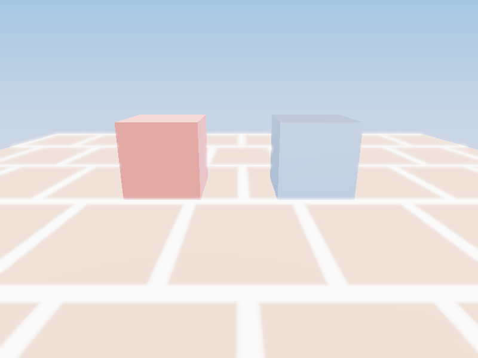

# 32 — IBL: Image-Based Lighting aus einer beliebigen Cubemap

> 🇬🇧 **English version:** [docs/en/tutorials/32-ibl-environment.md](../../en/tutorials/32-ibl-environment.md)

**Ziel:** Umgebungslicht, das aus der Environment (Skybox) kommt statt aus einer flachen
Farbe — `render::Environment` backt aus einer beliebigen Cubemap eine
Irradiance-Cubemap, eine GGX-vorgefilterte Env-Cubemap und eine BRDF-LUT, komplett auf
der CPU (deterministisch, funktioniert auf der GL-3.3-Baseline — keine Compute-Shader nötig).



## Nutzung

```cpp
fuhgl::Skybox sky;                       // oder beliebige Cubemap-Texture
sky.create();
sky.makeGradient({0.25f, 0.45f, 0.9f}, {0.85f, 0.88f, 0.95f}); // siehe Tutorial 06

fuhgl::render::Environment env;
env.createFromCubemap(sky.texture());   // Bake + Upload (Irr 32, Prefilter 128, LUT 256)
env.intensity = 1.2f;                    // uEnvIntensity-Multiplikator

// Deferred:
fuhgl::render::SceneView scene;
scene.env = &env;                        // Pipelines binden Units 7/8/9 selbst
deferredRenderer.render(scene);

// Forward:
fuhgl::render::ForwardRenderer fr;
fr.setEnvironment(&env);
```

## Was gebakt wird (`bakeEnvironment`, reiner CPU-Code — unit-testbar)

- **Irradiance-Cubemap** (RGB16F, 32 px): cosinus-gewichtetes Hemisphären-Mittel der
  Quelle um die jeweilige Texel-Normale.
- **Vorgefilterte Env-Cubemap** (RGB16F, 128 px, volle Mip-Kette): GGX-Importance-Sampling
  (`hammersley` + `importanceSampleGGX`); Mip-Level m = Roughness m/(levels-1). Gesampelt
  mit `textureLod(prefilter, reflect(-V, N), roughness * prefilterMaxLod)`.
- **BRDF-LUT** (RG16F, 256×256): Scale/Bias für den Fresnel-Term (Epic-artige Integration
  der GGX-VNDF).

Der Ambient-Term im Lighting-Shader wird zu
`(kD * irradiance * albedo + prefiltered * (F * brdf.r + brdf.g)) * ao * envIntensity`.
Ohne `SceneView::env` fallen die Pipelines auf das flache `albedo * uAmbient` zurück.

## Ergebnis

Schatten-/unbeleuchtete Seiten von Objekten nehmen die Himmelsfarbe an (blau von oben,
warm vom Boden) statt flaches Grau; Metalle zeigen unscharfe Reflexionen der Umgebung,
die mit `roughness` rauer werden. `gl_smoke_pbr` prüft, dass eine graue Env-Cubemap den
Ambient-Term um den erwarteten Betrag anhebt; `test_environment.cpp` prüft die
Bake-Mathematik an einer konstanten Cubemap (Irradiance/Prefilter ≈ konstant, LUT in
[0,1] mit Scale+Bias ≤ 1, bitgenaue Deterministik).

## Hinweise

- Der Bake ist einmalig und CPU-seitig (~0.5 s bei Default-Größen); einmal beim Start aufrufen.
- `readCubemap()` liest beliebige 8-Bit- oder Float-Cubemaps als RGBA-float zurück.
- Tests: `test_environment.cpp` (Label `unit`), `gl_smoke_pbr.cpp` (`gl_context`).
