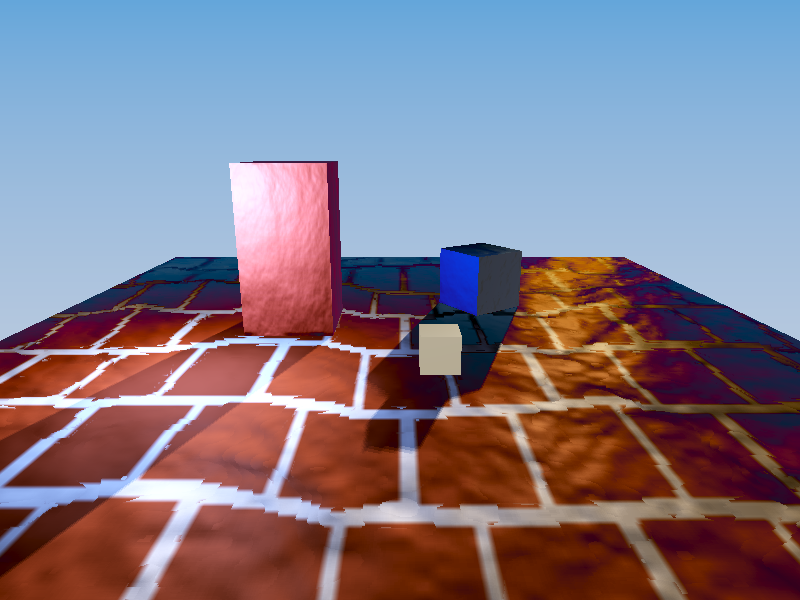

# 34 — Render Graph: deklarative Pässe, auto-sortiert

> 🇬🇧 **English version:** [docs/en/tutorials/34-render-graph.md](../../en/tutorials/34-render-graph.md)

**Ziel:** fest verdrahtete Pass-Folgen durch einen kleinen deklarativen Graph ersetzen —
benannte Textur-Ressourcen und Pässe (Inputs/Outputs + Callback) deklarieren; `compile()`
sortiert sie und legt pro Pass ein FBO an; `execute()` führt sie aus. Die Post-Kette des
`DeferredRenderer` (SSAO → Lighting → SSR → TAA → Bloom → God Rays → Composite) läuft
daraus.



## Nutzung

```cpp
fuhgl::render::RenderGraph g;
g.addResource("hdr", w, h, fuhgl::gl::GL_RGBA16F);          // owned
g.addExternal("gPosition", &pipeline.texPosition(), w, h); // geborgt (G-Buffer)

g.addPass("lighting", {"gPosition", "gNormal"}, {"hdr"},
          [](fuhgl::render::RenderGraph::PassContext& ctx) {
              ctx.bindInput(0, "gPosition");
              /* Material binden, Uniforms setzen, Fullscreen-Dreieck in ctx.framebuffer() zeichnen */
          });
g.addPass("taa", {"hdr", "taa"}, {"taa"},                   // feedback = voriges Frame lesen
          [](fuhgl::render::RenderGraph::PassContext& ctx) { /* ... */ },
          /*feedback=*/true);

if (!g.compile()) { /* Zyklus oder unbekannte Ressource */ }
g.execute();          // jedes Frame
g.setPassEnabled("taa", false);  // Runtime-Toggle
g.resize(newW, newH);
```

## Semantik

- Kante A → B existiert, wenn B eine Ressource liest, die A schreibt. Eine Ressource darf
  mehrere Writer haben (Ping-Pong): ein Leser hängt am **zuletzt deklarierten Writer vor
  ihm**.
- Forward-Referenzen (Ressource wird erst später geschrieben) erzeugen ebenfalls Kanten —
  echte Zyklen lassen `compile()` `false` zurückgeben.
- `feedback = true` erlaubt einem Pass, seine eigene Ausgabe (vorheriges Frame) zu lesen —
  wird von TAA genutzt.
- Pässe mit leerer Output-Liste bekommen kein FBO; ihr Callback bindet selbst ein Ziel
  (der Composite-Pass rendert so in `pipeline.output()`).
- Der pure Resolver `render::resolvePassOrder()` ist header-only und ohne GL unit-getestet.

## Ergebnis

`gl_smoke_graph` baut einen Zwei-Pass-Graph (rot füllen → nach `b` skalieren), führt ihn
aus und prüft die Readback-Pixel (R ≈ B ≈ 127, G = 0); ein zyklischer Graph wird von
`compile()` abgelehnt. `DeferredRenderer::postGraph()` exponiert die laufende Post-Kette
zur Inspektion und zum Toggeln einzelner Pässe.

## Hinweise

- Tests: `tests/test_graph.cpp` (Unit: Kette/Diamant/Zyklus/Feedback/Ping-Pong),
  `tests/gl_smoke_graph.cpp` (Label `gl_context`).
