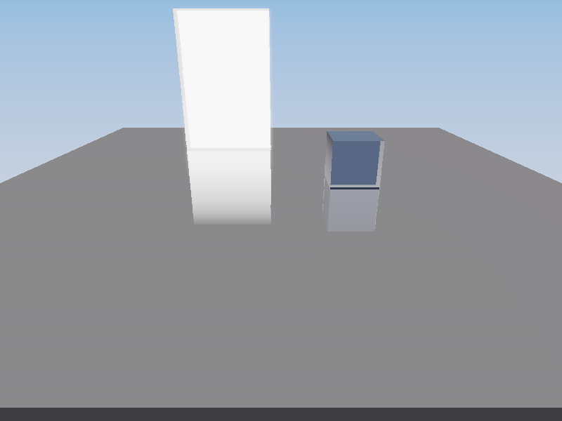

# 36 — Screen-Space Reflections (SSR)

> 🇬🇧 **English version:** [docs/en/tutorials/36-ssr.md](../../en/tutorials/36-ssr.md)

**Ziel:** glänzende Oberflächen spiegeln, was auf dem Bildschirm ist — ein Render-Graph-Pass,
der den Reflexionsstrahl marched und das HDR-Bild am Trefferpunkt sampelt.



## Nutzung

```cpp
fuhgl::render::DeferredRenderer renderer;
renderer.create(1280, 720);
renderer.ssrEnabled = true;
renderer.ssrStrength = 0.6f;    // Reflexionsintensität
renderer.ssrMaxSteps = 32;      // Raymarch-Schritte
renderer.ssrThickness = 0.3f;   // Treffer-Band um die Depth-Fläche
```

## Wie es funktioniert (F33)

Der `ssr`-Pass im Post-Graph läuft direkt nach dem Lighting-Pass. Pro Pixel mit Geometrie
(G-Buffer-Positions-Alpha):

1. `R = reflect(-V, N)` aus Welt-Position und Normal des G-Buffers,
2. Marsch `worldPos + R * step` (step ≈ 2 % der Sichtdistanz) bis `ssrMaxSteps`, jedes Sample
   mit der (gejitterten) View-Projektion projiziert,
3. Vergleich mit der G-Buffer-Position am projizierten UV — Treffer, wenn der Strahl hinter
   der gespeicherten Oberfläche liegt, aber innerhalb von `ssrThickness`,
4. beim Treffer: `reflection = hdr(hitUV) * (1 - i/steps)`; Ausgabe `hdr + reflection * ssrStrength`.

Sky-Pixel und Strahlen, die den Bildschirm verlassen, behalten die Grundfarbe. Ist
`ssrEnabled` aus, kopiert der Pass das HDR-Bild unverändert durch.

## Ergebnis

`gl_smoke_ssr` platziert eine helle emissive Box auf einem dunklen Boden und prüft per
Readback, dass der Bodenbereich (untere Bildhälfte) mit SSR deutlich heller ist — die
Spiegelung der Lampe.

## Hinweise

- Nur Screen-Space: Spiegelungen von Off-Screen-Geometrie sind nicht möglich (Fallback
  über IBL — die `Environment` aus Tutorial 32 könnte später dienen).
- Test: `tests/gl_smoke_ssr.cpp` (Label `gl_context`, skip ohne GL 3.3).
