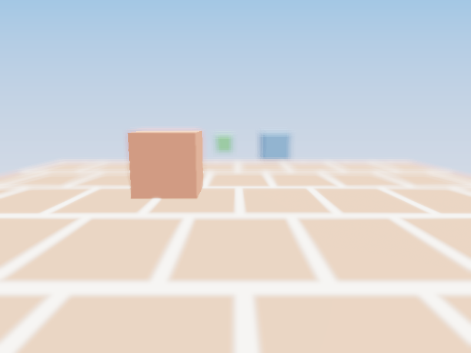

# 39 — Depth of Field (Bokeh-DoF)

> 🇬🇧 **English version:** [docs/en/tutorials/39-dof.md](../../en/tutorials/39-dof.md)

**Ziel:** eine Schärfeebene mit weichem Circle-of-Confusion-Verlauf — scharfes Subjekt,
weicher Vorder-/Hintergrund — als Post-Pass auf dem HDR-Bild, ohne den G-Buffer anzufassen.



## Verwendung

```cpp
fuhgl::render::DeferredRenderer renderer;
renderer.create(1280, 720);
renderer.dofEnabled = true;
renderer.dofFocusDist = 6.0f;   // Welt-Distanz der Schärfeebene
renderer.dofFocusRange = 2.5f;  // Distanz, über die der CoC bis dofStrength wächst
renderer.dofStrength = 18.f;    // max. Circle of Confusion in Pixeln
renderer.dofTaps = 24;          // Gather-Taps (Golden-Winkel-Spirale)
```

## Wie es funktioniert (F36)

Ein neuer `dof`-Pass im Post-Graph läuft nach dem TAA (die gejitterte, akkumulierte
HDR-Szene ist die Quelle) und vor dem Composite:

1. CoC pro Pixel aus der G-Buffer-Position: `dist = |worldPos − camPos|` (Himmel → weit →
   max. Blur), `coc = |clamp((dist − focusDist) / focusRange, −1, 1)|` — der reine Helfer
   `math::cocRadius()` (unit-getestet), symmetrisch vor/hinter der Schärfeebene.
2. Bokeh-Gather: `dofTaps` Samples auf einer Golden-Winkel-Spirale, Offset skaliert mit
   dem **eigenen** CoC des Pixels (in UV = `dofStrength / Auflösung`), jedes Tap gewichtet
   mit `max(tapCoC, ownCoC)` — scharfe Pixel sampeln nur ihr Zentrum und bleiben scharf.
3. Ausgabe = gewichtetes Mittel in eine neue HDR-Ressource `dof`; der Composite-Pass liest
   `dof` statt `taa`. Mit `dofEnabled = false` kopiert der Pass nur `taa` → `dof`.

Bloom und God Rays laufen weiter auf dem Pre-DoF-`taa`-Bild (helle Quellen bleiben hell).

## Ergebnis

`gl_smoke_dof` platziert eine nahe Box auf der Schärfeebene und eine ferne Box jenseits des
Fokusbereichs, projiziert beine auf den Bildschirm und vergleicht die Gradientenenergie
(Kantenschärfe) in HDR: Die Kanten der fernen Box fallen mit DoF um >30 %, die nahe Box
bleibt scharf.

## Hinweise

- Läuft absichtlich nach dem TAA: Subpixel-Jitter + Akkumulation glättet die Bokeh-Scheiben.
- Kosten: `dofTaps` Textur-Fetches pro Pixel auf dem HDR-Bild; `dofTaps = 0` schaltet den
  Gather aus (nur Copy).
- Tests: `test_dof.cpp` (Unit: `cocRadius`), `gl_smoke_dof.cpp` (Label `gl_context`,
  skippt ohne GL 3.3). Screenshot: `examples/features --scene dof`.
