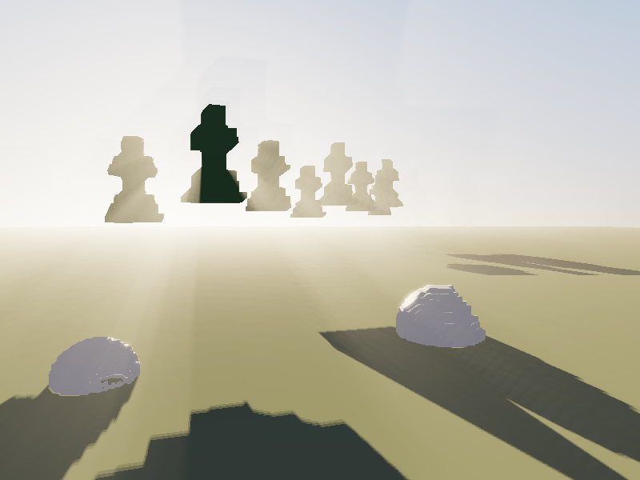

# 40 — Volumetrischer Nebel / Lichtschächte

> 🇬🇧 **English version:** [docs/en/tutorials/40-volfog.md](../../en/tutorials/40-volfog.md)

**Ziel:** echter volumetrischer Nebel — Luftperspektive, Bodenmist und sichtbare
Lichtschächte durch Verdecker — pro Pixel auf dem HDR-Bild geraymarcht, vor dem Tone Mapping
komponiert.



## Verwendung

```cpp
fuhgl::render::DeferredRenderer renderer;
renderer.create(1280, 720);
renderer.volFogEnabled = true;
renderer.volFogDensity = 0.03f;              // Extinktionskoeffizient (1 / Welteinheit)
renderer.volFogColor = {0.82f, 0.84f, 0.90f}; // Streu-Albedo-Tönung
renderer.volFogAnisotropy = 0.55f;           // Henyey-Greenstein-g: Vorwärtsstreuung
renderer.volFogHeight = 0.4f;                // > 0: exponentieller Höhennebel ab hier
renderer.volFogFalloff = 0.30f;              // exp(-(y - height) * falloff)
renderer.volFogShadows = true;               // In-Scattering per Shadow-Map / CSM dämpfen
renderer.volFogSteps = 32;                   // Raymarch-Schritte pro Pixel (max 64)
renderer.volFogMaxDist = 90.f;               // Kappung der gemarchten Strahllänge
```

## So funktioniert es (F37)

Ein neuer `volfog`-Pass in der Post-Graph läuft nach dem DoF (Ressource `volfog`, RGBA16F)
und vor dem Composite:

1. Pro Pixel wird der Welt-Raum-Blickstrahl aus der inversen View-Projektion rekonstruiert.
   Geometrie-Pixel (G-Buffer-Position alpha > 0.5) marchen nur bis zur Oberfläche; Himmel
   bis zur Far-Ebene. Die Strahllänge ist auf `volFogMaxDist` begrenzt.
2. `volFogSteps` Samples entlang des Strahls akkumulieren Single-Scattering:
   `inscatter += sunColor * phase * fogColor * sigma * shadow * T * step`,
   `T *= exp(-sigma * step)` — mit `sigma = volFogDensity`, optional multipliziert mit dem
   Höhennebel `exp(-max(y - volFogHeight, 0) * volFogFalloff)`.
3. Die Phasenfunktion ist Henyey-Greenstein, `math::henyeyGreenstein(cosTheta, g)`
   (func.hpp, unit-getestet: über die Kugel normalisiert, isotrop bei g = 0, vorwärts
   gepeakt für g > 0) — sie formt die Schächte um die Sonne.
4. Mit `volFogShadows = true` wird der Sonnenanteil jedes Samples mit dem Schattenfaktor
   der aktiven Shadow-Map multipliziert — der Single-Map (F15) oder dem CSM-Depth-Array
   (F30), unter Wiederverwendung von `kShadowUniforms` + `kShadowFunc` aus
   `lighting_glsl.hpp` (Textureinheiten 4/10, 1x1-Dummies halten die Sampler komplett, wenn
   Schatten aus sind). Verdeckter Nebel bleibt dunkel → Lichtschächte.
5. Ausgabe: `src * T + inscatter` nach `volfog`; der Composite liest `volfog` statt `dof`.
   Mit `volFogEnabled = false` kopiert der Pass nur `dof` → `volfog`.

Bloom und God Rays laufen weiter auf dem Pre-Fog-`taa`-Bild.

## Ergebnis

`gl_smoke_volfog` rendert einen Boden mit einer hohen Verdecker-Platte: Mit Nebel an ändert
sich ein fernes Bodenfenster messbar (Extinktion + In-Scattering), während ein nahes Fenster
fast identisch bleibt; mit `volFogShadows` + CSM ist der Boden im Schatten der Platte
deutlich dunkler (das eingestreute Sonnenlicht ist blockiert).

## Hinweise

- Kosten: `volFogSteps` Iterationen pro Pixel, je mit bis zu einem 3x3-PCF-Shadow-Lookup —
  auf schwachen GPUs `volFogSteps` ≤ 32 halten.
- Die Nebelfarbe kombiniert sich mit dem analytischen Distanznebel (F16,
  `SceneView::fogDensity`) — nutze einen davon für den fernen Dunst oder beide für
  geschichtete Tiefe.
- Tests: `test_volfog.cpp` (Unit: `henyeyGreenstein`), `gl_smoke_volfog.cpp` (Label
  `gl_context`, skippt ohne GL 3.3). Screenshot: `examples/features --scene volfog`.
