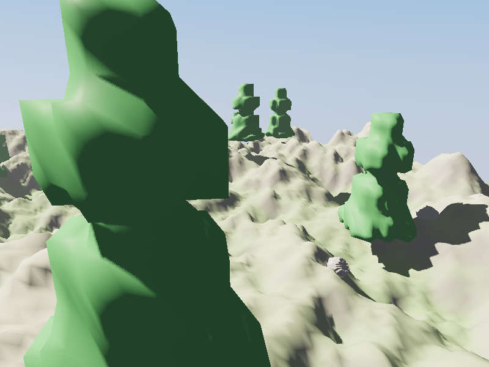

# 41 — Heightmap-Terrain (Landschaft aus einer Heightmap)

> 🇬🇧 **English version:** [docs/en/tutorials/41-heightmap-terrain.md](../../en/tutorials/41-heightmap-terrain.md)

**Ziel:** Aus einer Heightmap — einem Float-Grid oder einem Graustufenbild — ein
Landschafts-Mesh erzeugen: korrekte Normalen, gefällebasierte Färbung und eine
`heightAt()`-Abfrage zum Platzieren von Objekten.



## Verwendung

```cpp
// 1) Heightmap-Quelle: geseedetes prozedurales fBm-Bild (Graustufen, Rotkanal = Höhe in [0,1])
fuhgl::render::procedural::Image img =
    fuhgl::render::procedural::heightmap(192, 192, /*seed=*/11u, /*octaves=*/6, /*scale=*/0.045f);

// ... oder eigenes Float-Grid / geladenes Graustufenbild
fuhgl::render::HeightmapTerrain terrain;
terrain.create(img, /*sizeX=*/36.f, /*sizeZ=*/36.f, /*heightScale=*/7.f);
// terrain.create(heights, w, h, sizeX, sizeZ, heightScale);   // Float-Grid-Variante

// 2) wie jedes andere Mesh zeichnen
scene.items.push_back({&terrain.mesh(), &material, fuhgl::math::Mat4{}});

// 3) Objekte auf dem Terrain platzieren (bilinear, Welt-Höhe)
float y = terrain.heightAt(x, z);
scene.items.push_back({&treeMesh, &treeMat, fuhgl::math::translate({x, y, z})});
```

## So funktioniert es (F38)

`render/terrain.hpp`:

- `heightmapTerrainData(heights, w, h, sizeX, sizeZ, heightScale, ...)` baut die rohen
  `MeshData`: ein regelmäßiges (w × h)-Vertex-Grid um den Ursprung, `y = height * heightScale`,
  Normalen per zentraler Differenz (an Rändern geclampt), UVs = Welt-xz × `uvScale` und
  pro Vertex die Farbe `lowColor → highColor` mit normalisierter Höhe, bei steilem Gefälle
  (`n.y < 0.78`) Richtung `steepColor` (Fels) verschoben. Die Index-Winding ist CCW von +Y
  gesehen und passt zum Backface-Culling der Pipelines.
- `heightmapSample(heights, w, h, u, v)` — bilinear, geclampt — sowie die `Image`-Überladung
  (Rotkanal / 255) sind die Sampling-Primitive.
- `HeightmapTerrain` (PIMPL) besitzt das `Mesh`: `create()` kopiert die Heightmap, baut die
  `MeshData` und lädt sie hoch; `heightAt(x, z)` mappt Welt → normalisierte UV und liefert die
  bilinare Höhe (außerhalb des Terrains geclampt).
- `procedural::heightmap(w, h, seed, octaves, scale)` ist die deterministische, geseedete
  fBm-Heightmap-Quelle der Screenshot-Szene.

## Hinweise

- Für sehr große Terrains mit LOD kombinieren (mehrere Grids in w, w/2, w/4 aufbauen) oder
  Kacheln streamen; das Showcase baut sein Terrain direkt aus `math::fbm2`.
- `create()` braucht einen aktuellen GL-Kontext (lädt das Mesh hoch); die reinen
  Daten-Builder (`heightmapTerrainData`, `heightmapSample`, `procedural::heightmap`) laufen
  CPU-seitig und sind ohne GL unit-getestet.
- Tests: `test_terrain.cpp` (Unit: Sampling, Bild-Determinismus, Mesh-Anzahlen/Normalen/
  Winding/Farben), `gl_smoke_terrain.cpp` (Label `gl_context`). Screenshot:
  `examples/features --scene heightmap`.
