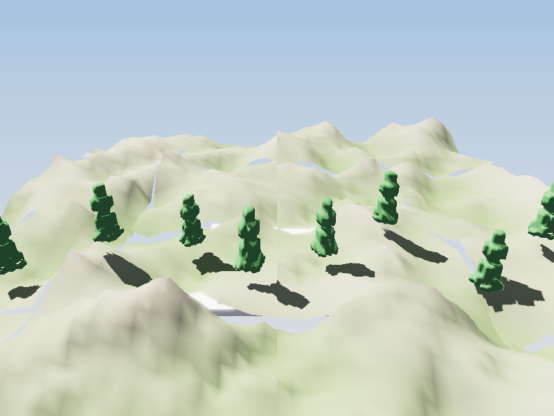

# 43 — Level of Detail (LOD)

> 🇬🇧 **English version:** [docs/en/tutorials/43-lod.md](../../en/tutorials/43-lod.md)

**Ziel:** Jedes Objekt mit dem günstigsten Mesh rendern, das auf seiner Entfernung noch gut
aussieht — pro Item, automatisch in allen Pipelines, und abschaltbar (`lodEnabled = false`).



## Verwendung

```cpp
// 1) Detailstufen bauen (Stufe 0 = höchste Detaillierung) + Schaltdistanzen
fuhgl::render::Mesh hi, mid, lo;
// ... Meshes füllen (z.B. CSG-Solid in hoher/mittlerer/niedriger Auflösung) ...
std::vector<fuhgl::render::Mesh> levels;
levels.push_back(std::move(hi));
levels.push_back(std::move(mid));
levels.push_back(std::move(lo));
fuhgl::render::LodMesh lod;
lod.create(std::move(levels), /*distances=*/{8.f, 16.f});   // >=8 -> mid, >=16 -> lo
// oder bildschirmplatz-Heuristik: lod.setDistances(
//     fuhgl::render::LodMesh::defaultDistances(fovY, boundingRadius, {0.5f, 0.25f}));

// 2) an ein Draw-Item hängen — die Pipelines wählen die Stufe per Kameradistanz
scene.items.push_back({&lod.level(0), &material, model, &lod}); // mesh = Fallback/Bounding

// 3) Schalter (beide Renderer; auch setEffectEnabled(render::Effect::Lod, false))
renderer.lodEnabled = false;          // immer Stufe 0
int stufe = renderer.lastLodLevel();  // Introspektion/Tests

// Heightmap-Terrain mit eingebauten LOD-Stufen (w, w/2, w/4 Grids):
fuhgl::render::LodMesh terrain = fuhgl::render::terrainLods(heights, w, h, sizeX, sizeZ, heightScale, 3);
```

## So funktioniert es (F41)

- `render::LodMesh` (render/lod.hpp) speichert die Stufen-Meshes + aufsteigende
  Schaltdistanzen. `selectLevel(dist)` liefert die Stufe zur Kameradistanz (geclampt);
  `defaultDistances()` leitet Distanzen aus einer Bildschirmdeckungs-Heuristik ab
  (`Anteil ≈ radius / (dist · tan(fovY/2))`).
- `DrawItem::lod` markiert ein Item als LOD-fähig; `resolveLodMesh(item, camPos, lodEnabled,
  &level)` berechnet das Weltzentrum (`model × boundingSphere(Stufe 0)`) und liefert das
  Stufen-Mesh. Alle Draw-Loops nutzen das: der deferred G-Buffer, der Forward-Pass und beide
  Schattenpässe (single + CSM) — LOD-Objekte bekommen also korrekte Schatten auf der
  gewählten Stufe.
- `SceneView::lodEnabled` trägt den `lodEnabled`-Schalter des Renderers in die Pipelines;
  `SceneView::lastLodLevel` zeichnet die letzte Wahl auf (`renderer.lastLodLevel()`).
- Die Stufenwahl ist reine CPU-Logik — `render::Effect::Lod` ist immer unterstützt (F39),
  funktioniert also auf jeder GPU; Abschalten nur `lodEnabled = false` (oder
  `setEffectEnabled(Effect::Lod, false)`).
- `terrainLods()` (terrain.hpp) baut direkt aus einer Heightmap ein Terrain-LodMesh durch
  Subsampling des Grids (w, w/2, w/4, ...). Für große Welten das Terrain in Kacheln
  aufteilen — jede Kachel ist ein `DrawItem` mit eigenem `LodMesh` (so macht es die
  Screenshot-Szene).

## Hinweise

- `distances` aufsteigend und `levels-1` groß halten (`create()`/`setDistances()` prüfen das).
- Die Bounding-Sphere stammt von Stufe 0 — alle Stufen sollten ungefähr gleich groß sein.
- Tests: `test_lod.cpp` (Unit: Validierung, Selektion, Heuristik, resolveLodMesh),
  `gl_smoke_lod.cpp` (Label `gl_context`: nahe Kamera → Stufe 0, fern → Stufe 1,
  `lodEnabled=false` → Basis-Mesh). Screenshot: `examples/features --scene lod`.
