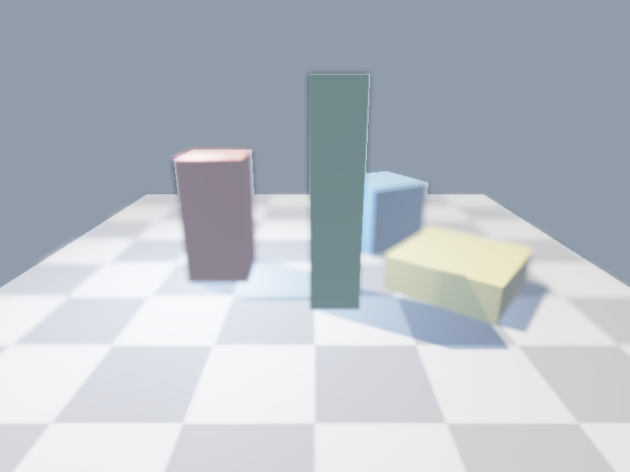

# 44 — Forward-Renderer Post-FX (PostChain)

> 🇬🇧 **English version:** [docs/en/tutorials/44-forward-postfx.md](../../en/tutorials/44-forward-postfx.md)

**Ziel:** Der Forward-Renderer bekommt dieselbe Post-Processing-Pipeline wie der deferred —
Bloom, God Rays, TAA, Depth of Field und volumetrischer Nebel — über eine wiederverwendbare
`render::PostChain`, die über jedem HDR-Bild läuft. Standardmäßig aus, der klassische
Forward-Pfad bleibt unverändert.



## Verwendung

```cpp
fuhgl::render::ForwardRenderer renderer;
renderer.create(1280, 720);            // eigenes LDR-Target + HDR-Zwischentarget
renderer.enablePostFX(true);           // F42: Forward-Pass -> HDR -> PostChain -> LDR-Target

renderer.postChain().bloomStrength = 0.55f;
renderer.postChain().rayWeight = 0.4f;      // God Rays
renderer.postChain().taaEnabled = true;     // F32 temporäres AA (Jitter automatisch)
renderer.postChain().dofEnabled = true;     // F36 DoF aus dem Tiefenpuffer
renderer.postChain().dofFocusDist = 6.5f;
renderer.postChain().volFogEnabled = true;  // F37 volumetrischer Nebel
renderer.postChain().volFogDensity = 0.012f;

// einheitliche Schalter-API (F40) deckt auch die Post-Effekte ab — sie brauchen enablePostFX():
renderer.setEffectEnabled(fuhgl::render::Effect::Bloom, false);
bool an = renderer.effectEnabled(fuhgl::render::Effect::DoF); // false solange Post-FX aus

renderer.render(cam, items, w, h);     // schreibt das LDR-Target()
renderer.blitToScreen();
```

`examples/forward --fx --screenshot out.png` rendert die Demo mit Post-Chain.

## So funktioniert es (F42)

- `render::PostChain` (render/post_chain.hpp) besitzt einen `RenderGraph` mit den Pässen
  `taa → dof → volfog → bright → Bloom-Blur-Pingpong → rays → composite`.
  `execute(scene, hdrTexture, depthTexture, ldrTarget)` bindet pro Frame HDR-Eingang und
  Tiefentextur und führt den Graph aus; das Composite macht ACES-Tonemapping + Gamma ins
  LDR-Target.
- DoF (F36) und volumetrischer Nebel (F37) rekonstruieren Weltpositionen aus der
  **Tiefentextur** über die inverse View-Projektion (Himmel = Far-Ebene) — dafür braucht es
  keinen G-Buffer, deshalb funktionieren sie auch im Forward-Renderer. SSAO und SSR bleiben
  deferred-only: `ForwardRenderer::effectSupported()` liefert dafür false.
- `ForwardRenderer` bekommt ein HDR-Zwischentarget (RGBA16F-Farbe + samplingfähige
  Tiefentextur); mit `enablePostFX(false)` (Default) rendert er wie bisher direkt ins
  LDR-Target. TAA wendet den Halton-Subpixel-Jitter direkt im Forward-Pass an.
- Alle Post-Effekte sind in der PostChain capability-gegated (F39) und über die gemeinsame
  `Effect`-API schaltbar (F40) — nicht unterstützte Effekte werden mit Warnung übersprungen.
- Die generischen Pass-Shader (Vollbild-Dreieck, Blur, Bright-Pass, Rays, TAA, Composite,
  Copy) liegen gemeinsam in `src/render/postfx_glsl.hpp` für beide Chains.

## Hinweise

- Kosten: ein Vollbild-Pass pro aktiviertem Effekt; DoF/Vol-Nebel marchen bis zu `dofTaps` /
  `volFogSteps` Samples pro Pixel.
- Test: `gl_smoke_forward_fx.cpp` (Label `gl_context`): ungemischter Pfad unverändert,
  Post-Pfad rendert beleuchtet ins LDR-Target, SSR/SSAO auf Forward als nicht unterstützt
  gemeldet, keine GL-Fehler. Screenshot: `examples/forward --fx`.
