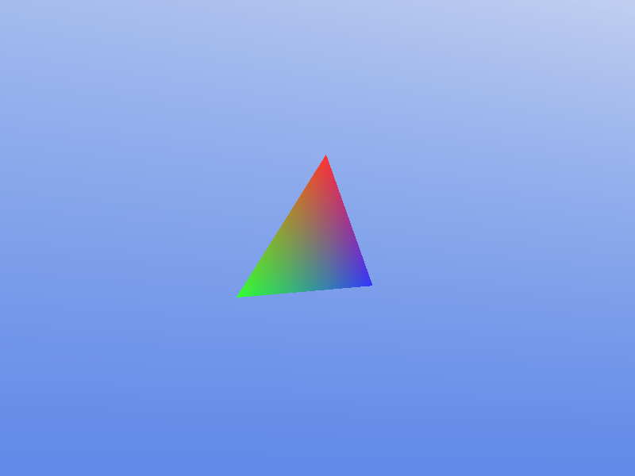

# 01 — Window, GL context and the first triangle

**Goal:** open a native window with a GL 3.3 core context and draw a colored triangle.
No windowing library is involved — `fuhgl::Window` does it natively (Win32/WGL,
X11/GLX, Cocoa; EGL/Wayland/surfaceless on Linux with `-DFUHGL_LINUX_BACKEND=EGL`).



```cpp
#include <fuhgl/fuhgl.hpp>

int main() {
    fuhgl::Window window;
    if (!window.create("Triangle", 800, 600)) return 1; // context current + gl::init() done

    // --- shaders ---
    fuhgl::Shader vs(fuhgl::Shader::Type::Vertex), fs(fuhgl::Shader::Type::Fragment);
    vs.compile(kVertexSrc); fs.compile(kFragmentSrc);      // full source in examples/triangle
    fuhgl::Program prog; prog.create(); prog.attach(vs); prog.attach(fs); prog.link();

    // --- geometry ---
    const float vertices[] = { /* pos + color, 3 vertices */ };
    fuhgl::Buffer vbo(fuhgl::Buffer::Target::Array);
    vbo.bind(); vbo.setData(sizeof(vertices), vertices, fuhgl::Buffer::Usage::StaticDraw);
    fuhgl::VertexArray vao; vao.create(); vao.bind();
    vao.setAttrib(0, 3, fuhgl::gl::GL_FLOAT, false, 6*sizeof(float), 0);          // aPos
    vao.setAttrib(1, 3, fuhgl::gl::GL_FLOAT, false, 6*sizeof(float), 3*sizeof(float)); // aColor

    fuhgl::FirstPersonCamera cam; cam.position = {0, 0, 3}; cam.attach(window);

    while (!window.shouldClose()) {
        window.pollEvents();                              // dispatch key/mouse/resize/close
        cam.update(1.f/60.f);
        fuhgl::gl::viewport(0, 0, window.framebufferWidth(), window.framebufferHeight());
        fuhgl::gl::clearColor(0.1f, 0.1f, 0.12f, 1.f);
        fuhgl::gl::clear(fuhgl::gl::ClearBit::Color | fuhgl::gl::ClearBit::Depth);
        prog.use();
        prog.setUniform("uViewProj", cam.viewProj(800.f/600.f));
        vao.bind();
        fuhgl::gl::drawArrays(fuhgl::gl::Primitive::Triangles, 0, 3);
        window.swapBuffers();
    }
}
```

Key points:

- `Window::create(title, w, h, hints)` — hints control GL version (`glMajor/glMinor`,
  default 3.3 core), MSAA samples, vsync, resizable.
- Events are callbacks: `setKeyCallback`, `setCursorPosCallback`, `setScrollCallback`,
  `setResizeCallback`, `setCloseCallback`, `setMouseButtonCallback`. Keys are
  platform-independent (`fuhgl::Key::W`, `Key::Escape`, …).
- `window.framebufferWidth/Height()` differ from `width()/height()` on HiDPI (macOS).
- Press **Escape** in `examples/triangle` to quit (wired via the close/key callback).

Complete program: `examples/triangle/main.cpp`.
