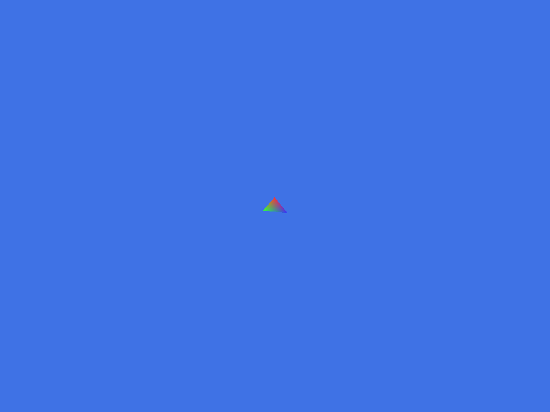

# 06 — Skybox

**Goal:** a skybox that always stays at the far plane, from 6 images or a procedural
gradient — no image files needed for the procedural variant.



```cpp
fuhgl::Skybox sky; sky.create();

// variant A: 6 cube faces (PosX, NegX, PosY, NegY, PosZ, NegZ), each size x size
sky.loadFaces(faces, 512);   // GL_RGB8/GL_RGB/GL_UNSIGNED_BYTE by default

// variant B: procedural vertical gradient
sky.makeGradient({0.25f, 0.45f, 0.9f},   // top color
                 {0.85f, 0.88f, 0.95f}); // horizon color

// per frame, before scene geometry:
sky.draw(camera, aspect);    // handles the xyww depth trick + state save/restore
```

How it works: the skybox is a unit cube; the vertex shader outputs
`gl_Position = (uViewProj * pos).xyww`, so its depth is exactly 1.0 (far plane).
`draw()` sets `depthFunc(LEQUAL)` + `depthMask(false)`, strips the translation from the
view matrix (the skybox is infinitely far away), draws, and restores state.

See `examples/triangle/main.cpp` for a complete scene.
