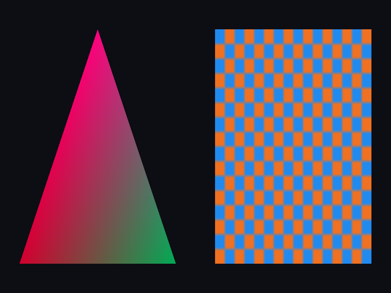

# 15 — Buffer streaming, GPU-side copies & the GL 4.3 vertex binding model

**Goal:** update a VBO every frame without stalls (`mapRange` + invalidate), copy buffers
on the GPU (`glCopyBufferSubData`), read data back (`glGetBufferSubData`), and use the
modern GL 4.3 vertex binding model instead of classic attribute pointers.



*(Left half: triangle with per-frame streamed colors. Screenshot rendered headless in CI
by `examples/stream --screenshot` — see [12](12-headless-rendering-and-screenshots.md).)*

## Streaming with mapRange (the right way to update per-frame data)

```cpp
fuhgl::Buffer vbo(fuhgl::Buffer::Target::Array);
vbo.bind();
vbo.setData(3 * sizeof(Vert), nullptr, fuhgl::Buffer::Usage::StreamDraw); // allocate once

// per frame:
vbo.bind();
void* p = vbo.mapRange(0, 3 * sizeof(Vert),
                       fuhgl::gl::GL_MAP_WRITE_BIT | fuhgl::gl::GL_MAP_INVALIDATE_BUFFER_BIT);
if (p) {
    std::memcpy(p, verts, 3 * sizeof(Vert));   // orphaning: driver may hand us a fresh buffer
    vbo.flushMappedRange(0, 3 * sizeof(Vert)); // only needed with GL_MAP_FLUSH_EXPLICIT_BIT
    vbo.unmap();
} else {
    vbo.setSubData(0, 3 * sizeof(Vert), verts); // fallback for ancient drivers
}
```

`GL_MAP_INVALIDATE_BUFFER_BIT` / `GL_MAP_INVALIDATE_RANGE_BIT` tell the driver the old
content is dead — this is what avoids the CPU/GPU sync stall on dynamic buffers.
Flags `GL_MAP_PERSISTENT_BIT`/`GL_MAP_COHERENT_BIT` (GL 4.4) enable even finer control.

## GPU-side copy, invalidate, readback, parameters

```cpp
fuhgl::Buffer src(fuhgl::Buffer::Target::CopyRead), dst(fuhgl::Buffer::Target::CopyWrite);
src.bind(); src.setData(size, data, fuhgl::Buffer::Usage::StaticDraw);
dst.bind(); dst.setData(size, nullptr, fuhgl::Buffer::Usage::StaticDraw);

fuhgl::gl::copyBufferSubData(fuhgl::gl::GL_COPY_READ_BUFFER, fuhgl::gl::GL_COPY_WRITE_BUFFER,
                             0, 0, size);                       // GPU-side memcpy
dst.invalidateSubData(0, 64);                                  // mark a region dead
unsigned char back[64];
dst.getSubData(0, sizeof back, back);                          // readback to host
gl::GLint bytes = dst.parameteri(fuhgl::gl::GL_BUFFER_SIZE);   // GL_BUFFER_SIZE query
```

`Buffer::Target` gained `CopyRead`, `CopyWrite`, `PixelPack`, `PixelUnpack` and
`DispatchIndirect` (the latter feeds `gl::dispatchComputeIndirect`, see tutorial 16).

## GL 4.3 vertex binding model (no classic attrib pointers)

```cpp
fuhgl::VertexArray vao;
vao.create();
vao.bind();
vao.bindVertexBuffer(0, vbo, 0, sizeof(Vert));        // binding index 0 <- vbo
vao.setAttribFormat(0, 3, fuhgl::gl::GL_FLOAT, false, offsetof(Vert, pos));
vao.setAttribFormat(1, 3, fuhgl::gl::GL_FLOAT, false, offsetof(Vert, color));
vao.setAttribBinding(0, 0);                           // attrib 0 reads binding 0
vao.setAttribBinding(1, 0);
vao.enableAttrib(0);
vao.enableAttrib(1);
vao.setBindingDivisor(0, 1);                          // 1 = per-instance
// ... draw as usual
```

Integer/64-bit attributes use the `I`/`L` variants (no normalization):
`vao.setAttribI(2, 1, fuhgl::gl::GL_INT, ...)` / `setAttribL(...)`, and matching
`setAttribIFormat` / `setAttribLFormat`. All 4.3 calls are no-ops on older contexts.

## Example

`examples/stream` — windowed animation (Esc quits) or headless PNG:

```
./build/examples/stream
./build/examples/stream --screenshot stream.png
```

Test: `tests/gl_smoke_buffers.cpp` verifies mapRange/getSubData round-trip, buffer copies,
VAO-4.3 rendering and more against a real context in CI.
