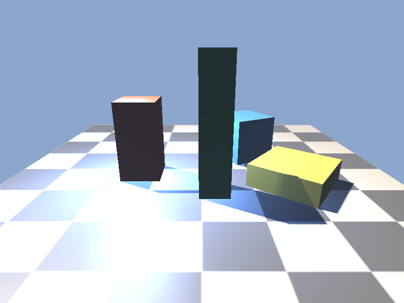

# 22 — Default forward renderer (F16)

**Goal:** a ready-to-use renderer object instead of wiring pipeline + lights + shadow
map by hand: `render::ForwardRenderer` owns a `ForwardPipeline`, the scene-wide settings
(lights, ambient, clear color, fog) and an optional shadow map that is re-rendered
automatically from the first directional/spot light on every `render()` call.


*With shadows and fog (left would be `--no-shadows`: see `tutorial-forward-renderer-noshadow.png`).*

## Usage

```cpp
fuhgl::render::ForwardRenderer renderer;
renderer.create(800, 600);          // own RGBA8+depth target; create() renders to the window instead

renderer.addLight(fuhgl::render::Light::directional({0.55f, -1.f, 0.3f}, {1.f, 0.9f, 0.72f}, 1.7f)); // sun
renderer.addLight(fuhgl::render::Light::point({-2.5f, 3.f, 1.f}, {0.45f, 0.65f, 1.f}, 12.f, 10.f));
renderer.setAmbient({0.10f, 0.10f, 0.12f});
renderer.setClearColor({0.55f, 0.65f, 0.8f});
renderer.setFog({0.55f, 0.65f, 0.8f}, 0.028f);  // exponential distance fog

renderer.enableShadows(1024);                    // depth map size
renderer.setShadowSceneBounds({0.f, 0.5f, 0.f}, 8.f); // center + radius the map covers
renderer.setShadowStrength(1.f);

std::vector<fuhgl::render::DrawItem> items = { {&boxMesh, &floorMaterial, fuhgl::math::translate({0,1.4f,0.4f})}, ... };

// per frame:
renderer.render(cam, items, width, height);      // shadow pass + forward pass, one call
// windowed: blit manually or create() without size to render straight into the window
renderer.blitToScreen();                        // when created with a size
```

`render()` builds the `SceneView` internally: it copies `lights()`, ambient/clear/fog,
computes `lightViewProj()` for the first directional or spot light, renders the
`ShadowMap` depth pass and then the forward pass — the shadow map is sampled with PCF
in the lighting shader (tutorial 21).

## Features included

| Feature | How |
|---|---|
| Light types | `lights()` — directional/point/spot (tutorial 20) |
| Shadows | `enableShadows(size)` + `setShadowSceneBounds()` — auto depth pass, PCF |
| Fog | `setFog(color, density)` — `visibility = exp(-density·distance)` in the shader |
| Ambient / clear | `setAmbient()`, `setClearColor()` |
| Own render target | `create(w, h)` → `target()`, `blitToScreen()`; `create()` → window FB |
| MSAA | via `pipeline().setTarget(...)` with your own multisample FBO |

## Tests & example

`tests/gl_smoke_forward.cpp` renders a floor + caster through `ForwardRenderer` and
verifies (a) the auto shadow pass darkens a visible blob and (b) strong red fog pushes
far pixels toward the fog color. `examples/forward/main.cpp` is the full demo
(`--screenshot`, `--no-shadows`, `--no-fog`).
