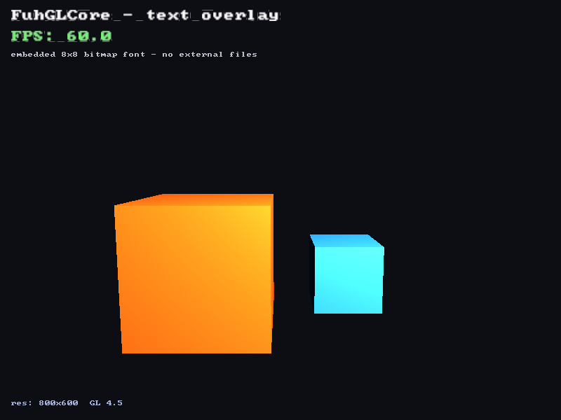

# 24 — Text & FPS overlay (bitmap font HUD)

**Goal:** draw text on top of a rendered frame — HUD labels, FPS counters, debug info —
without any external font file or dependency.



`render::TextRenderer` embeds a public-domain 8x8 bitmap font (font8x8, IBM VGA based)
as a 128×64 `GL_R8` atlas and batches all glyphs of a frame into **one draw call**.

```cpp
fuhgl::render::TextRenderer text;
text.create();                    // once after the GL context exists

// per frame, after rendering the 3D scene into the current framebuffer:
text.begin(width, height);        // ortho projection (pixels, y down), blending on
text.draw("FuhGLCore", 16.f, 14.f, 2.f, {1.f, 1.f, 1.f, 1.f});   // scale 2 = 16 px glyphs
char line[64];
std::snprintf(line, sizeof(line), "FPS: %.1f", fps.fps());
text.draw(line, 16.f, 44.f, 2.f, {0.45f, 0.95f, 0.45f, 1.f});     // green
text.end();                       // one draw call, restores state
```

- Coordinates are pixels, `(0,0)` = top-left, y grows downward.
- `TextRenderer::measure(text, scale)` returns the pixel size; `lineHeight(scale)` = 8·scale.
- `render::FpsCounter` is a tiny value type: call `frame(window.time())` once per frame,
  read `fps()` (EMA-smoothed).

The font data itself is pure data and unit-testable without GL:
`render::font8x8Glyph('A')` returns the 8 row-bitmasks of a glyph
(`render::kFontGlyphCount` = 128, `render::kFontGlyphSize` = 8).

## Example

`examples/text` renders two lit boxes and a HUD (title, live FPS, resolution + GL version).
Headless screenshot (CI docs job):

```
FUHGL_BACKEND=surfaceless ./build-egl/examples/text --screenshot docs/images/tutorial-text.png
```

`examples/gpuinfo` uses the same renderer to label the capability bars — that is what
makes the [tutorial 14](14-device-info-and-capabilities.md) screenshot readable.

Tests: `tests/test_text.cpp` (font sanity, `measure`, `FpsCounter`) and
`tests/gl_smoke_text.cpp` (renders text into an FBO headless and verifies via readback
that glyph pixels were written; skips without GL ≥ 3.3).
