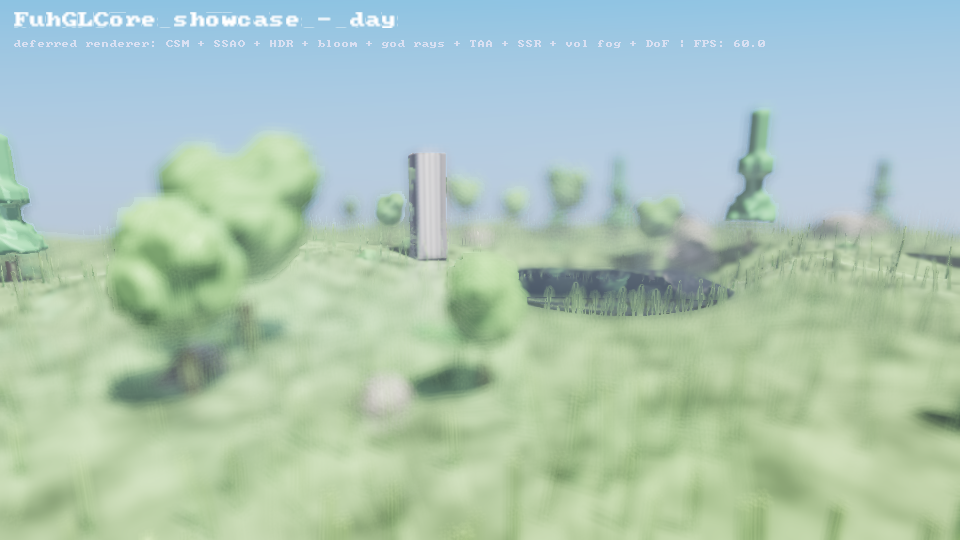
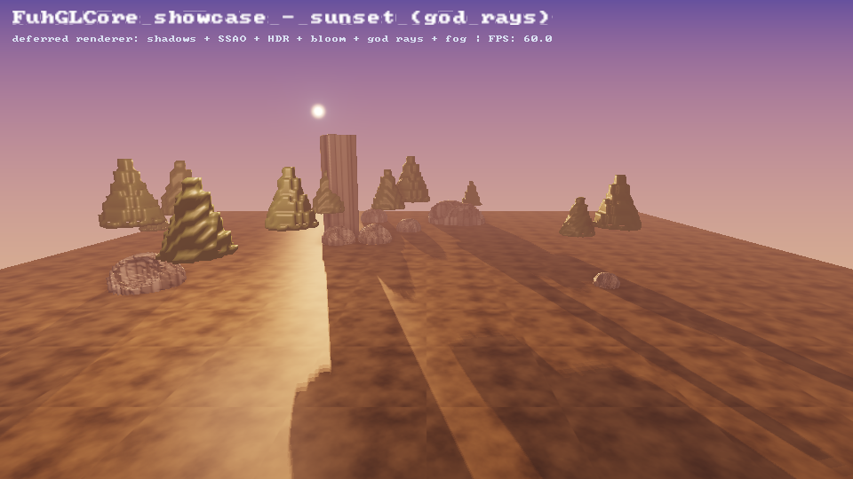
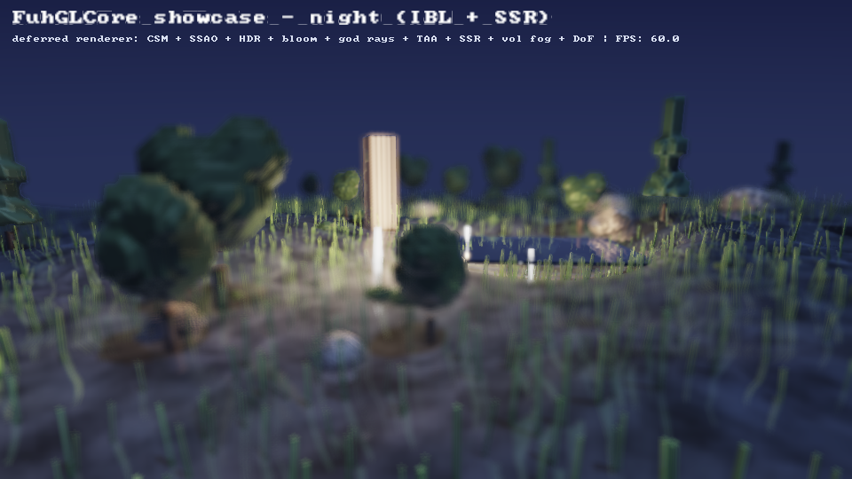

# 29 — Showcase scene (the README images)

**Goal:** a small, good-looking landscape rendered with the default `DeferredRenderer`
and its full effect stack — used for the two hero images at the top of the README.





The scene (`examples/showcase`) combines several features from earlier tutorials:

- **CSG solids** (tutorial 18): rocks (`makeSphere - makeSphere`), trees
  (`makeCylinder | makeCone`), a monolith (`makeCube - makeSphere`), all meshed once and
  placed with model matrices — the rock/stone/ground get **procedural textures**
  (voronoi / noise via `materials::textured`, tutorials 17 + 18).
- **DeferredRenderer** (tutorial 23) with `enableShadows(2048)` (tutorial 21),
  SSAO, HDR lighting with a visible sun disk, bloom, crepuscular **god rays**
  (`rayWeight`), distance fog and a gradient sky (`pipeline().skyTop/skyBottom`).
- **Text overlay** (tutorial 24) for the HUD line.

Three looks are rendered in CI:

```
FUHGL_BACKEND=surfaceless ./build-egl/examples/showcase --screenshot docs/images/readme-showcase-day.png    --mode day    --width 960 --height 540
FUHGL_BACKEND=surfaceless ./build-egl/examples/showcase --screenshot docs/images/readme-showcase-sunset.png --mode sunset --width 960 --height 540
FUHGL_BACKEND=surfaceless ./build-egl/examples/showcase --screenshot docs/images/readme-showcase-night.png --mode night --width 960 --height 540
```

`--mode sunset` lowers the directional sun into the camera frustum (direction
`{0.25, -0.10, 1.0}` → the sun disk sits low in front) with warm colors — that is what
produces the long shadows and the strong god-ray burst in the second image. The
`DeferredRenderer` derives `scene.sunDirection`/`sunColor` from the first directional
light automatically.

Windowed: `./build/examples/showcase` (WASD + mouse, Esc quits).
