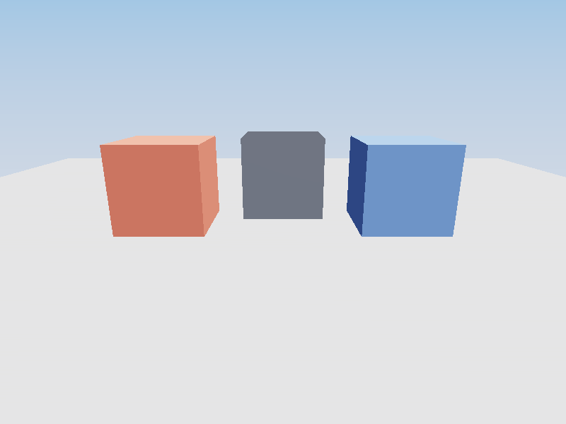

# 31 — PBR materials (metallic-roughness, Cook-Torrance GGX)

**Goal:** shade materials with a physically-based metallic-roughness model (GGX
specular + Fresnel) in both built-in pipelines — the modern default in Unreal/Unity/
Filament.



## Materials

```cpp
#include <fuhgl/render.hpp>

fuhgl::render::Material gold   = fuhgl::render::materials::pbr({0.95f, 0.64f, 0.22f}, 1.0f, 0.25f);
fuhgl::render::Material plastic = fuhgl::render::materials::pbr({0.8f, 0.1f, 0.1f}, 0.0f, 0.5f);
fuhgl::render::Material roughMetal = fuhgl::render::materials::pbr({0.7f, 0.7f, 0.7f}, 1.0f, 0.9f);

// textured variant (albedo texture on unit 3, tinted):
fuhgl::render::Material floorTex = fuhgl::render::materials::pbrTextured(tex, {1,1,1}, 0.f, 0.8f);
```

`Material` gained three preset fields: `metallic` (0 = dielectric, 1 = metal),
`roughness` (0 = mirror, 1 = fully diffuse-ish), `ao` (ambient occlusion multiplier).
The old `matte()/textured()/emissive()` presets keep working — they are just PBR with
`metallic = 0`.

## How the pipelines use it

- **Forward**: the fields are per-item uniforms (`uMetallic/uRoughness/uAo`, set in
  `detail::bindItem`).
- **Deferred**: the G-buffer gained a 5th attachment (`texPbr()`, RGBA8 =
  metallic/roughness/ao, texture unit 6, MSAA-resolved like the others); the lighting
  pass reads it per pixel.

The shared GLSL (`src/render/lighting_glsl.hpp`, `kPbrFuncs`) implements
`distributionGGX` / `geometrySmith` / `fresnelSchlick` and
`shade(albedo, metallic, roughness, ao, N, worldPos, V)` — per-light GGX direct term
plus the ambient term (IBL when set, see [tutorial 32](32-ibl-environment.md)), with PCF
shadows applied to the shadow light as before. Note: the diffuse term is `kD * albedo`
without 1/π, matching the IBL bake, so direct and image-based ambient are consistent.

## Result

A metal sphere (metallic 1, roughness 0.15) shows a tight, albedo-tinted highlight under
a directional light, while the same sphere with roughness 1 spreads it into a soft sheen;
a dielectric (metallic 0) keeps the classic white-ish specular. The smoke test
`gl_smoke_pbr` verifies all three cases by pixel readback, plus that the G-buffer's 5th
attachment really stores `metallic = 1` (R = 255) at the box center.

## Notes

- Custom (non-preset) materials are unaffected — they run their own shader; the PBR
  uniforms are simply ignored there.
- Tests: `gl_smoke_pbr.cpp` (label `gl_context`, skips without GL 3.3).
