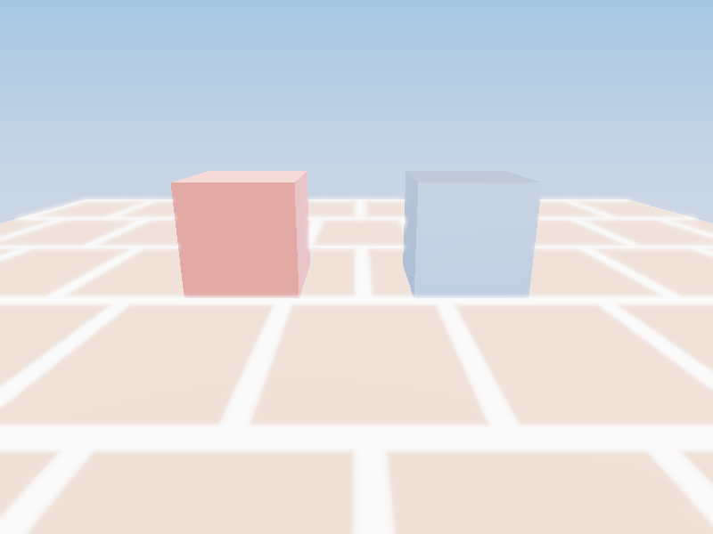

# 32 — IBL: image-based lighting from any cubemap

**Goal:** ambient light that comes from the environment (skybox) instead of a flat
color — `render::Environment` bakes an irradiance cubemap, a GGX-prefiltered
environment cubemap and a BRDF LUT from any source cubemap, fully on the CPU
(deterministic, works on the GL 3.3 baseline — no compute shaders needed).



## Usage

```cpp
fuhgl::Skybox sky;                       // or any cubemap Texture
sky.create();
sky.makeGradient({0.25f, 0.45f, 0.9f}, {0.85f, 0.88f, 0.95f}); // see tutorial 06

fuhgl::render::Environment env;
env.createFromCubemap(sky.texture());   // bake + upload (irr 32, prefilter 128, LUT 256)
env.intensity = 1.2f;                    // uEnvIntensity multiplier

// deferred:
fuhgl::render::SceneView scene;
scene.env = &env;                        // pipelines bind units 7/8/9 themselves
deferredRenderer.render(scene);

// forward:
fuhgl::render::ForwardRenderer fr;
fr.setEnvironment(&env);
```

## What gets baked (`bakeEnvironment`, pure CPU — unit-testable)

- **Irradiance cubemap** (RGB16F, 32 px): cosine-weighted hemisphere average of the
  source around each texel normal.
- **Prefiltered env cubemap** (RGB16F, 128 px, full mip chain): GGX importance sampling
  (`hammersley` + `importanceSampleGGX`); mip level m = roughness m/(levels-1). Sampled
  with `textureLod(prefilter, reflect(-V, N), roughness * prefilterMaxLod)`.
- **BRDF LUT** (RG16F, 256×256): scale/bias for the Fresnel term (Epic-style
  integration of the GGX VNDF).

The lighting shader's ambient term becomes
`(kD * irradiance * albedo + prefiltered * (F * brdf.r + brdf.g)) * ao * envIntensity`.
Without `SceneView::env` the pipelines fall back to the flat `albedo * uAmbient`.

## Result

Shadowed/unlit sides of objects pick up the sky color (blue from above, warm from the
ground) instead of a flat gray; metals show blurred reflections of the environment that
get rougher with `roughness`. `gl_smoke_pbr` verifies that a gray env cubemap brightens
the ambient term by the expected amount; `test_environment.cpp` checks the bake math on
a constant cubemap (irradiance/prefilter ≈ the constant, LUT in [0,1] with scale+bias
≤ 1, bit-exact determinism).

## Notes

- The bake is one-time and CPU-side (~0.5 s at default sizes); call it once at startup.
- `readCubemap()` reads back any 8-bit or float cubemap texture as RGBA float.
- Tests: `test_environment.cpp` (label `unit`), `gl_smoke_pbr.cpp` (`gl_context`).
