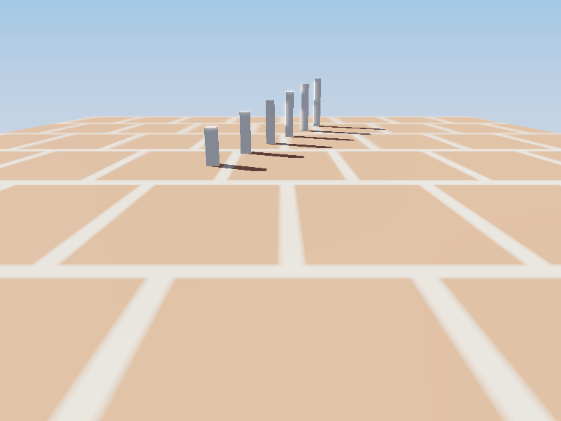

# 33 — Cascaded shadow maps (CSM)

**Goal:** sharp shadows near the camera *and* at distance — one depth map per cascade of
the camera frustum, instead of a single map that is either blurry up close or too small
far away.



## Usage

```cpp
fuhgl::render::ForwardRenderer renderer;
renderer.create(1280, 720);
renderer.enableCsmShadows(2048, 4);          // map size per cascade, cascade count
renderer.setShadowZRange(0.5f, 200.f);       // camera depth range the cascades cover
renderer.setShadowSceneBounds({0, 0.5f, 0}, 12.f);
renderer.addLight(fuhgl::render::Light::directional({0.55f, -1.f, 0.3f}, {1, 1, 1}, 1.5f));
// per frame: renderer.render(cam, items, w, h) — the CSM pass runs automatically
```

The deferred renderer has the same switches: `DeferredRenderer::enableCsmShadows()`.
At the pipeline level, set `SceneView::cascades = &map` after
`CascadeShadowMap::render(scene, camera, light, center, radius, zNear, zFar)`.

## How it works

- `CascadeShadowMap` owns one **depth texture array** (`GL_TEXTURE_2D_ARRAY`, one layer
  per cascade). Each frame it renders the scene depth once per cascade into its layer
  (`glFramebufferTextureLayer`), drawing back faces like the single `ShadowMap`.
- `cascadeSplits(zNear, zFar, count, lambda)` computes the split planes with the
  practical scheme (log + uniform mix, `lambda = 0.5` default).
- `cascadeViewProj(...)` fits a tight ortho box around the 8 corners of each camera
  frustum slice (directional lights); spot lights fall back to the full-range VP.
- In the shader (`kShadowFunc`), each fragment picks its cascade by view-space depth
  (`uCascadeSplits`), projects with that cascade's `uLightVPs[i]` and samples the
  matching array layer with 3x3 PCF on top of the LINEAR-filtered depth.

## Result

`gl_smoke_csm` renders a floor + caster with `enableCsmShadows(1024, 4)` and verifies by
pixel readback that the shadow blob gets darker **both** in a near view (cascade 0) and
in a far view (a higher cascade) — the single-map renderer loses the shadow at distance.

## Notes

- `kMaxCascades = 8`; the single-map path (`enableShadows`) is unchanged and remains the
  default — CSM is opt-in.
- The pipelines need the camera view matrix for cascade selection — they set `uView`
  themselves from `SceneView::camera`.
- Tests: `test_shadow.cpp` (unit: split monotonicity, lambda 0/1, clamping, per-slice VP
  coverage), `gl_smoke_csm.cpp` (label `gl_context`, skips without GL 3.3).
