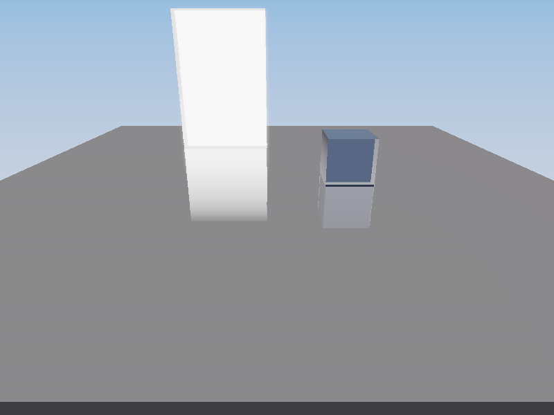

# 36 — Screen-space reflections (SSR)

**Goal:** glossy surfaces reflect what is on screen — a render-graph pass that marches
the reflection ray and samples the HDR image at the hit point.



## Usage

```cpp
fuhgl::render::DeferredRenderer renderer;
renderer.create(1280, 720);
renderer.ssrEnabled = true;
renderer.ssrStrength = 0.6f;    // reflection intensity
renderer.ssrMaxSteps = 32;      // raymarch steps
renderer.ssrThickness = 0.3f;   // hit band around the depth surface
```

## How it works (F33)

The `ssr` pass in the post graph runs right after the lighting pass. Per pixel with
geometry (G-buffer position alpha flag):

1. `R = reflect(-V, N)` from the G-buffer world position and normal,
2. march `worldPos + R * step` (step ≈ 2% of the view distance) up to `ssrMaxSteps`,
   projecting each sample with the (jittered) view-projection,
3. compare against the G-buffer position sampled at the projected UV — a hit when the
   ray is behind the stored surface but within `ssrThickness`,
4. on hit: `reflection = hdr(hitUV) * (1 - i/steps)`; output `hdr + reflection * ssrStrength`.

Sky pixels and rays leaving the screen simply keep the base color. When `ssrEnabled` is
off, the pass copies the HDR image through unchanged.

## Result

`gl_smoke_ssr` places a bright emissive box on a dim floor and verifies by readback that
the floor region (bottom half of the frame) is measurably brighter with SSR on — the
lamp's reflection.

## Notes

- Screen-space only: reflections of off-screen geometry are not possible (that needs SSR
  fallback to IBL — the `Environment` from tutorial 32 could serve as fallback later).
- Test: `tests/gl_smoke_ssr.cpp` (label `gl_context`, skips without GL 3.3).
