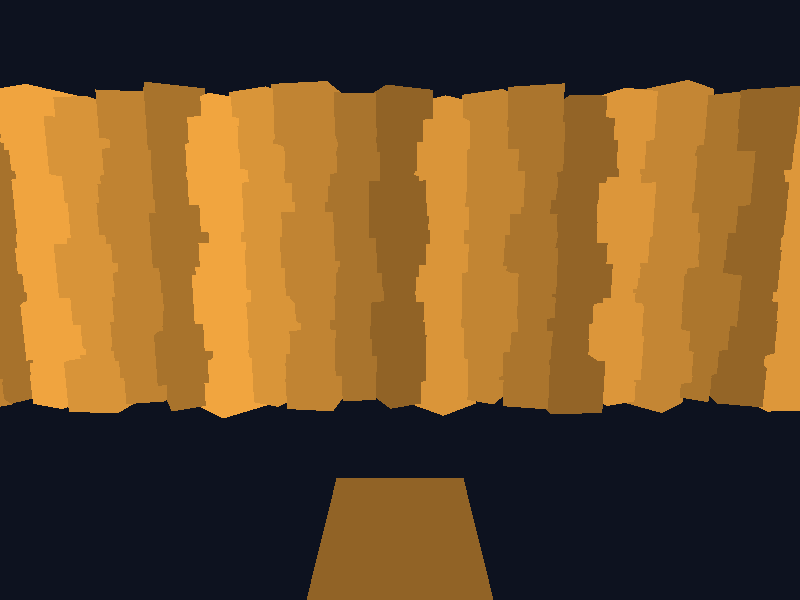

# 37 — GPU culling + indirect draw

**Goal:** render thousands of instances of one mesh with a single draw call while the
GPU decides which instances are visible — no per-instance CPU work, no overdraw from
off-screen instances.



## Usage

```cpp
fuhgl::render::Mesh boxMesh;
fuhgl::render::shapes::box(boxMesh, {0.3f, 0.3f, 0.3f}, {1.f, 1.f, 1.f});

fuhgl::render::GpuCuller culler;
culler.create(4096);            // capacity in instances, requires GL >= 4.3
culler.setMesh(boxMesh);        // mesh drawn per visible instance

std::vector<fuhgl::math::Mat4> models = /* ... one model matrix per instance ... */;
culler.setInstances(models.data(), (int)models.size());

// per frame:
culler.cull(camera.viewProj(aspect));   // compute shader: frustum cull + compact
prog.use();                              // program reading aInstanceModel (loc 4..7)
prog.setUniform("uViewProj", camera.viewProj(aspect));
culler.draw();                           // ONE indirect instanced draw
int visible = culler.lastVisibleCount();
```

## How it works (F34)

`render::GpuCuller` (`render/culling.hpp`, PIMPL) owns three buffers:

1. **items SSBO** (binding 0): per instance a `mat4 model` + `vec4 sphere` (the mesh's
   object-space bounding sphere, `Mesh::boundingSphere()`, transformed per frame).
2. **models SSBO** (binding 1): the *compacted* model matrices of the visible instances.
   The same buffer object is also bound as `GL_ARRAY_BUFFER` for the divisor-1 `mat4`
   vertex attributes at locations 4..7 — exactly the layout `Mesh::setInstanceData()`
   uses, so existing instanced shaders (`aInstanceModel`) work unchanged.
3. **indirect command buffer** (binding 2, `GL_DRAW_INDIRECT_BUFFER`): a
   `DrawElementsIndirectCommand`/`DrawArraysIndirectCommand` whose `count`/`firstIndex`
   are set once by `setMesh()`, plus an atomic counter.

The compute shader (`#version 430`, 64 threads/group) does per instance:

- world sphere = `math::transformSphere(model, sphere)` — center via the matrix, radius
  scaled by the largest axis scale (mirrored on the CPU in `math::transformSphere`,
  unit-tested in `test_culling.cpp`),
- frustum test against the 6 planes of `math::Frustum::fromViewProj(viewProj)`
  (sphere-vs-plane: `dot(n, c) + d < -r` → culled),
- visible instances: `slot = atomicAdd(counter, 1)`, `models[slot] = model`,
  `atomicMax(command.instanceCount, slot + 1)`.

`draw()` then binds the culler's VAO (mesh vertex data + compacted instance matrices) and
issues `glDrawElementsIndirect` / `glDrawArraysIndirect` — one draw, `instanceCount`
written by the GPU.

## Result

`gl_smoke_culling` places 1000 box instances (500 in front of the camera, 500 behind),
culls them on the GPU and verifies: the counter reads back exactly 500, the indirect
command's `instanceCount` is 500, the indirect draw lights pixels, and a camera looking
away culls everything (0 visible, 0 lit pixels).

## Notes

- Requires GL 4.3 (compute shaders) — `create()` returns false otherwise; macOS (GL 4.1)
  is covered by the CPU mirror (`math::transformSphere` + `Frustum::containsSphere`) and
  the unit tests.
- Culling is per *mesh instanced set*: for many different meshes, use one culler per
  mesh (or group items by mesh) — the API deliberately stays simple.
- Test: `tests/test_culling.cpp` (unit), `tests/gl_smoke_culling.cpp` (label `gl_context`,
  skips without GL 4.3).
