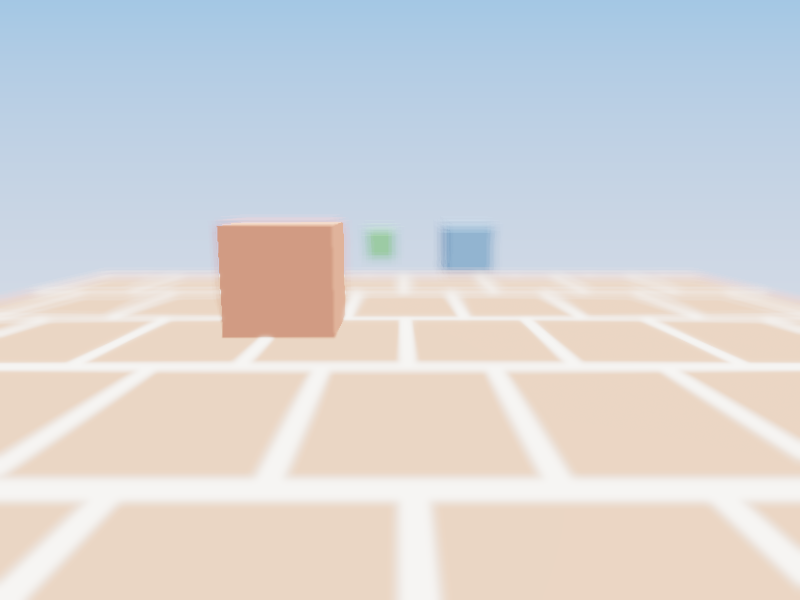

# 39 — Depth of field (bokeh DoF)

**Goal:** a focus plane with a smooth circle-of-confusion falloff — sharp subject, soft
background/foreground — as a post pass on the HDR image, without touching the G-buffer.



## Usage

```cpp
fuhgl::render::DeferredRenderer renderer;
renderer.create(1280, 720);
renderer.dofEnabled = true;
renderer.dofFocusDist = 6.0f;   // world-space distance of the focus plane
renderer.dofFocusRange = 2.5f;  // distance over which the CoC grows to dofStrength
renderer.dofStrength = 18.f;    // max circle of confusion in pixels
renderer.dofTaps = 24;          // gather taps (golden-angle spiral)
```

## How it works (F36)

A new `dof` pass in the post graph runs after TAA (so the jittered, accumulated HDR image
is the source) and before the composite:

1. CoC per pixel from the G-buffer position: `dist = |worldPos − camPos|` (sky → far →
   max blur), `coc = |clamp((dist − focusDist) / focusRange, −1, 1)|` — the pure helper
   `math::cocRadius()` (unit-tested), symmetric in front of/behind the focus plane.
2. Bokeh gather: `dofTaps` samples on a golden-angle spiral, offset scaled by the pixel's
   **own** CoC (in UV = `dofStrength / resolution`), each tap weighted by
   `max(tapCoC, ownCoC)` — in-focus pixels sample only their own center and stay sharp.
3. Output = weighted average into a new HDR resource `dof`; the composite pass reads `dof`
   instead of `taa`. With `dofEnabled = false` the pass just copies `taa` → `dof`.

Bloom and god rays still run on the pre-DoF `taa` image (bright sources stay bright).

## Result

`gl_smoke_dof` places a near box on the focus plane and a far box beyond the focus range,
projects both to screen space and compares gradient energy (edge sharpness) in HDR: the far
box's edges drop by >30 % with DoF on, the near box stays sharp.

## Notes

- Runs after TAA on purpose: subpixel jitter + accumulation smooths the bokeh discs.
- Cost is `dofTaps` texture fetches per pixel on the HDR image; `dofTaps = 0` disables the
  gather (copy only).
- Tests: `test_dof.cpp` (unit: `cocRadius`), `gl_smoke_dof.cpp` (label `gl_context`, skips
  without GL 3.3). Screenshot: `examples/features --scene dof`.
