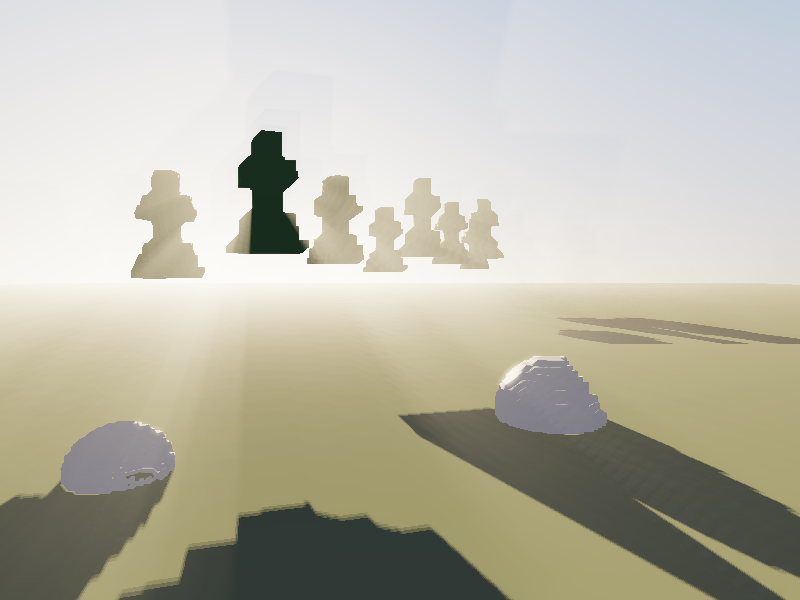

# 40 — Volumetric fog / light shafts

**Goal:** real volumetric fog — aerial perspective, ground mist and visible light shafts
through occluders — raymarched per pixel on the HDR image, composited before tone mapping.



## Usage

```cpp
fuhgl::render::DeferredRenderer renderer;
renderer.create(1280, 720);
renderer.volFogEnabled = true;
renderer.volFogDensity = 0.03f;              // extinction coefficient (1 / world unit)
renderer.volFogColor = {0.82f, 0.84f, 0.90f}; // scattering albedo tint
renderer.volFogAnisotropy = 0.55f;           // Henyey-Greenstein g: forward scattering
renderer.volFogHeight = 0.4f;                // > 0: exponential height fog from here on
renderer.volFogFalloff = 0.30f;              // exp(-(y - height) * falloff)
renderer.volFogShadows = true;               // attenuate in-scattering by the shadow map / CSM
renderer.volFogSteps = 32;                   // raymarch steps per pixel (max 64)
renderer.volFogMaxDist = 90.f;               // clamp of the marched ray
```

## How it works (F37)

A new `volfog` pass in the post graph runs after DoF (resource `volfog`, RGBA16F) and before
the composite:

1. Per pixel the world-space view ray is reconstructed from the inverse view-projection.
   Geometry pixels (G-buffer position alpha > 0.5) march only up to the surface; sky pixels
   march to the far plane. The ray length is clamped to `volFogMaxDist`.
2. `volFogSteps` samples along the ray accumulate single scattering:
   `inscatter += sunColor * phase * fogColor * sigma * shadow * T * step`,
   `T *= exp(-sigma * step)` — with `sigma = volFogDensity`, optionally multiplied by the
   height fog `exp(-max(y - volFogHeight, 0) * volFogFalloff)`.
3. The phase function is Henyey-Greenstein, `math::henyeyGreenstein(cosTheta, g)`
   (func.hpp, unit-tested: normalized over the sphere, isotropic at g = 0, forward-peaked
   for g > 0) — that is what shapes the shafts around the sun.
4. With `volFogShadows = true` each sample's sun contribution is multiplied by the shadow
   factor of the active shadow map — the single map (F15) or the CSM depth array (F30),
   reusing `kShadowUniforms` + `kShadowFunc` from `lighting_glsl.hpp` (texture units 4/10,
   1x1 dummy textures keep the samplers complete when shadows are off). Occluded fog stays
   dark → light shafts.
5. Output: `src * T + inscatter` into `volfog`; the composite reads `volfog` instead of
   `dof`. With `volFogEnabled = false` the pass just copies `dof` → `volfog`.

Bloom and god rays still run on the pre-fog `taa` image.

## Result

`gl_smoke_volfog` renders a floor with a tall caster slab: with fog on, a far floor window
changes measurably (extinction + in-scattering) while a near window stays almost identical;
with `volFogShadows` + CSM the floor inside the caster's shadow is clearly darker (the
in-scattered sun light is blocked).

## Notes

- Cost is `volFogSteps` iterations per pixel, each with up to one 3x3 PCF shadow lookup —
  keep `volFogSteps` ≤ 32 on weak GPUs.
- The fog color combines with the analytic distance fog (F16, `SceneView::fogDensity`) —
  use one of them for the far haze, or both for layered depth.
- Tests: `test_volfog.cpp` (unit: `henyeyGreenstein`), `gl_smoke_volfog.cpp` (label
  `gl_context`, skips without GL 3.3). Screenshot: `examples/features --scene volfog`.
