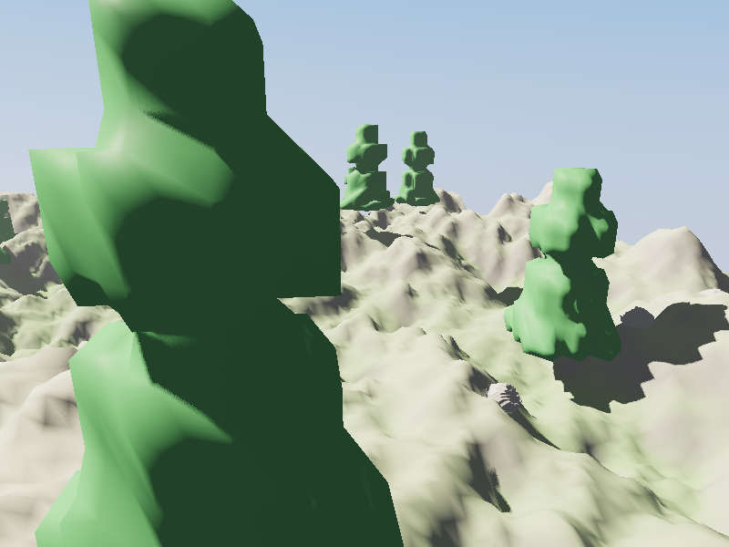

# 41 — Heightmap terrain (landscape from a heightmap)

**Goal:** generate a landscape mesh from a heightmap — a float grid or a grayscale image —
with correct normals, slope-based coloring and a `heightAt()` query for placing objects on it.



## Usage

```cpp
// 1) heightmap source: seeded procedural fBm image (grayscale, red channel = height in [0,1])
fuhgl::render::procedural::Image img =
    fuhgl::render::procedural::heightmap(192, 192, /*seed=*/11u, /*octaves=*/6, /*scale=*/0.045f);

// ... or your own float grid / loaded grayscale image
fuhgl::render::HeightmapTerrain terrain;
terrain.create(img, /*sizeX=*/36.f, /*sizeZ=*/36.f, /*heightScale=*/7.f);
// terrain.create(heights, w, h, sizeX, sizeZ, heightScale);   // float grid version

// 2) draw it like any mesh
scene.items.push_back({&terrain.mesh(), &material, fuhgl::math::Mat4{}});

// 3) place objects on the terrain (bilinear world-space height)
float y = terrain.heightAt(x, z);
scene.items.push_back({&treeMesh, &treeMat, fuhgl::math::translate({x, y, z})});
```

## How it works (F38)

`render/terrain.hpp`:

- `heightmapTerrainData(heights, w, h, sizeX, sizeZ, heightScale, ...)` builds the raw
  `MeshData`: a regular (w × h) vertex grid centered at the origin, `y = height * heightScale`,
  normals by central differences (clamped at the borders), UVs = world xz × `uvScale`, and
  per-vertex color = `lowColor → highColor` with normalized height, shifted toward
  `steepColor` (rock) where the slope gets steep (`n.y < 0.78`). Index winding is CCW from
  +Y, matching the pipelines' back-face culling.
- `heightmapSample(heights, w, h, u, v)` — bilinear, clamped — and the `Image` overload
  (red channel / 255) are the sampling primitives.
- `HeightmapTerrain` (PIMPL) owns the `Mesh`: `create()` copies the heightmap, builds the
  `MeshData` and uploads it; `heightAt(x, z)` maps world → normalized UV and returns the
  bilinear height (clamped outside the terrain).
- `procedural::heightmap(w, h, seed, octaves, scale)` is the deterministic seeded fBm
  heightmap source used by the screenshot scene.

## Notes

- For very large terrains combine with LOD (F41-ready: build several grids at w, w/2, w/4)
  or stream tiles; the showcase builds its terrain directly from `math::fbm2`.
- `create()` needs a current GL context (it uploads the mesh); the pure data builders
  (`heightmapTerrainData`, `heightmapSample`, `procedural::heightmap`) are CPU-only and
  unit-tested without GL.
- Tests: `test_terrain.cpp` (unit: sampling, image determinism, mesh counts/normals/
  winding/colors), `gl_smoke_terrain.cpp` (label `gl_context`). Screenshot:
  `examples/features --scene heightmap`.
