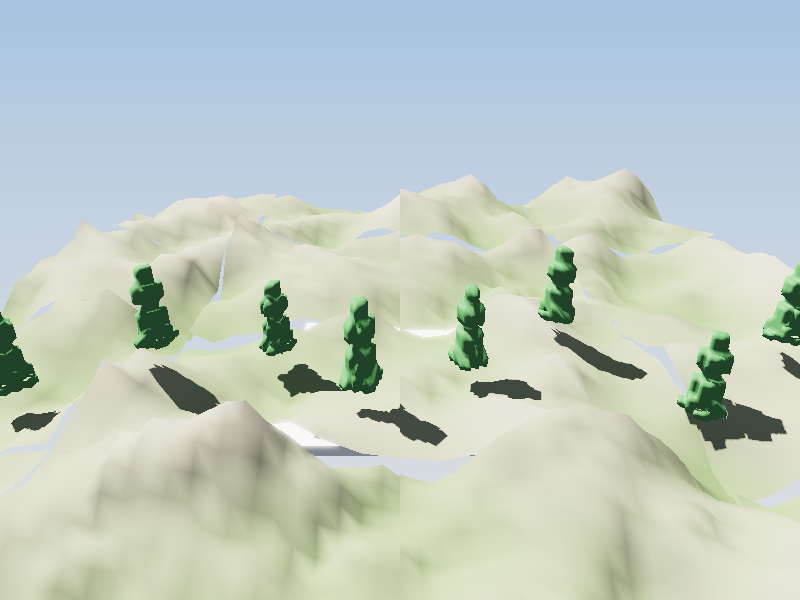

# 43 — Level of detail (LOD)

**Goal:** render each object with the cheapest mesh that still looks good at its distance —
per-item, automatic in all pipelines, and switchable off (`lodEnabled = false`).



## Usage

```cpp
// 1) build the detail levels (level 0 = highest detail) + switch distances
fuhgl::render::Mesh hi, mid, lo;
// ... fill meshes (e.g. a CSG solid at high/medium/low resolution) ...
std::vector<fuhgl::render::Mesh> levels;
levels.push_back(std::move(hi));
levels.push_back(std::move(mid));
levels.push_back(std::move(lo));
fuhgl::render::LodMesh lod;
lod.create(std::move(levels), /*distances=*/{8.f, 16.f});   // >=8 -> mid, >=16 -> lo
// or screen-space heuristic: lod.setDistances(
//     fuhgl::render::LodMesh::defaultDistances(fovY, boundingRadius, {0.5f, 0.25f}));

// 2) attach to a draw item — the pipelines pick the level by camera distance
scene.items.push_back({&lod.level(0), &material, model, &lod}); // mesh = fallback/bounding

// 3) toggle (both renderers; also via setEffectEnabled(render::Effect::Lod, false))
renderer.lodEnabled = false;          // always level 0
int lvl = renderer.lastLodLevel();   // introspection/tests

// heightmap terrain with built-in LOD levels (w, w/2, w/4 grids):
fuhgl::render::LodMesh terrain = fuhgl::render::terrainLods(heights, w, h, sizeX, sizeZ, heightScale, 3);
```

## How it works (F41)

- `render::LodMesh` (render/lod.hpp) stores the level meshes + ascending switch distances.
  `selectLevel(dist)` returns the level for a camera distance (clamped); `defaultDistances()`
  derives distances from a screen-coverage heuristic
  (`fraction ≈ radius / (dist · tan(fovY/2))`).
- `DrawItem::lod` marks an item as LOD-able; `resolveLodMesh(item, camPos, lodEnabled, &level)`
  computes the world-space center (`model × boundingSphere(level 0)`) and returns the level
  mesh. All draw loops use it: the deferred G-buffer, the forward pass and both shadow
  passes (single + CSM) — so LOD objects also get correct shadows at the selected level.
- `SceneView::lodEnabled` carries the renderer's `lodEnabled` flag into the pipelines;
  `SceneView::lastLodLevel` records the last selection (`renderer.lastLodLevel()`).
- LOD selection is pure CPU — `render::Effect::Lod` is always supported (F39), so it works
  on any GPU; disabling it is just `lodEnabled = false` (or `setEffectEnabled(Effect::Lod, false)`).
- `terrainLods()` (terrain.hpp) builds a terrain LodMesh directly from a heightmap by
  subsampling the grid (w, w/2, w/4, ...). For big worlds, split the terrain into tiles —
  each tile is one `DrawItem` with its own `LodMesh` (that is what the screenshot scene does).

## Notes

- Keep `distances` ascending and sized `levels-1` (`create()`/`setDistances()` validate).
- The bounding sphere is taken from level 0 — make all levels roughly the same size.
- Tests: `test_lod.cpp` (unit: validation, selection, heuristic, resolveLodMesh),
  `gl_smoke_lod.cpp` (label `gl_context`: near camera → level 0, far → level 1,
  `lodEnabled=false` → base mesh). Screenshot: `examples/features --scene lod`.
