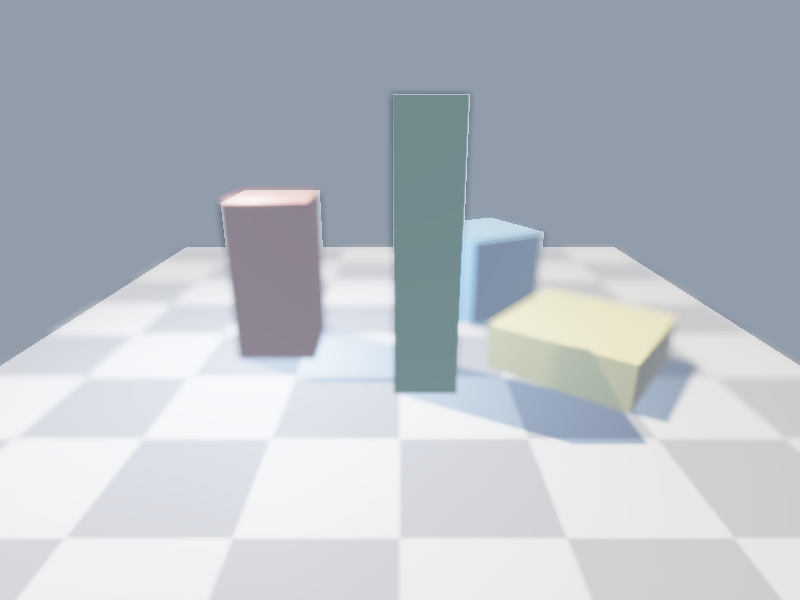

# 44 — Forward renderer post FX (PostChain)

**Goal:** the forward renderer gets the same post-processing as the deferred one — bloom,
god rays, TAA, depth of field and volumetric fog — via a reusable `render::PostChain` that
runs over any HDR image. Off by default, so the classic forward path is unchanged.



## Usage

```cpp
fuhgl::render::ForwardRenderer renderer;
renderer.create(1280, 720);            // own target (LDR) + HDR intermediate
renderer.enablePostFX(true);           // F42: forward pass -> HDR -> PostChain -> LDR target

renderer.postChain().bloomStrength = 0.55f;
renderer.postChain().rayWeight = 0.4f;      // god rays
renderer.postChain().taaEnabled = true;     // F32 temporal AA (jitter applied automatically)
renderer.postChain().dofEnabled = true;     // F36 depth of field from the depth buffer
renderer.postChain().dofFocusDist = 6.5f;
renderer.postChain().volFogEnabled = true;  // F37 volumetric fog
renderer.postChain().volFogDensity = 0.012f;

// uniform toggle API (F40) also covers the post effects — they need enablePostFX():
renderer.setEffectEnabled(fuhgl::render::Effect::Bloom, false);
bool on = renderer.effectEnabled(fuhgl::render::Effect::DoF); // false while post FX are off

renderer.render(cam, items, w, h);     // writes the LDR target()
renderer.blitToScreen();
```

`examples/forward --fx --screenshot out.png` renders the demo with the post chain on.

## How it works (F42)

- `render::PostChain` (render/post_chain.hpp) owns a `RenderGraph` with the passes
  `taa → dof → volfog → bright → bloom blur ping-pong → rays → composite`. `execute(scene,
  hdrTexture, depthTexture, ldrTarget)` binds the per-frame HDR input and depth texture and
  runs the graph; the composite does ACES tone mapping + gamma into the LDR target.
- DoF (F36) and volumetric fog (F37) reconstruct world positions from the **depth texture**
  via the inverse view-projection (sky = far plane) — no G-buffer needed, so they work on
  the forward renderer. SSAO and SSR stay deferred-only: `ForwardRenderer::effectSupported()`
  returns false for them.
- `ForwardRenderer` gains an HDR intermediate target (RGBA16F color + sampleable depth
  texture); with `enablePostFX(false)` (default) it renders straight into the LDR target
  exactly as before. TAA applies the Halton subpixel jitter on the forward pass itself.
- All post effects are capability-gated (F39) inside the PostChain and toggleable through
  the shared `Effect` API (F40) — unsupported effects are skipped with a warning.
- The generic pass shaders (fullscreen triangle, blur, bright-pass, rays, TAA, composite,
  copy) are shared between both chains via `src/render/postfx_glsl.hpp`.

## Notes

- Cost: one fullscreen pass per enabled effect; DoF/vol fog march up to `dofTaps` /
  `volFogSteps` samples per pixel.
- Test: `gl_smoke_forward_fx.cpp` (label `gl_context`): plain path unchanged, post path
  renders lit into the LDR target, SSR/SSAO reported unsupported on forward, no GL errors.
  Screenshot: `examples/forward --fx`.
