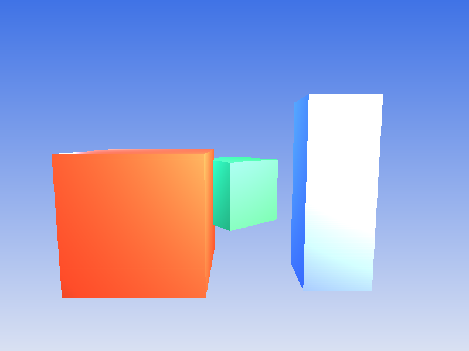
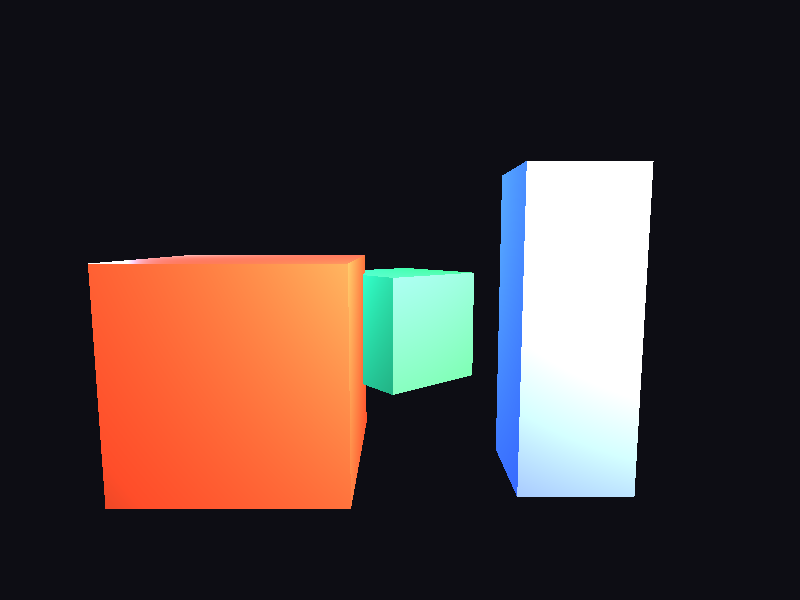

# 13 — Render pipelines (Forward & Deferred)

**Goal:** render a small scene through a pipeline object instead of hand-writing passes.
`fuhgl::render` provides `ForwardPipeline` (one pass) and `DeferredPipeline`
(G-buffer + fullscreen lighting), both driven by a plain `SceneView`.




*(Both screenshots rendered headless in CI via the surfaceless EGL backend — see
[tutorial 12](12-headless-rendering-and-screenshots.md).)*

## The pieces

```cpp
fuhgl::render::Mesh boxMesh;
fuhgl::render::shapes::box(boxMesh, {1,1,1}, {0.9f, 0.3f, 0.2f}); // pos+normal+color

fuhgl::render::SceneView scene;
scene.camera = &cam;
scene.width = 800; scene.height = 600; scene.aspect = 800.f/600.f;
scene.items.push_back({&boxMesh, nullptr, fuhgl::math::translate({0,0,0})}); // nullptr = default material
scene.lights.push_back({{3,3,4}, {1.f,0.9f,0.7f}, 25.f});                        // point light
```

`DrawItem { mesh, material, model }`, `Light { position, color, intensity }` — that's the
whole "scene"; no scene graph. Lights go to the shaders through a std140 UBO (binding 0,
max 64).

## Deferred

```cpp
fuhgl::render::DeferredPipeline pipe;
pipe.create(800, 600, /*msaaSamples=*/0);   // >0 enables MSAA G-buffer + resolve

// per frame:
pipe.render(scene);
fuhgl::Framebuffer::blitToDefault(pipe.output(), window.framebufferWidth(), window.framebufferHeight());
```

Internals: G-buffer = albedo (RGBA8) + normal (RGBA8) + position (RGBA16F, alpha marks
geometry) as MRT attachments + depth; pass 2 is a fullscreen triangle that shades from the
G-buffer, with a procedural sky gradient where no geometry was written. MSAA resolves via
`Framebuffer::blitTo`.

## Forward

```cpp
fuhgl::render::ForwardPipeline fwd;
fwd.create();
fwd.setTarget(nullptr);        // render straight into the window's framebuffer
// or: fwd.setTarget(&myFbo);  // render offscreen, then fwd.blitToScreen()

fwd.render(scene);             // same SceneView, same lighting model
```

## Custom materials

A `Material` is just a `Program` + texture bindings. Custom shaders must use the standard
uniform names the pipelines set: `uModel`, `uViewProj` (geometry), `uCamPos`, `uAmbient`,
`uLightCount` + light UBO (lighting). For deferred geometry materials additionally write
`layout(location=0..2) out` albedo/normal/position. GLSL `#include` works here too
(see [02](02-shaders-programs-includes.md)).

```cpp
fuhgl::render::Material custom;
custom.create();
custom.program().attach(myVs); custom.program().attach(myFs); custom.program().link();
custom.setTexture(0, myTexture);
scene.items.push_back({&boxMesh, &custom, model});
```

Complete demo: `examples/deferred/main.cpp` (windowed, or headless
`--screenshot out.png [--forward]`). Headless pipeline test: `tests/gl_smoke_deferred.cpp`
(runs in CI, verifies a lit box pixel and the sky background).
