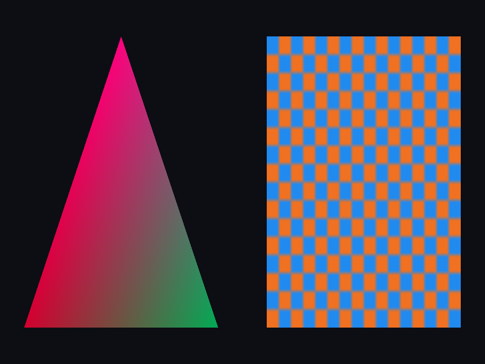

# 16 — Texture upload/readback, compressed textures, buffer textures & compute image I/O

**Goal:** update 3D texture volumes (`setSubImage3D`), copy framebuffer regions into
textures, upload **compressed** (DXT/BC) textures without CPU decompression, read pixels
back (`getTexImage`), view a buffer as a texture (`texBuffer`), create zero-copy texture
views (`glTextureView`), and bind textures as **compute images** (`glBindImageTexture`)
with direct/indirect dispatch.



*(Right half: quad with a DXT1-compressed checkerboard uploaded via
`Texture::compressedImage2D` — `examples/stream --screenshot`, rendered headless in CI.)*

## Sub-images, copies, readback

```cpp
tex.setSubImage2D(0, x, y, w, h, fuhgl::gl::GL_RGBA, fuhgl::gl::GL_UNSIGNED_BYTE, pixels);
tex.setSubImage3D(0, x, y, z, w, h, d, fuhgl::gl::GL_RGBA, fuhgl::gl::GL_UNSIGNED_BYTE, voxels);

tex.copyTexImage2D(0, fuhgl::gl::GL_RGBA8, 0, 0, 512, 512);        // framebuffer -> texture
tex.copyTexSubImage2D(0, dx, dy, sx, sy, w, h);                    // ... sub-rectangle
tex.copyTexSubImage3D(0, dx, dy, dz, sx, sy, w, h);                // 3D variant

std::vector<unsigned char> px(w * h * 4);
fuhgl::gl::getTexImage(fuhgl::gl::GL_TEXTURE_2D, 0, fuhgl::gl::GL_RGBA, fuhgl::gl::GL_UNSIGNED_BYTE, px.data());
// for big readbacks bind a PixelPack buffer first (Buffer::Target::PixelPack)

gl::GLint w = tex.getLevelParameteri(fuhgl::gl::GL_TEXTURE_WIDTH, 0);
gl::GLint compressed = tex.getLevelParameteri(fuhgl::gl::GL_TEXTURE_COMPRESSED, 0);
gl::GLint minFilter = tex.getParameteri(fuhgl::gl::GL_TEXTURE_MIN_FILTER);
```

## Compressed textures (DXT/BC — no CPU decompression needed)

```cpp
tex.bind();
tex.compressedImage2D(0, fuhgl::gl::GL_COMPRESSED_RGBA_S3TC_DXT5_EXT, w, h, imageSize, dxtBytes);
tex.compressedSubImage2D(0, x, y, w, h, fuhgl::gl::GL_COMPRESSED_RGBA_S3TC_DXT5_EXT, imageSize, block);
// 3D/array/cube variants: compressedImage3D / compressedSubImage3D
// readback: fuhgl::gl::getCompressedTexImage(target, level, buffer);
```

Common formats are predefined in `types.hpp`: `GL_COMPRESSED_RGB(A)_S3TC_DXT1/3/5_EXT`,
the SRGB variants, and `GL_COMPRESSED_RGBA_BPTC_UNORM` (BC7). A 4x4 DXT1 block is 8 bytes,
DXT5 is 16 bytes. Check support at runtime with `gl::queryDeviceInfo()` / `hasExtension`
(tutorial 14) and keep an uncompressed fallback (as `examples/stream` does).

## Buffer textures and texture views

```cpp
fuhgl::Buffer data(fuhgl::Buffer::Target::Array);
data.bind(); data.setData(bytes, ptr, fuhgl::Buffer::Usage::StaticDraw);

fuhgl::Texture bufTex(fuhgl::Texture::Target::TexBuffer);
bufTex.bind();
bufTex.texBufferImage(fuhgl::gl::GL_RGBA8, data);                  // whole buffer as 1D texture
// or a slice: bufTex.texBufferRangeImage(fuhgl::gl::GL_RGBA8, data, offset, size);

fuhgl::Texture view(fuhgl::Texture::Target::Tex2D);
view.create(fuhgl::Texture::Target::Tex2D);
view.view(fuhgl::Texture::Target::Tex2D, srcTex, fuhgl::gl::GL_RGBA8, 2, 1, 0, 1); // mip 2 as a view (GL 4.3)
```

## Compute image I/O (GL 4.2+) + indirect dispatch

```cpp
// shader: layout(rgba8, binding = 0) uniform writeonly image2D uImg;
fuhgl::gl::bindImageTexture(0, img.id(), 0, false, 0, fuhgl::gl::GL_WRITE_ONLY, fuhgl::gl::GL_RGBA8);
prog.use();
fuhgl::gl::dispatchCompute(groupsX, groupsY, groupsZ);
fuhgl::gl::memoryBarrier(fuhgl::gl::GL_SHADER_IMAGE_ACCESS_BARRIER_BIT);

// indirect: the group counts come from a buffer bound to GL_DISPATCH_INDIRECT_BUFFER
indirectBuf.bind(); // Buffer::Target::DispatchIndirect
fuhgl::gl::dispatchComputeIndirect(0);

// SSBO blocks: bind by name like UBOs
prog.bindShaderStorageBlock("DataBlock", 0);   // glGetShaderStorageBlockIndex + glShaderStorageBlockBinding
ssbo.bindBase(0);                              // Buffer::Target::ShaderStorage
```

Also new on `Program`: unsigned uniform setters (`setUniform("uCount", 3u)`, `setUniform(loc, count, uint*)`)
and readback getters (`getUniformi/f/u(name)` — they query the program object directly, no `use()` needed).

## Example & test

```
./build/examples/stream                       # windowed: streamed triangle + DXT quad
./build/examples/stream --screenshot out.png  # headless PNG (CI docs job)
```

`tests/gl_smoke_buffers.cpp` (CI, real context): mapRange/copy/getSubData round-trips,
2D+3D sub-image/readback, DXT5 compressed round-trip, image-binding compute (direct and
indirect), SSBO compute write, VAO 4.3 rendering, uniform readback.
