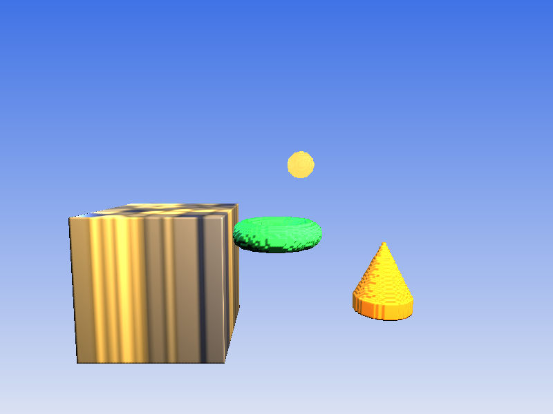

# 17 — Procedural textures & predefined materials

**Goal:** generate textures in code (no image files) and use ready-made materials
instead of hand-written shaders.



*(The CSG part on the left uses a procedural voronoi texture with the `textured`
material — screenshot rendered headless in CI by `examples/solids --screenshot`,
see [12](12-headless-rendering-and-screenshots.md) and [18](18-solids-and-csg.md).)*

## Procedural textures (`fuhgl::render::procedural`)

All generators return a CPU-side RGBA8 `Image` (deterministic — seeded noise gives
the same image for the same seed), and `makeTexture()` uploads it into a
`fuhgl::Texture` (RGBA8, mipmaps + linear filtering by default):

```cpp
auto img = fuhgl::render::procedural::voronoi(128, 128, 6, 1337u,
                                              {0.12f,0.14f,0.22f}, {0.95f,0.75f,0.35f});
fuhgl::Texture tex = fuhgl::render::procedural::makeTexture(img);
// also: checker(w,h,cells,c1,c2), gradient, stripes, bricks, rings, noise(w,h,seed,octaves,...)
```

## Predefined materials (`fuhgl::render::materials`)

Preset materials need **no GLSL**: they set `builtinShader = true` and carry data;
the pipelines (forward + deferred) drive their built-in shaders with the uniforms
`uAlbedo`, `uEmissive`, `uUseTex`, `uMatTex` (albedo texture on unit 3):

```cpp
fuhgl::render::Material m1 = fuhgl::render::materials::matte({0.85f, 0.6f, 0.25f});
fuhgl::render::Material m2 = fuhgl::render::materials::textured(tex, {1,1,1}); // texture * tint
fuhgl::render::Material m3 = fuhgl::render::materials::emissive({1.f, 0.35f, 0.15f}, 2.5f);
fuhgl::render::Material m4 = fuhgl::render::materials::texturedEmissive(tex, tint, glow);

scene.items.push_back({&mesh, &m2, model}); // DrawItem.material = preset
```

In the **deferred** pipeline the emissive term is stored in a 4th G-buffer attachment
and added in the lighting pass; in the **forward** pipeline it is added directly in the
fragment shader.

Fully custom materials (own `Program`) still work as before (tutorial 13): set
`builtinShader = false` (default) and use the standard uniform names.

## Example

```
./build/examples/solids                       # windowed (WASD + mouse, Esc quits)
./build/examples/solids --screenshot out.png  # headless PNG (CI docs job)
```

Tests: `tests/test_solids.cpp` (generator determinism/patterns) and
`tests/gl_smoke_solids.cpp` (real GL render of a textured CSG body in CI).
