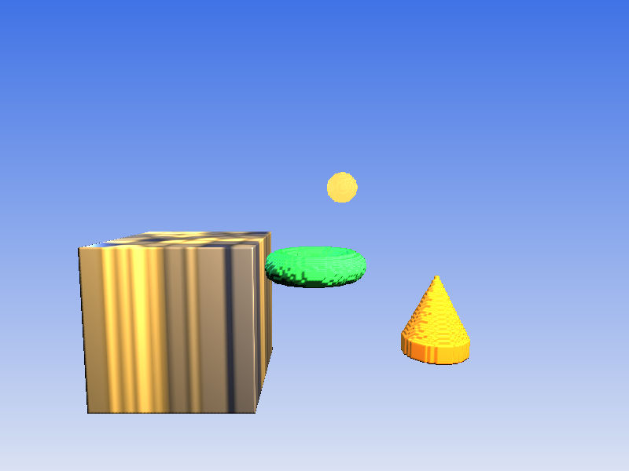
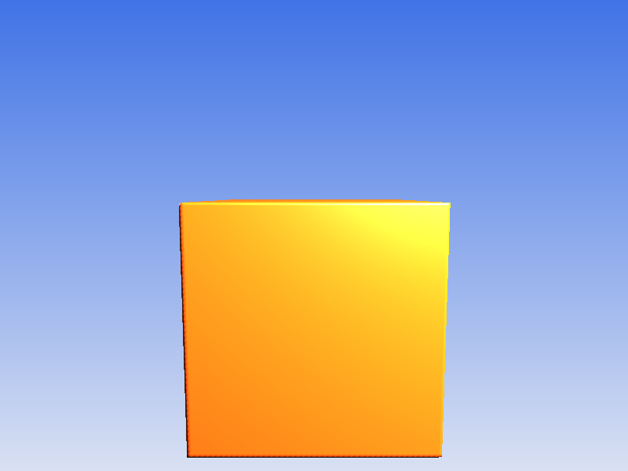
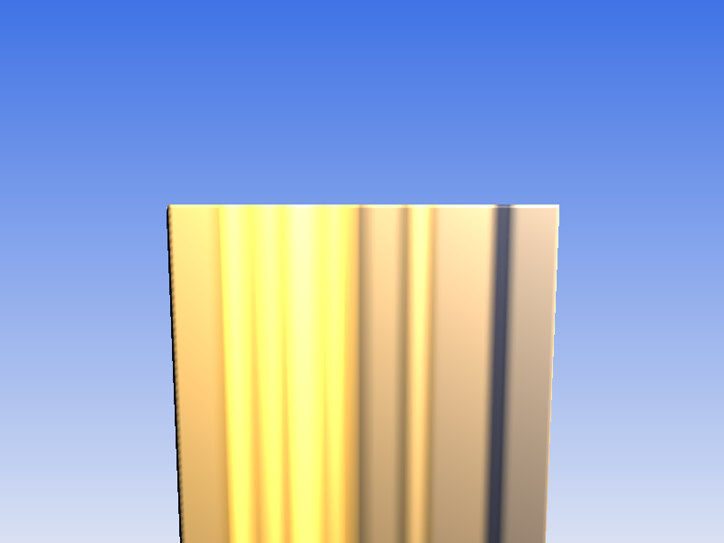
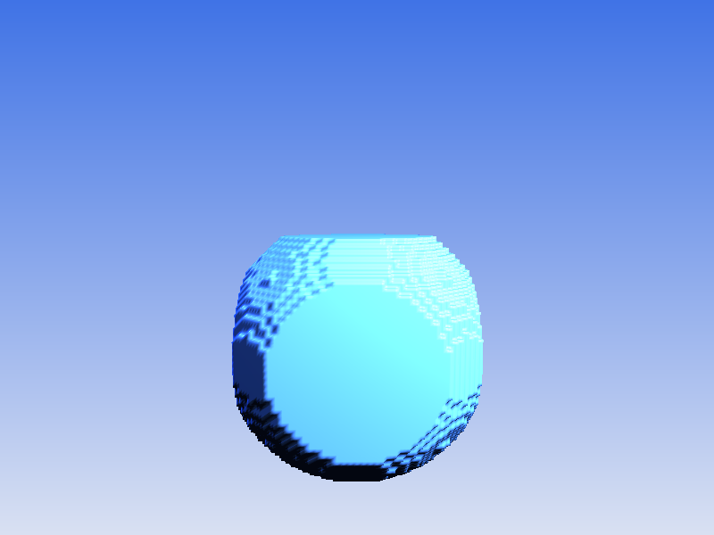
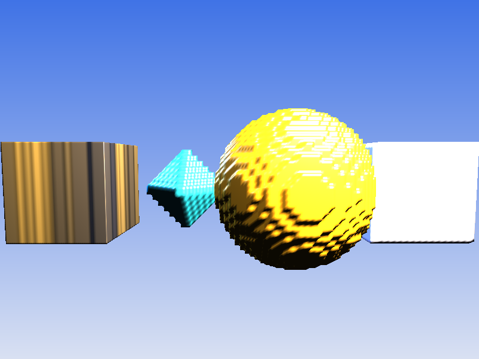

# 18 — Solids & CSG (constructive solid geometry)

**Goal:** describe bodies analytically, combine them with boolean operators
(union / intersection / difference) and extract a renderable mesh on demand.



*(Left: `cube - sphere` with a voronoi texture, middle: `torus - cylinder`,
right: `cylinder | translated(cone)`, plus an emissive marker sphere.
Screenshot rendered headless in CI — see [12](12-headless-rendering-and-screenshots.md).)*

## The `Solid` abstraction

A `fuhgl::render::Solid` is an analytic body: an `inside(point)` test plus an AABB.
It holds no GL objects (polymorphic value type, shared via `SolidPtr`):

```cpp
class Solid {
public:
    virtual bool inside(const math::Vec3& p) const = 0; // local space, centered at origin
    virtual math::Vec3 aabbMin() const = 0;
    virtual math::Vec3 aabbMax() const = 0;
    render::MeshData buildMeshData(int resolution = 32, const math::Vec3& color = ...) const;
    render::Mesh      buildMesh(int resolution = 32, const math::Vec3& color = ...) const; // GL upload
};
```

Primitives: `makeCube(halfExtents)`, `makeSphere(r)`, `makeCylinder(r, height)` (Y axis),
`makeCone(r, height)`, `makeTorus(R, r)`, plus `translated(solid, offset)`.

## CSG operators

```cpp
using namespace fuhgl::render;
auto part = makeCube({1,1,1}) - makeSphere(0.75f);            // difference
auto both = makeTorus(0.55f, 0.2f) & makeCube({0.8f,0.8f,0.8f}); // intersection
auto uni  = makeCylinder(0.45f, 0.25f) | translated(makeCone(0.45f, 0.9f), {0,0.55f,0}); // union

Mesh mesh = part->buildMesh(48, {1,1,1});   // marching tetrahedra, pos/normal/color/uv
scene.items.push_back({&mesh, &material, model});
```

Operators on `SolidPtr`: `a | b` (union), `a & b` (intersection), `a - b` (difference).
The AABB of a CSG node is derived automatically (difference is bounded by `a`).

## CSG in pictures

All rendered headless in CI by `examples/solids --screenshot ... --csg <mode>`:

**Union** — `makeCube({0.85,0.85,0.85}) | makeSphere(0.8)`:



**Difference** — `makeCube({1,1,1}) - makeSphere(0.75)` (voronoi-textured):



**Intersection** — `makeSphere(0.95) & makeCube({0.8,0.8,0.8})`:



**Bounding volumes** of the difference part — solid, low-poly octahedron, bounding sphere, AABB box:



## How meshing works

`buildMeshData(resolution)` samples the `inside()` field on a voxel grid
(`resolution` cells along the longest AABB edge) and extracts the iso-surface with
**marching tetrahedra** (each voxel split into 6 tets; 1/3-inside cases → 1 triangle,
2-inside → quad = 2 triangles; winding is fixed against the field gradient, vertex
normals are accumulated face normals). Vertices are shared across cells via an
edge map. UVs are planar (XZ). Fully CPU-side and unit-testable without a GL context.

Higher `resolution` = smoother surface, more triangles (48³ for hero parts is a good
default; the example prints vertex/index counts).

## Bounding volumes

Every solid (including CSG results — their AABB is derived automatically) can be wrapped
in a bounding volume, e.g. for frustum culling or collision pre-tests:

```cpp
auto box  = fuhgl::render::makeBoundingBox(*part);        // exact AABB as a Solid (cube)
auto sph  = fuhgl::render::makeBoundingSphere(*part);     // circumsphere: AABB center, half-diagonal radius
auto oct  = fuhgl::render::makeBoundingOctahedron(*part); // low-poly variant (L1 ball, 6 tips / 8 faces)
auto any  = fuhgl::render::makeBoundingVolume(*part, fuhgl::render::BoundingVolume::Octahedron);

// culling with the math module:
fuhgl::math::Frustum fr = fuhgl::math::Frustum::fromViewProj(cam.viewProj(aspect));
if (fuhgl::render::intersects(fr, *part))   // AABB vs frustum (positive-vertex test)
    scene.items.push_back({&partMesh, &partMat, model});
```

All three are solids themselves, so they can be meshed (`buildMesh`), transformed
(`translated`) and combined with CSG operators.

## Example

```
./build/examples/solids                       # windowed demo scene (Esc quits)
./build/examples/solids --screenshot out.png  # headless PNG (CI docs job)
```

Tests: `tests/test_solids.cpp` (inside()/AABB of every primitive, CSG logic at sample
points, mesh sanity: index range, shell bounds, unit normals; procedural generators)
and `tests/gl_smoke_solids.cpp` (renders a textured CSG body through DeferredPipeline
in CI and checks the pixels).
