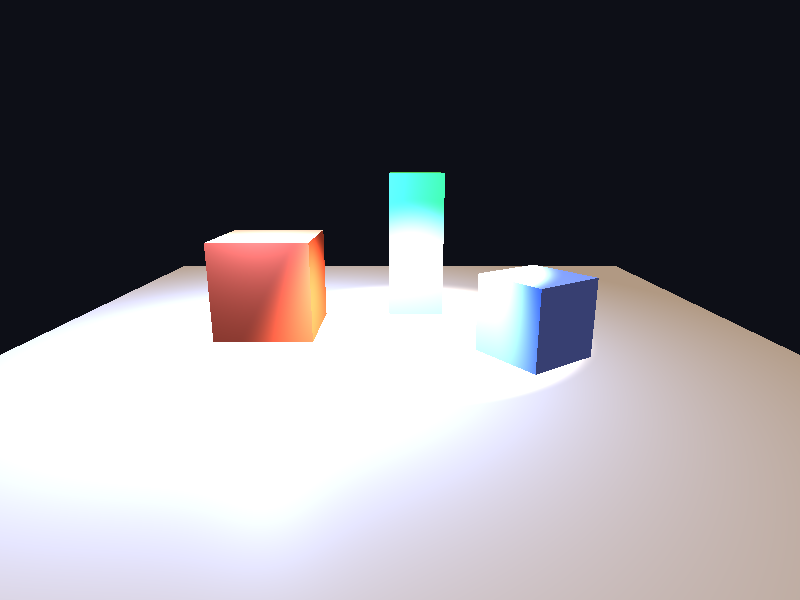

# 20 — Lights: directional, point & spot (F14)

**Goal:** real light source classes for the built-in lighting model. `render::Light`
(see `include/fuhgl/render/light.hpp`) replaces the old point-only struct and supports
**directional** (sun), **point** and **spot** lights with analytic attenuation, range
cutoff and spot cones. The pipelines upload up to `kMaxLights` (64) of them through the
std140 `LightBlock` UBO at binding 0 — no shader changes needed to add lights.



## The Light class

`Light` is a value type (no GL handles, no PIMPL). The first three members keep the
historical order, so aggregate initialization still yields a point light:

```cpp
fuhgl::render::SceneView scene;
scene.lights.push_back({{3.f, 3.f, 4.f}, {1.f, 0.9f, 0.7f}, 25.f}); // point light (aggregate init)

// factories (preferred):
using fuhgl::render::Light;
scene.lights.push_back(Light::directional({-0.4f, -1.f, -0.25f}, {1.f, 0.85f, 0.65f}, 1.6f)); // sun
scene.lights.push_back(Light::point({-2.2f, 2.6f, 0.6f}, {0.45f, 0.65f, 1.f}, 14.f, 9.f));      // range = 9
scene.lights.push_back(Light::spot({0.3f, 4.5f, 1.6f}, {0.f, -1.f, -0.35f}, {1.f, 0.95f, 0.7f}, 60.f,
                                    fuhgl::math::radians(18.f), fuhgl::math::radians(32.f)));
```

Fields (all public, documented in the header):

| Field | Meaning |
|---|---|
| `type` | `LightType::Point` / `Directional` / `Spot` |
| `position` | point/spot origin |
| `direction` | travel direction (directional) / aim (spot), normalized by the factories |
| `color`, `intensity` | linear RGB × scalar; directional: constant irradiance scale |
| `attenuationConstant/Linear/Quadratic` | `atten = intensity / (c + l·d + q·d²)` (point/spot) |
| `range` | 0 = infinite; else smooth quartic window to zero at `d = range` |
| `coneInner`, `coneOuter` | spot cone half-angles in radians (full brightness → zero) |

The CPU-side math mirrors the shader exactly and is unit-tested
(`tests/test_light.cpp`):

```cpp
float a = light.attenuation(distance);        // distance falloff + range window
float c = light.coneFactor(toLightDir);       // 1 inside inner cone, 0 outside outer
```

## How the pipelines consume lights

`SceneView::lights` is a `std::vector<Light>`. Both `ForwardPipeline` and
`DeferredPipeline` pack it with `render::packLightBlock(lights, block)` into the
`LightBlock` struct (C++ mirror of the std140 UBO) and upload it once per frame:

```glsl
layout(std140) uniform LightBlock {
    vec4 lightPosIntensity[64]; // xyz = position, w = intensity
    vec4 lightColor[64];        // rgb = color
    vec4 lightDirType[64];      // xyz = direction, w = type (0 point, 1 dir, 2 spot)
    vec4 lightParams0[64];      // atten c/l/q, range
    vec4 lightParams1[64];      // cos(coneInner), cos(coneOuter)
};
```

The shared GLSL (`src/render/lighting_glsl.hpp`) computes per light the direction `L`
and attenuation (`lightVector()`) and accumulates diffuse + Blinn-Phong specular in
`shade()`. Directional lights ignore distance; spots additionally multiply by the
smooth cone factor.

## Rendering a lit scene

```cpp
fuhgl::render::ForwardPipeline pipeline;
pipeline.create();

fuhgl::render::SceneView scene;
scene.camera = &cam;          // any fuhgl::Camera
scene.width = 800; scene.height = 600; scene.aspect = 800.f / 600.f;
scene.clearColor = {0.05f, 0.06f, 0.09f};
scene.ambient    = {0.05f, 0.05f, 0.06f};
scene.items.push_back({&boxMesh, nullptr, fuhgl::math::translate({0.f, 0.8f, 0.f})});
scene.lights.push_back(fuhgl::render::Light::directional({-0.4f, -1.f, -0.25f}, {1.f, 0.85f, 0.65f}, 1.6f));

pipeline.render(scene);       // lights + ambient are part of the SceneView
```

See `examples/lights/main.cpp` for a complete demo (sun + point + spot, windowed or
`--screenshot out.png` headless). The headless test `tests/gl_smoke_lights.cpp` verifies
per light type that the rendered center pixel is bright/dark as expected.

## Custom shaders

If you write your own material shaders, bind the same block yourself:

```glsl
layout(std140) uniform LightBlock { /* same layout as above */ };
// in C++ after linking:
program.bindUniformBlock("LightBlock", 0);
ubo.bindBase(0); // upload a render::LightBlock with packLightBlock()
```
