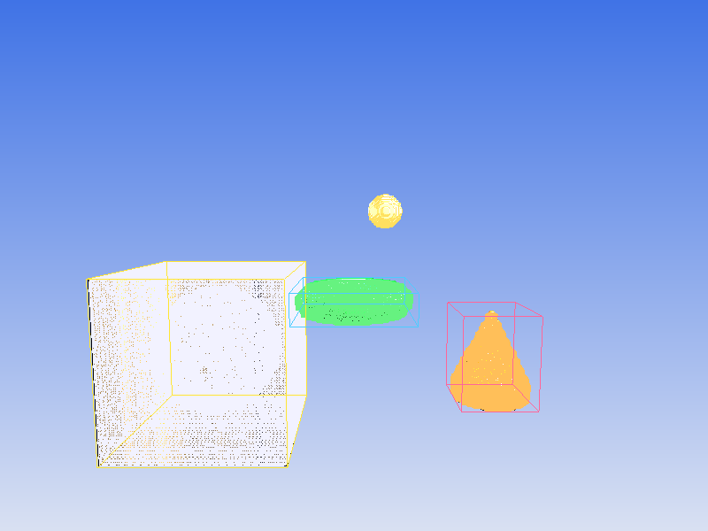

# 25 — Wireframe: solids & bounding boxes as line grids

**Goal:** visualize solids and their bounding volumes as wireframe — for debugging,
bounding-volume previews and CSG inspection.



`render::Wireframe` queues line segments on the CPU (no GL calls while queueing) and
draws everything in **one `glDrawArrays(GL_LINES)`** per frame:

```cpp
fuhgl::render::Wireframe wire;
wire.create();                       // once after the GL context exists

// per frame:
wire.clear();
wire.addSolid(*part, 24, model, {0.95f, 0.95f, 1.f});   // marching-tetrahedra mesh edges
wire.addBoundingBox(*part, model, {1.f, 0.9f, 0.2f});   // AABB edges (12 lines)
wire.addBox({-1,-1,-1}, {1,1,1}, {1.f, 1.f, 1.f});      // explicit AABB
wire.addMesh(meshData, model, {0.f, 1.f, 0.f});        // triangle edges of any MeshData
wire.addLine({0,0,0}, {1,1,0}, {1.f, 0.f, 0.f});        // single segment
wire.render(camera, width, height); // depth-tested, into the current framebuffer
```

- Triangle edges are deduplicated per mesh (`wireframeEdges(meshData)` is a pure,
  unit-testable helper; box corners/edges via `boxCorners()` / `kBoxEdgeIndices`).
- `addBoundingBox(solid, model, color)` uses the solid's exact `aabbMin()/aabbMax()`
  (works for CSG bodies too — see tutorial 18).

## Example

`examples/solids --wireframe` renders the demo scene filled (deferred pipeline) plus a
wireframe overlay: each solid in light color, its AABB in an accent color.

```
FUHGL_BACKEND=surfaceless ./build-egl/examples/solids --screenshot docs/images/tutorial-wireframe.png --wireframe
```

Tests: `tests/test_wireframe.cpp` (corner/edge tables, edge dedupe counts, CPU queueing
without GL) and `tests/gl_smoke_wireframe.cpp` (headless FBO render of a white AABB +
green mesh wireframe, verified by readback; skips without GL ≥ 3.3).
